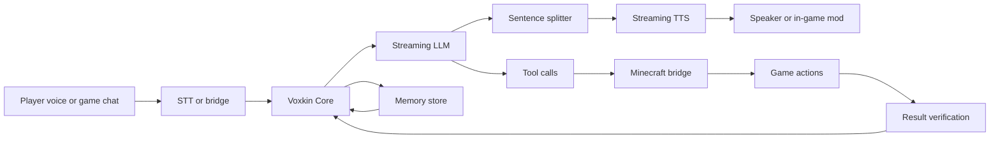

# Voxkin

<p align="center">
  <b>An AI companion that lives, talks and works with you in Minecraft</b><br>
  Real-time voice · autonomous actions · long-term memory · local-first
</p>

<p align="center">
  <a href="https://github.com/DeckDes233/Voxkin/actions/workflows/ci.yml"></a>
  
  
  
</p>

Voxkin is an AI companion for Minecraft. It splits "hear the player → understand → answer with natural speech → act in the world" into two channels that never block each other: the voice channel starts speaking as early as possible, while the action channel runs in the background and reports verified results.

The current build closes the loop locally: a player says one sentence in game, Voxkin starts speaking within 1 to 4 seconds, decides on a game action, executes it, and speaks the result when it finishes.

> Chinese documentation: [README.md](README.md). Beginner guide: [docs/GETTING_STARTED_CN.md](docs/GETTING_STARTED_CN.md) (Chinese).

---

## Contents

- [What it does](#what-it-does)
- [How it works](#how-it-works)
- [Measured latency](#measured-latency)
- [Quick start](#quick-start)
- [Configuration](#configuration)
- [Project layout](#project-layout)
- [Documentation](#documentation)
- [License](#license)

---

## What it does

| Capability | Status | Notes |
| --- | --- | --- |
| Real-time voice conversation | Working | Microphone → local STT → streaming LLM → sentence split → streaming TTS → speaker |
| In-game chat | Working | Players talk in Minecraft chat, Voxkin answers with voice |
| Game actions | Working | Dig blocks, walk to coordinates, look at a player, stop |
| Interruption | Working | New speech closes the old TTS request and clears the playback queue |
| Long-term memory | Working | SQLite stores turns, idle-time summaries, keyword retrieval into context |
| Control console | Working | Status, TTS preview, live events, latency breakdown, config, service control, logs |
| Client audio mod | Builds, not verified in a live client | Receives PCM over WebSocket; spatial audio not wired yet |
| Engine adapters | Working | GPT-SoVITS or Genie for TTS; any OpenAI-compatible endpoint for the LLM |

## How it works



## Measured latency

Machine: i9-14900HX, RTX 4060 Laptop 8 GB, 32 GB RAM; GPT-SoVITS v2Pro for TTS, faster-whisper small for STT.

| Scenario | First audible (median) | Notes |
| --- | --- | --- |
| Local test LLM + real TTS | 964 ms | Pipeline overhead only |
| Real LLM + real TTS | 3871 ms | Network and model first token dominate |
| In-game chat to voice | 975–1494 ms | Local test LLM used for these runs |
| Speech recognition | 2.58 s for 9.88 s audio | CPU, int8 |

Full numbers and reproduction steps: [docs/BENCHMARK_RESULTS.md](docs/BENCHMARK_RESULTS.md).

## Quick start


Requirements: Windows 10/11, Python 3.10, Node.js 20+, JDK 21 for the mod build, a GPT-SoVITS v2Pro runtime and a trained voice.

```powershell
git clone https://github.com/DeckDes233/Voxkin.git
cd Voxkin
python -m venv .venv --system-site-packages
.\.venv\Scripts\python.exe -m pip install -U pip
.\.venv\Scripts\python.exe -m pip install -e ".[dev]"
Copy-Item config\voxkin.example.yaml config\voxkin.yaml
```

Put provider credentials in `config/local.yaml`:

```yaml
llm:
  base_url: "https://opencode.ai/inference/go/openai/v1"
  model: "deepseek-v4.1-flash"
  api_key: "<your key>"
  headers:
    x-opencode-session: "voxkin-deepseek-chan-01"
```

Start the services:

```powershell
# TTS
<GPT-SoVITS>\runtime\python.exe api_v2.py -a 127.0.0.1 -p 9880 -c GPT_SoVITS\configs\tts_infer.yaml

# Console
.\.venv\Scripts\python.exe -m voxkin serve

# Minecraft bridge
cd bridge
npm install
$env:MC_HOST="127.0.0.1"; $env:MC_PORT="25565"; $env:MC_USERNAME="Voxkin"
node minecraft_bridge.js
```

Open <http://127.0.0.1:8765>, type a sentence, and the full chain runs.

## Configuration

| File | Purpose |
| --- | --- |
| `config/voxkin.example.yaml` | Committed defaults |
| `config/voxkin.yaml` | Local settings, ignored |
| `config/local.yaml` | Secrets and personal paths, ignored |
| `data/voxkin.db` | Conversation and memory database, ignored |

## Project layout

```
src/voxkin/          Core: config, pipeline, adapters, memory, services
src/voxkin/studio/   Console frontend
bridge/              Minecraft bridge (mineflayer)
mod/                 Fabric client audio mod
tests/               Automated tests
tools/               Local test LLM
docs/                Audit, architecture, evaluation, decisions, roadmap, status, benchmarks
```

## Documentation

- [Architecture](docs/ARCHITECTURE.md)
- [Repository audit](docs/REPO_AUDIT.md)
- [Technology evaluation](docs/TECH_EVALUATION.md)
- [Decisions](docs/DECISIONS.md)
- [Roadmap](docs/ROADMAP.md)
- [Status](docs/STATUS.md)
- [Benchmark results](docs/BENCHMARK_RESULTS.md)
- [License analysis](docs/LICENSE_ANALYSIS.md)

## License

The project license is not decided yet; MIT and GPL-3.0 are under evaluation. Dependencies are listed in [docs/LICENSE_ANALYSIS.md](docs/LICENSE_ANALYSIS.md). Until a license is chosen, treat the repository as all rights reserved.
