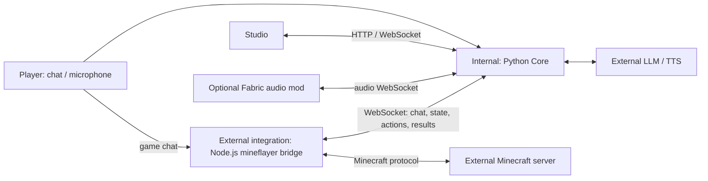

# Voxkin

<p align="center">
  <b>A real-time voice companion and autonomous-action prototype for Minecraft</b><br>
  Conversation and speech · Minecraft action bridge · Fixed-stage tasks · Reproducible evaluation
</p>

Voxkin connects a Python Core, a Minecraft bridge process, and a Minecraft world. Players can use in-game chat or a microphone; the Core generates replies and dispatches supported game actions, and the bridge reports structured results. The project explores unattended survival and completion, but cannot yet complete Minecraft independently: long-running tasks use fixed stage plans, with no general dynamic workflow engine or autonomous skill-generation and release loop.

中文: [README.md](README.md).

## Current status

| Capability | Status | Evidence |
| --- | --- | --- |
| Core conversation, voice, and Minecraft action bridge | Implemented; engines require local configuration, and the skill catalog does not mean every skill was live-tested | [Status](docs/STATUS.md), [bridge protocol](bridge/README.md), [skills](docs/SKILLS.md) |
| S0 | Live-tested: 10/10 Normal-difficulty runs completed all 5/5 steps | [S0 evidence](docs/evidence/S0_NORMAL_20261022.md) |
| S1 | Partially verified: 3/3 daytime S0→S1 chained regressions; overnight survival is unverified, so M3 is not accepted | [S1 evidence](docs/evidence/S1_NORMAL_20261022.md) |
| S2–S6 and full run | Two isolated live runs on 2026-10-24 stopped in S2; S3–S6 did not run, and unattended completion is not achieved | [Live run record](docs/evidence/S0_S6_CHAIN_20261024.md), [milestone](docs/MILESTONE.md) |
| Skills | Skill code is implemented; except for skills explicitly covered by S0/S1 evidence, the catalog and simulated tests do not establish live success | [Skill catalog and evidence boundaries](docs/SKILLS.md) |
| Fabric audio mod | Builds; end-to-end behavior in a real client is unverified | [Status](docs/STATUS.md) |

Automated tests, simulated-world tests, and live Paper regressions are different evidence and are not interchangeable. See [docs/MILESTONE.md](docs/MILESTONE.md) for the final objective and acceptance criteria.

## Internal and external boundaries

“Internal / external” describes Voxkin’s boundary with its environment and services; it does not imply plugin-style hot swapping.



| Boundary | Responsibility | Code |
| --- | --- | --- |
| Internal Core | Voice turns, engine adapters, action dispatch/arbitration, fixed-task runner, memory, Studio API | [`src/voxkin/`](src/voxkin/), [`__main__.py`](src/voxkin/__main__.py) |
| External game bridge | mineflayer login, action/skill execution, result and world-state reporting | [`bridge/minecraft_bridge.js`](bridge/minecraft_bridge.js), [`bridge/skills/`](bridge/skills/) |
| External services | Minecraft, LLM, and TTS, connected through configuration or protocols | [`config/voxkin.example.yaml`](config/voxkin.example.yaml) |
| Optional client output | Mod receives PCM and plays it in the game client; it does not execute game actions | [`mod/`](mod/) |

Actual control path: input → Core conversation/intent → LLM tool call or local fast path → action arbitration/dispatch → bridge execution → result reporting. Autonomous stage tasks are fixed steps run by `TaskRunner`, not a general task graph dynamically planned by an LLM. See the [bridge protocol](bridge/README.md) and [current status](docs/STATUS.md).

## Minimal startup

The following uses Windows PowerShell and requires Python 3.10:

```powershell
python -m venv .venv
.\.venv\Scripts\python.exe -m pip install -e ".[dev]"
Copy-Item config\voxkin.example.yaml config\voxkin.yaml
$env:DEEPSEEK_API_KEY = "<your API key>"
.\.venv\Scripts\python.exe -m voxkin doctor
.\.venv\Scripts\python.exe -m voxkin serve
```

Open <http://127.0.0.1:8765>. Provide credentials through environment variables or a local override in git-ignored `config/local.yaml`; never commit secrets. Without valid LLM credentials, model conversation is unavailable. If TTS is unavailable, the Core falls back to log-only output. Microphone input additionally requires STT/audio dependencies and recognition models; speech synthesis requires a working TTS engine.

## Connect Minecraft

Prepare a Minecraft 1.21.1 server. Start the Core first, then launch the bridge:

```powershell
cd bridge
npm install
$env:MC_HOST = "127.0.0.1"
$env:MC_PORT = "25565"
$env:MC_USERNAME = "Voxkin"
$env:MC_AUTH = "offline"
$env:VOXKIN_WS = "ws://127.0.0.1:8765/ws/bridge"
node minecraft_bridge.js
```

Offline accounts should only connect to a local or trusted test server. `online-mode=false` weakens identity checks; do not expose such a server publicly. The optional mod builds, but playback/spatial audio in a real client is not accepted. Full guide: [Minecraft setup (Chinese)](docs/ENTER_MINECRAFT_CN.md).

### One-command local live-test startup

First start your dedicated Minecraft 1.21.1 test server and confirm it listens on local port `25566`. From the repository root, run:

```powershell
.\scripts\eval_stack.ps1 -Action start -McPort 25566
```

This starts the configured GPT-SoVITS runtime if present, Voxkin Studio, and the independent-mode Minecraft bridge. It **does not start, reset, or create a Minecraft server/world**. Open <http://127.0.0.1:8765> and confirm the bridge is connected. Stop the processes launched by the script with:

```powershell
.\scripts\eval_stack.ps1 -Action stop
```

Paper is not stopped. Use a disposable test world, not a valuable save or an in-use evaluation world. The bridge defaults to offline username `Voxkin`; pass a different `-McPort` when needed. See [Minecraft setup](docs/ENTER_MINECRAFT_CN.md) for prerequisites.

## Autonomous completion progress

- **S0:** all 10 Normal-difficulty runs completed 5/5; this validates one stage, not full autonomy.
- **S1:** three daytime S0→S1 chained regressions; three-night survival is unverified, so M3 has not passed.
- **S2–S6:** plans and skill implementations exist; two isolated live runs on 2026-10-24 stopped in S2, and S3–S6 did not run. Death recovery, cross-dimension progression, and the Ender Dragon fight lack final acceptance.
- **G1:** no unattended end-to-end completion has been performed.

The roadmap is not a capability claim. See [status](docs/STATUS.md), [stage plan](docs/plans/INDEPENDENT_RUN_ROADMAP.md), and the [live evidence directory](docs/evidence/).

## Documentation

[Getting started (Chinese)](docs/GETTING_STARTED_CN.md) · [Bridge protocol](bridge/README.md) · [Skill catalog](docs/SKILLS.md) · [Status](docs/STATUS.md) · [Milestone](docs/MILESTONE.md) · [Evaluation](docs/plans/EVALUATION.md) · [Benchmarks](docs/BENCHMARK_RESULTS.md) · [License analysis](docs/LICENSE_ANALYSIS.md)

## License

MIT. See [LICENSE](LICENSE).
