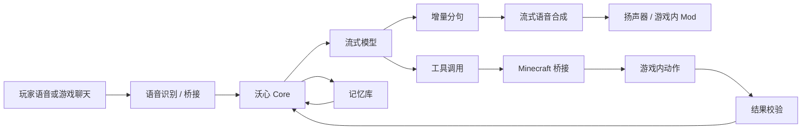
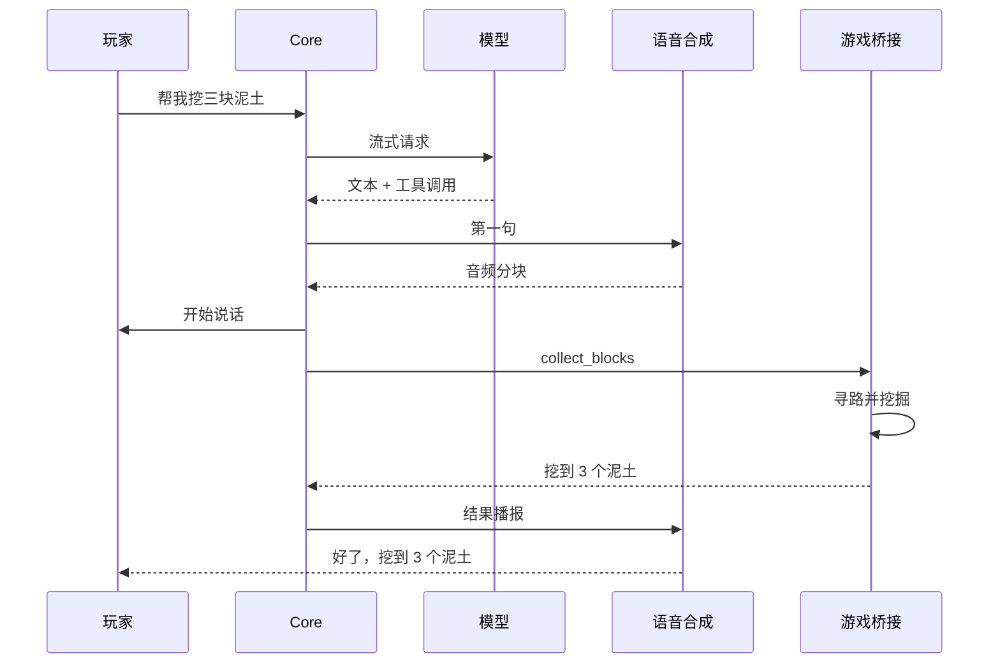

# 沃心 Voxkin

<p align="center">
  <b>会和你在 Minecraft 里一起生活、说话、干活的 AI 伙伴</b><br>
  实时语音 · 自主行动 · 长期记忆 · 本地部署
</p>

<p align="center">
  <a href="https://github.com/DeckDes233/Voxkin/actions/workflows/ci.yml"></a>
  
  
  
  
</p>

沃心是一个面向 Minecraft 的 AI 伙伴系统。它把「听见玩家 → 理解 → 用自然语音回答 → 在游戏里执行动作」拆成两条互不阻塞的通道：语音通道尽快出声，行动通道在后台执行并回报可验证的结果。

当前版本在本机完成了完整闭环：玩家在游戏里说一句话，沃心在 1 到 4 秒内开始说话，同时决定并执行游戏动作，动作结果会在完成后播报。

> **最终里程碑**：沃心独立通关 Minecraft 一次，全流程，玩家只负责旁观。定义见 [最终里程碑](docs/MILESTONE.md)，阶段计划见 [独立通关路线图](docs/plans/INDEPENDENT_RUN_ROADMAP.md)。

> 第一次接触这个项目，建议先读 [小白版说明](docs/GETTING_STARTED_CN.md)。<br>
> English documentation: [README.en.md](README.en.md).

---

## 目录

- [现在能做什么](#现在能做什么)
- [它是怎么工作的](#它是怎么工作的)
- [延迟实测](#延迟实测)
- [快速开始](#快速开始)
- [配置](#配置)
- [项目结构](#项目结构)
- [文档](#文档)
- [许可证](#许可证)

---

## 现在能做什么

| 能力 | 状态 | 说明 |
| --- | --- | --- |
| 实时语音对话 | 可用 | 麦克风 → 本地识别 → 流式模型 → 分句 → 流式语音 → 扬声器 |
| 游戏内聊天 | 可用 | 玩家在 Minecraft 里说话，沃心用语音回应 |
| 游戏动作 | 可用 | 挖方块、走到坐标、看向玩家、停止，动作结果经桥接确认后才算完成 |
| 打断 | 可用 | 新语音到来时关闭旧语音请求并清空播放队列 |
| 长期记忆 | 可用 | SQLite 保存原始对话，空闲时把旧对话压缩成摘要，按关键词检索后放入上下文 |
| 统一控制台 | 可用 | 状态、试听、实时事件、延迟分解、配置、服务启停、日志 |
| 客户端音频 Mod | 构建通过，接入 Minecraft 流式声源 | 通过 WebSocket 接收 PCM，绑定机器人实体位置；未在真实客户端验证 |
| 多引擎适配 | 可用 | 语音合成可换 GPT-SoVITS 或 Genie；模型接口兼容 OpenAI 格式 |


## 它是怎么工作的



两条通道互不等待：语音在动作执行之前就开始了，动作完成后结果会补一句播报。



## 延迟实测

测试机器：i9-14900HX、RTX 4060 Laptop 8GB、32GB 内存；语音合成使用 GPT-SoVITS v2Pro，识别使用 faster-whisper small。

| 场景 | 首次可听（中位数） | 说明 |
| --- | --- | --- |
| 本地测试模型 + 真实语音 | 964 ms | 验证管线本身的开销 |
| 真实模型 + 真实语音 | 3871 ms | 真实网络与模型首 token 占主要部分 |
| 游戏内聊天到语音 | 975–1494 ms | 真实模型未参与该轮，用本地测试模型 |
| 语音识别 | 9.88 秒音频 2.58 秒 | CPU、int8 |

完整数据与复现命令见 [基准结果](docs/BENCHMARK_RESULTS.md)。

## 快速开始

### 1. 准备环境

- Windows 10/11，Python 3.10
- Node.js 20 以上（Minecraft 桥接与客户端 Mod 构建）
- JDK 21（只用于构建 Fabric Mod）
- GPT-SoVITS v2Pro 运行包与一个训练好的音色

### 2. 安装与配置

```powershell
git clone https://github.com/DeckDes233/Voxkin.git
cd Voxkin
python -m venv .venv --system-site-packages
.\.venv\Scripts\python.exe -m pip install -U pip
.\.venv\Scripts\python.exe -m pip install -e ".[dev]"
Copy-Item config\voxkin.example.yaml config\voxkin.yaml
```

把模型密钥写进 `config/local.yaml`：

```yaml
llm:
  base_url: "https://opencode.ai/inference/go/openai/v1"
  model: "deepseek-v4.1-flash"
  api_key: "<你的密钥>"
  headers:
    x-opencode-session: "voxkin-deepseek-chan-01"
```

### 3. 启动三个服务

```powershell
# 语音合成
<GPT-SoVITS 目录>\runtime\python.exe api_v2.py -a 127.0.0.1 -p 9880 -c GPT_SoVITS\configs\tts_infer.yaml

# 控制台
.\.venv\Scripts\python.exe -m voxkin serve

# Minecraft 桥接
cd bridge
npm install
$env:MC_HOST="127.0.0.1"; $env:MC_PORT="25565"; $env:MC_USERNAME="Voxkin"
node minecraft_bridge.js
```

打开 <http://127.0.0.1:8765> 就能看到控制台，在输入框里发一句话即可试听完整链路。

### 4. 在游戏里使用

完整流程（专用服务器、桥接、麦克风、客户端 Mod、YSM）见 [让沃心进入 Minecraft：全流程](docs/ENTER_MINECRAFT_CN.md)。最短路径：

1. 开一个 `online-mode=false` 的 Paper 1.21.1 服务器（单机世界对局域网开放会拒绝离线机器人），并把 `spawn-protection` 设为 `0`。
2. 启动 Studio 与桥接，确认控制台里桥接状态为已连接、机器人 `Voxkin` 进入世界。
3. 玩家连进服务器，在聊天框里对沃心说话；它会用语音回答，并执行挖掘、移动、转身这类动作。
4. 想让声音从机器人位置传来，再装客户端 Mod：

   ```powershell
   cd mod
   $env:JAVA_HOME="<JDK 21 路径>"
   gradle build
   ```

   把 `mod/build/libs/voxkin-audio-0.1.0.jar` 与 Fabric API 放进 `mods/`，把 `audio.output` 改成 `websocket`，并在 JVM 参数里加 `-Dvoxkin.audio.url=ws://127.0.0.1:8765/ws/audio -Dvoxkin.audio.bot=Voxkin`。

客户端 Mod 通过 Minecraft 的流式声源播放，声音定位在机器人实体上，跟随距离衰减；尚未在真实客户端验证空间效果。

### 5. 用麦克风对话

```powershell
.\.venv\Scripts\python.exe -m voxkin mic
```

直接用说话和沃心交流，按 `Ctrl+C` 退出。常用参数：

| 参数 | 作用 |
| --- | --- |
| `--listen-only` | 只识别，不调用模型与语音，用来检查麦克风 |
| `--gain 4` | 麦克风声音偏小时放大输入 |
| `--no-barge-in` | 外放音箱时关闭打断，避免听到自己的声音 |
| `--output speaker` | 临时覆盖音频输出方式 |

外放音箱时建议加 `--no-barge-in`，播放结束后的 1.5 秒内会忽略麦克风输入，避免把自己说的话当成新指令。戴耳机可以得到更自然的打断体验。

## 配置

| 文件 | 用途 |
| --- | --- |
| `config/voxkin.example.yaml` | 可提交的默认配置 |
| `config/voxkin.yaml` | 本地实际配置，不进入版本库 |
| `config/local.yaml` | 密钥与个人路径覆盖，不进入版本库 |
| `data/voxkin.db` | 对话与记忆数据库，不进入版本库 |

常用开关：

```yaml
audio:
  output: "speaker"        # speaker / minecraft_file / websocket / wav_dir

memory:
  enabled: true
  summarize_threshold: 8   # 累计多少条消息后压缩一次
  context_token_budget: 900
```

## 项目结构

```
src/voxkin/          核心：配置、管线、模型与语音适配器、记忆、服务
src/voxkin/studio/   控制台前端
bridge/              Minecraft 桥接（mineflayer）
mod/                 Fabric 客户端音频 Mod
tests/               自动化测试
tools/               本地测试模型
docs/                审计、架构、评估、决策、路线图、状态、基准
```

## 文档

| 文档 | 内容 |
| --- | --- |
| [小白版说明](docs/GETTING_STARTED_CN.md) | 不写代码也能看懂的上手流程 |
| [进入 Minecraft 全流程](docs/ENTER_MINECRAFT_CN.md) | 从开服务器到语音、动作、客户端 Mod 的完整步骤 |
| [架构](docs/ARCHITECTURE.md) | 组件、数据流、时序、故障恢复 |
| [仓库审计](docs/REPO_AUDIT.md) | 旧项目 MiddleAPI 与 Mod 的问题定位 |
| [技术评估](docs/TECH_EVALUATION.md) | GPT-SoVITS、Genie、CosyVoice、IndexTTS 的对比证据 |
| [决策记录](docs/DECISIONS.md) | 为什么这样拆分与选型 |
| [路线图](docs/ROADMAP.md) | 后续优先级 |
| [当前状态](docs/STATUS.md) | 已完成、已知问题、阻塞 |
| [基准结果](docs/BENCHMARK_RESULTS.md) | 所有实测数据与复现方式 |

## 许可证

本项目使用 MIT 许可证，全文见 [LICENSE](LICENSE)。依赖与分发边界见 [许可证分析](docs/LICENSE_ANALYSIS.md)。
