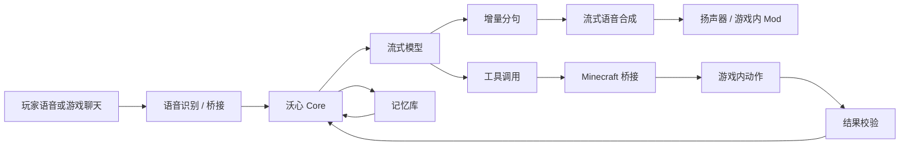
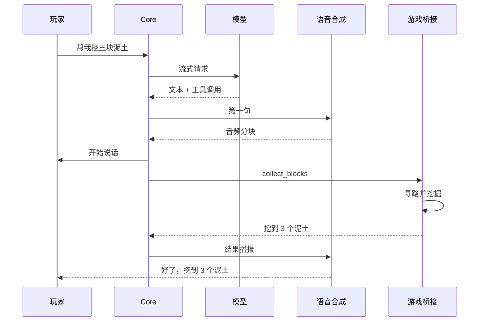

# 沃心 Voxkin

<p align="center">
  <b>会和你在 Minecraft 里一起生活、说话、干活的 AI 伙伴</b><br>
  实时语音 · 自主行动 · 长期记忆 · 本地部署
</p>

<p align="center">
  <a href="https://github.com/DeckDes233/Voxkin/actions/workflows/ci.yml"></a>
  
  
  
  
</p>

沃心是一个面向 Minecraft 的 AI 伙伴系统。玩家在游戏里打字，或者对着麦克风说话，沃心用自然语音回答，同时在后台执行挖掘、走动、转身这类游戏动作，动作结束后用语音回报真实结果。

最终目标是让沃心独立通关一次 Minecraft，全流程，玩家只负责旁观。完成定义见 [最终里程碑](docs/MILESTONE.md)，阶段计划见 [独立通关路线图](docs/plans/INDEPENDENT_RUN_ROADMAP.md)。

English documentation: [README.en.md](README.en.md)。英文版这一轮没有同步本文的新章节，内容停留在旧的结构。

## 目录

- [这是什么](#这是什么)
- [工作方式](#工作方式)
- [最小可跑路径](#最小可跑路径)
- [组件地图](#组件地图)
- [配置](#配置)
- [语音链路](#语音链路)
- [Minecraft 链路](#minecraft-链路)
- [评测与自主任务](#评测与自主任务)
- [常见问题](#常见问题)
- [文档索引](#文档索引)
- [许可证](#许可证)

## 这是什么

| 指标 | 现状 | 出处 |
| --- | --- | --- |
| 自动化测试 | 270 个 Python 测试通过；剪羊桥接另有 8 个模拟测试 | [docs/STATUS.md](docs/STATUS.md) |
| 自主阶段 S0 | Normal 难度连续 10 次 5/5 步，P50 36.4 秒 | [docs/evidence/S0_NORMAL_20261022.md](docs/evidence/S0_NORMAL_20261022.md) |
| 桥接技能 | 58 个（21 个内建 + 37 个模块），参数与失败条件登记在清单里 | [bridge/skills/manifest.json](bridge/skills/manifest.json) |
| 首次可听延迟 | 本地测试模型 964 毫秒，真实模型 3871 毫秒 | [docs/BENCHMARK_RESULTS.md](docs/BENCHMARK_RESULTS.md) |
| 语音识别 | faster-whisper small，CPU int8，9.88 秒音频约 2.6 秒 | [docs/BENCHMARK_RESULTS.md](docs/BENCHMARK_RESULTS.md) |
| 游戏内动作 | 58 个已登记技能，结果由桥接回报；S2 剪羊新路线尚未实机验证 | [docs/SKILLS.md](docs/SKILLS.md) |
| 客户端音频 Mod | 构建通过，未在真实客户端验证 | [docs/STATUS.md](docs/STATUS.md) |

这些数字的事实来源是 [docs/STATUS.md](docs/STATUS.md) 与 [docs/evidence/](docs/evidence/)，本文只做摘录。

## 工作方式



当前实现是“语音与动作在工具调用后并行”：动作在后台执行，语音随后开始，动作完成后再补一句播报。但首句仍要等 LLM 首 token 和 TTS 首块。

已经落地一部分的实时快路：本地规则能认出来的命令（停止、跟随、过来、攻击、进食、睡觉、观察、背包、采集）不再等模型，先用预合成缓存里的确认语出声，同时把动作发给桥接；缓存缺失时回落到动态合成，并受截止时间约束，超时就如实降级。复杂请求仍然走原来的模型路径。

下一步的实时性能设计见 [实时语音与动作并行计划](docs/plans/VOICE_ACTION_LATENCY_PLAN.md)：动作仲裁与取消、桥接反射的抢占，以及把缓存收益变成可测的延迟结论。该文档同时列了已经落地的阶段和还没做的阶段，别把计划当成已完成的能力。



## 最小可跑路径

分七步，每一步都能单独检查。前四步不碰 Minecraft，不需要语音合成模型，也不需要任何 API 凭据。

### 前置条件

| 组件 | 版本 | 什么时候用到 |
| --- | --- | --- |
| Python | 3.10 或更高 | 跑 Core |
| Node.js | 20 或更高 | 跑 Minecraft 桥接 |
| JDK | 21 | 构建 Fabric 客户端 Mod |
| 显卡 | 无要求 | 语音合成用 CPU 也能跑，只是慢 |

### 第 1 步：装依赖

```powershell
git clone https://github.com/DeckDes233/Voxkin.git
cd Voxkin
python -m venv .venv
$env:NO_PROXY="*"
.\.venv\Scripts\python.exe -m pip install -U pip
.\.venv\Scripts\python.exe -m pip install -e ".[dev,stt,audio]"
```

`.[dev,stt,audio]` 装三组扩展：`dev` 是 pytest，`stt` 是 faster-whisper，`audio` 是 sounddevice。少了 `stt`，`voxkin mic` 与 `voxkin stt` 用不了；少了 `audio`，麦克风采集与 `audio.output: speaker` 的播放都会报缺少 sounddevice 的错误。

预期现象：最后一行出现 `Successfully installed ...`。

出错处理：

- pip 卡在下载或报 SSL 错误，是系统代理在中间捣乱。`$env:NO_PROXY="*"` 要写在 pip 命令之前，这行只对当前窗口有效，换窗口要重设。
- 报 `No matching distribution found`，说明 Python 版本低于 3.10，用 `.\.venv\Scripts\python.exe --version` 检查。

### 第 2 步：写配置

```powershell
Copy-Item config\voxkin.example.yaml config\voxkin.yaml
```

`config/voxkin.yaml` 与 `config/local.yaml` 都不进版本库。`voxkin.yaml` 放通用设置，`local.yaml` 放密钥与个人路径，后者会覆盖前者的同名项。

在 `config/local.yaml` 里写：

```yaml
llm:
  base_url: "http://127.0.0.1:8799/v1"
  model: "dev-local"
  api_key: "local"
  temperature: 0.7

audio:
  output: "wav_dir"
```

`api_key` 随便写一个非空字符串，本地测试服务不校验它。`audio.output` 先设成 `wav_dir`，语音合成的音频会写成 `data/audio_out/*.wav`，这样第 1 到第 5 步完全不依赖声卡。

预期现象：文件 `config/local.yaml` 存在。

### 第 3 步：起本地测试模型

```powershell
.\.venv\Scripts\python.exe tools\dev_llm_server.py --port 8799
```

这个服务实现了 OpenAI 的 `/v1/chat/completions` 流式接口，不访问外网，专门用来在没有 API 凭据时把整条链路跑通。

预期现象：终端没有报错，服务在后台监听 8799。

出错处理：提示端口占用就换一个端口启动，同时把 `config/local.yaml` 里的 `base_url` 改成同一个端口。

### 第 4 步：起 Core

新开一个 PowerShell 窗口：

```powershell
cd D:\AI-Workspace\Voxkin
.\.venv\Scripts\python.exe -m voxkin serve
```

预期现象：日志出现 `Voxkin Studio 已启动: http://127.0.0.1:8765`。

出错处理：

- 报 `未知的音频输出` 或 `未知的 TTS engine`，说明 `config/voxkin.yaml` 里写错了枚举值，可选值见本文的「配置」一节。
- 报声卡相关错误，检查 `config/local.yaml` 里的 `audio.output` 有没有写成 `speaker`。
- 端口 8765 被占用，把 `config/local.yaml` 里的 `server.port` 改成 8766，浏览器地址也跟着换。

### 第 5 步：在控制台里说一句话

浏览器打开 <http://127.0.0.1:8765>，在「实时对话」的输入框里发一句「你好」。

预期现象：控制台的实时事件里出现模型回复的文字，Core 窗口的日志里有一行「（无语音）...」。这一步没有语音合成服务，合成会降级为只写日志，所以不会有音频文件；第 6 步接上语音合成之后，音频才会写成 `data/audio_out/*.wav`。

出错处理：

- 提示「LLM 未配置」，说明 `config/local.yaml` 里的 `llm.api_key` 是空的，或者第 3 步的服务没起来。`.\.venv\Scripts\python.exe -m voxkin doctor` 会打印当前读到的模型地址、密钥是否配置、音频设备列表。
- 一直没有回复，先确认第 3 步的窗口还在运行，再看 Core 窗口的日志。也可以用 `.\.venv\Scripts\python.exe -m voxkin say "你好"` 单独跑一轮模型调用，它会打印这一轮的 JSON 摘要。

### 第 6 步：接上语音合成

这一步需要 GPT-SoVITS 运行包和一份训练好的音色，完整步骤见 [语音链路](#语音链路)。

预期现象：把 `config/local.yaml` 的 `audio.output` 改回 `speaker`，重启 Core，在控制台发一句话，电脑扬声器播放模型回复。

### 第 7 步：换成真实模型

这一步需要自己的 API 凭据。把 `config/local.yaml` 里的 `llm` 段换成真实服务地址，关掉第 3 步启动的本地测试服务，重启 Core。

用 OpenCode Go 的写法：

```yaml
llm:
  base_url: "https://opencode.ai/inference/go/openai/v1"
  model: "deepseek-v4.1-flash"
  api_key: "<你的密钥>"
  api_key_env: "OPENCODE_API_KEY"
  headers:
    x-opencode-session: "voxkin-deepseek-chan-01"
```

用官方 DeepSeek 的写法：

```yaml
llm:
  base_url: "https://api.deepseek.com/v1"
  model: "deepseek-chat"
  api_key: "<你的密钥>"
  api_key_env: "DEEPSEEK_API_KEY"
```

`headers` 里的 `x-opencode-session` 是 OpenCode Go 要求的请求头，官方接口不需要这一行。密钥也可以改用环境变量提供，进程启动时读 `api_key_env` 指向的变量。

预期现象：控制台回复变成真实模型的内容。真实模型的首次可听延迟在 3.1 到 4.4 秒之间，本地测试模型在 0.7 到 1.6 秒之间。

### 七步之后想加什么

| 想加的东西 | 从这里开始 |
| --- | --- |
| 麦克风说话 | [语音链路](#语音链路) 里的「识别与麦克风」 |
| 让沃心进入游戏 | [Minecraft 链路](#minecraft-链路) |
| 批量回归与阶段验收 | [评测与自主任务](#评测与自主任务) |
| 给机器人换外观 | [docs/ENTER_MINECRAFT_CN.md](docs/ENTER_MINECRAFT_CN.md) 里的 YSM 一节 |

## 组件地图

| 进程 / 目录 | 负责什么 | 不跑会怎样 |
| --- | --- | --- |
| `python -m voxkin serve`（Voxkin Core） | Studio 控制台、模型调用、语音合成、识别、记忆、动作派发、桥接接入 | 浏览器打不开控制台，桥接连不上，游戏里的聊天没人接 |
| `tools/dev_llm_server.py` | 本地 OpenAI 兼容流式服务，不访问外网 | 没有真实 API 凭据时，对话无法进行 |
| GPT-SoVITS `api_v2.py` | 流式语音合成 | Core 降级为只写日志，控制台仍然显示回复文字 |
| `bridge/minecraft_bridge.js`（Node 进程） | 以玩家身份进入世界、转发游戏内聊天、执行动作 | 游戏里没有沃心，Core 下发的动作无人执行 |
| Paper 1.21.1 服务端 | 游戏世界本身 | 桥接报连接被拒绝，机器人进不去世界 |
| `mod/`（Fabric 客户端 Mod） | 把 PCM 音频绑在机器人实体位置播放 | 声音从电脑音箱平铺出来，没有方位感 |
| `scripts/run_stage.py`、`scripts/eval_stack.ps1` | 固定 seed 的阶段回归与证据归档 | 无法批量验收，也没有可追溯的记录 |
| `data/voxkin.db` | 对话原文与压缩后的摘要 | 每次启动都是空记忆 |

## 配置

配置文件有两层：`config/voxkin.yaml` 放通用设置，`config/local.yaml` 覆盖同样的结构，密钥与个人路径写进后者。两份文件都不进版本库。完整模板在 `config/voxkin.example.yaml`，字段定义在 `src/voxkin/config.py`。

| 配置项 | 默认值 | 含义 |
| --- | --- | --- |
| `llm.provider` | `openai_compat` | 模型接口类型，写错会在加载时报错。可选 `openai_compat`、`scripted`，当前只实现了 OpenAI 兼容接口 |
| `llm.base_url` | `https://api.deepseek.com/v1` | OpenAI 兼容接口的根地址，程序自动补上 `/chat/completions` |
| `llm.model` | `deepseek-chat` | 模型名 |
| `llm.api_key` | 空 | 密钥，优先于环境变量 |
| `llm.api_key_env` | `DEEPSEEK_API_KEY` | 密钥环境变量的名字 |
| `llm.temperature` | `0.7` | 采样温度 |
| `llm.max_tokens` | `512` | 单次回复的最大 token 数 |
| `llm.timeout_s` | `60.0` | 单次请求超时秒数 |
| `llm.stream` | `true` | 是否使用流式返回 |
| `llm.headers` | 空字典 | 附加请求头，OpenCode Go 需要 `x-opencode-session` |
| `llm.enable_tools` | `true` | 是否向模型下发工具定义，关掉后模型只会说话不会干活 |
| `tts.engine` | `gpt_sovits` | 语音合成引擎，可选 `gpt_sovits`、`genie` |
| `tts.character` | `Theresa` | 音色名 |
| `tts.base_url` | `http://127.0.0.1:9880` | GPT-SoVITS 的接口地址 |
| `tts.model_dir` | `models/Theresa` | Genie 引擎使用的模型目录 |
| `tts.genie_data_dir` | 空 | Genie 引擎的数据目录 |
| `tts.reference_audio` | `models/reference/xiaote.wav` | 参考音频路径，文件不存在时语音合成直接报错 |
| `tts.reference_text` | 空 | 参考音频对应的文字，送给 GPT-SoVITS 当提示词，留空就传空字符串 |
| `tts.max_chars_per_request` | `40` | 单次请求的最大字数 |
| `tts.timeout_s` | `120.0` | 合成超时秒数 |
| `tts.manage_service` | `false` | 开启后由 Studio 控制台启停语音合成服务 |
| `tts.start_command` | 空列表 | 受管服务的启动命令 |
| `tts.working_dir` | 空 | 受管服务的工作目录 |
| `tts.health_url` | `http://127.0.0.1:9880/openapi.json` | 健康检查地址 |
| `stt.engine` | `faster_whisper` | 识别引擎 |
| `stt.model` | `small` | 识别模型名，可填 faster-whisper 支持的尺寸，例如 `tiny`、`base`、`small`、`medium`、`large-v3` |
| `stt.device` | `cpu` | 推理设备，可选 `cpu`、`cuda` |
| `stt.compute_type` | `int8` | 量化类型 |
| `stt.language` | `zh` | 识别语言 |
| `stt.beam_size` | `1` | 解码束宽，调大更准也更慢 |
| `stt.vad_threshold` | `0.5` | 端点检测的能量阈值 |
| `stt.vad_min_speech_ms` | `320` | 判定语音的最短毫秒数 |
| `stt.vad_min_silence_ms` | `640` | 判定静音的最短毫秒数 |
| `stt.max_utterance_s` | `20.0` | 单次语音的最长秒数 |
| `stt.to_simplified` | `true` | 识别结果转简体 |
| `stt.input_gain` | `1.0` | 麦克风输入增益，环境偏安静时可以调到 3 到 4 |
| `stt.local_files_only` | `false` | 只用本地模型文件，不下载权重 |
| `stt.hallucination_filter` | `true` | 过滤模板幻觉与重复循环 |
| `stt.playback_cooldown_s` | `1.5` | 播放结束后的忽略输入秒数 |
| `stt.input_device` | 空 | 麦克风设备名，留空用系统默认 |
| `stt.barge_in` | `false` | 是否允许新语音打断正在播放的语音 |
| `audio.output` | `speaker` | 音频输出方式，可选 `speaker`、`wav_dir`、`minecraft_file`、`websocket` |
| `audio.device` | 空 | 输出设备名，留空用系统默认 |
| `audio.volume` | `1.0` | 播放音量 |
| `audio.minecraft_audio_dir` | 空 | `minecraft_file` 方式的输出目录，选这个方式时必填 |
| `audio.wav_dir` | `data/audio_out` | `wav_dir` 方式的输出目录 |
| `audio.segment_lead_s` | `0.05` | `minecraft_file` 方式下分段写入的时间间隔 |
| `server.host` | `127.0.0.1` | Studio 监听地址 |
| `server.port` | `8765` | Studio 监听端口 |
| `persona.name` | `DeepSeek-chan` | 角色名 |
| `persona.system_prompt` | 空 | 角色提示词，模板见 `config/voxkin.example.yaml` |
| `persona.max_history_turns` | `12` | 进入上下文的最大轮数 |
| `memory.enabled` | `true` | 是否启用记忆 |
| `memory.db_path` | `data/voxkin.db` | 记忆数据库路径 |
| `memory.session_id` | `minecraft` | 会话标识，不同会话的记忆分开存 |
| `memory.summarize_threshold` | `8` | 累计多少条消息后压缩一次 |
| `memory.summary_max_chars` | `200` | 单条摘要的最大字数 |
| `memory.retrieve_limit` | `5` | 每次检索取回的摘要条数 |
| `memory.recent_turns` | `8` | 保留最近多少轮原文 |
| `memory.context_token_budget` | `900` | 上下文的 token 预算 |
| `memory.summarize_delay_s` | `10.0` | 空闲多久后开始压缩 |

改完配置要重启 Core 才生效，Studio 控制台里改配置同样需要重启。

## 语音链路

### GPT-SoVITS

前置条件：

- 一个 GPT-SoVITS 运行包，内含 `api_v2.py` 与 `runtime/python.exe`；
- 一份训练好的音色，包含 GPT 权重 `.ckpt` 与 SoVITS 权重 `.pth`；
- 一段参考录音 wav。

把权重接进运行包，仓库里有一个脚本负责复制文件并写好推理配置：

```powershell
.\.venv\Scripts\python.exe scripts\setup_gpt_sovits.py --bundle "<运行包目录>" --ckpt "<GPT权重.ckpt>" --pth "<SoVITS权重.pth>" --ref-audio "<参考录音.wav>" --device cuda --half
```

没有显卡的机器用 `--device cpu`，并去掉 `--half`。

启动合成服务：

```powershell
cd "<运行包目录>"
runtime\python.exe api_v2.py -a 127.0.0.1 -p 9880 -c GPT_SoVITS\configs\tts_infer.yaml
```

预期现象：日志出现监听 `127.0.0.1:9880`。第一次启动要加载模型，约十几秒。

Core 侧把 `tts.base_url` 指向 `http://127.0.0.1:9880`，`tts.reference_audio` 指向参考录音的路径。合成服务没启动时，Core 会在日志里写一行警告并降级为只写日志，控制台仍然显示回复文字。

需要由 Studio 控制台直接启停合成服务时，把这三项写进 `config/local.yaml`：

```yaml
tts:
  manage_service: true
  start_command: ["runtime\\python.exe", "api_v2.py", "-a", "127.0.0.1", "-p", "9880", "-c", "GPT_SoVITS\\configs\\tts_infer.yaml"]
  working_dir: "D:\\AI-Workspace\\Voxkin\\work\\gpt_sovits_full\\GPTheresaV3.2\\GPT-SoVITS-v2pro-20250604"
```

### Genie TTS

Genie 在 Core 进程内跑 ONNX 推理，不需要单独启动服务。

前置条件：

- `pip install -e ".[tts]"` 装上 `genie-tts`；
- 一个与 Genie 词表一致的模型目录，配置在 `tts.model_dir`；
- `tts.genie_data_dir` 指向准备好的数据目录，里面要有 `G2P` 目录与 `speaker_encoder.onnx`，这些资源不在仓库里；
- `tts.reference_text` 必须填，Genie 需要参考音频与对应的文字，缺了就报「缺少参考音频文本」。

配置：

```yaml
tts:
  engine: "genie"
  character: "Theresa"
  model_dir: "D:\\AI-Workspace\\Voxkin\\models\\Theresa"
  genie_data_dir: "D:\\AI-Workspace\\Voxkin\\work\\genie_assets"
  reference_audio: "D:\\AI-Workspace\\Voxkin\\models\\reference\\xiaote.wav"
  reference_text: "阿米娅看上去还是这么瘦弱，这个年纪的孩子，个子是不是应该更高一点才对？她到底有没有好好吃饭呢。"
```

GPT-SoVITS 的 v2Pro 模型（`phoneme_vocab_size=512`）无法直接被 Genie 加载，两者的词表不一致，证据记在 [docs/TECH_EVALUATION.md](docs/TECH_EVALUATION.md)。用 Genie 就要换一套配套的模型文件。

### 识别与麦克风

```powershell
.\.venv\Scripts\python.exe -m voxkin mic
```

第一次运行会下载 faster-whisper 模型并加载，约十几秒。模型下载好之后，把 `stt.local_files_only` 设成 `true`，以后就不联网下载。

常用参数：

| 参数 | 作用 |
| --- | --- |
| `--listen-only` | 只识别，不调用模型与语音，用来检查麦克风 |
| `--gain 4` | 麦克风声音偏小时放大输入 |
| `--device "麦克风名称片段"` | 指定输入设备 |
| `--no-barge-in` | 关闭打断，外放音箱时用 |
| `--output wav_dir` | 临时改变音频输出方式 |
| `--seconds 30` | 录 30 秒后自动退出 |

外放音箱时，播放结束后的 1.5 秒内会忽略麦克风输入，避免沃心把自己的声音当成新指令。戴耳机可以得到更自然的打断体验。

没有麦克风时，可以用 WAV 文件跑完整链路：

```powershell
.\.venv\Scripts\python.exe -m voxkin talk "D:\录音\我的问题.wav"
```

## Minecraft 链路

三段：服务端提供世界，桥接让沃心进入世界并执行动作，客户端 Mod 让声音从机器人的位置传来。

### 服务端

需要 Java 21。单机世界的「对局域网开放」默认开启正版验证，离线机器人进不去；专用服务器可以关掉正版验证，而且单机世界在你打开菜单时会暂停，机器人会卡住。

1. 新建目录，例如 `D:\mc-server`。
2. 从 Paper 官方下载 1.21.1 的服务端 jar，重命名为 `paper.jar`。
3. 在同目录新建 `eula.txt`，写入：

   ```text
   eula=true
   ```

4. 启动一次，让它生成配置：

   ```powershell
   cd D:\mc-server
   java -Xms1G -Xmx2G -jar paper.jar nogui
   ```

5. 关闭服务器，编辑 `server.properties`，至少确认这几项：

   ```properties
   online-mode=false
   enforce-secure-profile=false
   spawn-protection=0
   server-port=25565
   gamemode=survival
   difficulty=normal
   ```

   `spawn-protection=0` 很关键，默认的出生点保护会让机器人挖不动出生点附近的方块。

6. 再次启动，看到 `Done (...)! For help, type "help"` 就绪。

这一步不需要正版账号。真人联机时玩家用自己的正版账号登录客户端即可，服务端的 `online-mode=false` 只影响机器人这一侧。把这样的服务器开放到公网会让任何人都能冒用任意用户名进入，只在本机或可信局域网里用。

### 桥接

```powershell
cd bridge
npm install
$env:MC_HOST="127.0.0.1"
$env:MC_PORT="25565"
$env:MC_VERSION="1.21.1"
$env:MC_USERNAME="Voxkin"
$env:MC_AUTH="offline"
$env:VOXKIN_WS="ws://127.0.0.1:8765/ws/bridge"
node minecraft_bridge.js
```

Core 必须先启动。桥接自己处理断线：与 Core 断开 3 秒后重连，与游戏断开 5 秒后重连。

预期现象，桥接日志依次出现：

```text
[bridge] 已连接 Voxkin Core
[bridge] Core 握手完成 Voxkin@127.0.0.1:25565
[bridge] 已进入世界
```

桥接状态在 `http://127.0.0.1:8765/api/bridge/state` 这个接口里返回，字段有 `connected`、`ready`、`age_s`。控制台界面目前不显示这一项，看桥接窗口的日志更快。

`MC_AUTH` 填 `offline` 时机器人用用户名直接进服务器，服务端必须 `online-mode=false`。要让机器人用正版账号，把 `MC_AUTH` 改成 `microsoft`，凭据由 mineflayer 自行处理。

### 客户端 Mod

Mod 让声音绑定在机器人实体上，走远会变小，转头能听出方向。没有它，声音从电脑音箱平铺出来。

构建：

```powershell
cd mod
$env:JAVA_HOME="<JDK 21 路径>"
.\gradlew build
```

仓库自带 Gradle 8.12 的 wrapper，不用单独装 Gradle。第一次构建要访问 Fabric 与 Mojang 仓库。

安装：

1. 客户端装 Fabric Loader 0.16.9 与 Fabric API 0.107.0+1.21.1，对应 Minecraft 1.21.1。
2. 把 `mod\build\libs\voxkin-audio-0.1.0.jar` 与 Fabric API 放进客户端的 `mods\` 目录。
3. 把 `config/voxkin.yaml` 的 `audio.output` 改成 `websocket`，重启 Core。
4. 在启动器的 JVM 参数里加上：

   ```text
   -Dvoxkin.audio.url=ws://127.0.0.1:8765/ws/audio
   -Dvoxkin.audio.bot=Voxkin
   ```

   `voxkin.audio.bot` 必须和桥接的 `MC_USERNAME` 一致，否则 Mod 找不到声音该绑定到谁身上。

预期现象：客户端日志出现 `[voxkin-audio] 已连接 ws://127.0.0.1:8765/ws/audio`，游戏里能听到从机器人方向传来的声音。

这段代码构建通过，协议与 Mixin 目标字段都对得上 1.21.1 的映射，空间音效的真实效果还没有在客户端里验证过。

### 验收清单

| 检查项 | 预期结果 |
| --- | --- |
| 桥接连接 | 桥接日志有「已进入世界」，`/api/bridge/state` 的 `connected` 为 true |
| 游戏内聊天 | 发一句话，几秒内听到语音回答 |
| 动作执行 | 让它挖两块泥土，动作回报给出实际数量，背包里有泥土 |
| 麦克风 | Studio 的麦克风面板能启停，说话后显示识别文本与回复 |
| 客户端 Mod | 声音从机器人方向传来，距离越远越小 |

## 评测与自主任务

自主任务按阶段推进：S0 是空背包做出木镐，S1 是石器、熔炉与第一夜庇护所，一直到 S6 的要塞、末地与末影龙。每个阶段的步骤是固定规则，由 `TaskRunner` 按背包里的实际物品判定完成与否，模型在这一段里不参与决策。目前代码里只有 S0 的步骤表，S1 及之后的阶段还是计划。

### 准备评测环境

评测服务器放在 `work/mc/eval_server`，这个目录不在版本库里，需要自己准备：

1. 从 Paper 官方下载 1.21.1 的服务端 jar，放进 `work/mc/eval_server`，重命名为 `paper.jar`。
2. 在同目录新建 `eula.txt`，写入 `eula=true`。
3. 编辑 `server.properties`，至少确认这几项：

   ```properties
   online-mode=false
   enforce-secure-profile=false
   spawn-protection=0
   server-port=25566
   rcon.port=25576
   rcon.password=voxkin
   gamemode=survival
   difficulty=normal
   level-seed=20261022
   ```

Java 21 的位置由 `--java` 参数指定，默认取 Minecraft 启动器自带的运行时，也可以用环境变量覆盖：

```powershell
$env:MINECRAFT_RUNTIME_JAVA="C:\Program Files\Java\jdk-21\bin\java.exe"
```

世界不用提前准备，脚本每次运行前会删掉 `world`、`world_nether`、`world_the_end` 三个目录，让 Paper 按 `level-seed` 重新生成。

### 跑 S0 回归

起语音合成、Studio 与桥接：

```powershell
.\scripts\eval_stack.ps1 start
.\scripts\eval_stack.ps1 status
```

`status` 会打印 9880、8765 与评测端口的监听状态，以及桥接的连接情况。`stop` 与 `restart` 用来停掉和重启这一组进程。

`eval_stack.ps1` 里的语音合成路径写死为 `work/gpt_sovits_full/GPTheresaV3.2/GPT-SoVITS-v2pro-20250604`，运行包放在别的位置就要改这个脚本。找不到运行包时，脚本会打印 `tts runtime missing` 并继续启动 Studio，语音合成降级为只写日志。

跑十次 S0：

```powershell
.\.venv\Scripts\python.exe scripts\run_stage.py --stage S0 --runs 10 --difficulty normal
```

脚本会重置世界、重启 Paper、按难度设置世界规则，通过 `/api/run/start` 触发阶段并轮询状态直到结束。Studio 没起来、桥接没连上，脚本会自己拉起来。

### 看证据

| 文件 | 内容 |
| --- | --- |
| `runs/S0-*.jsonl` | 每次运行的逐步记录，每行一步，含时间戳、工具、参数、结果、状态 |
| `runs/registry/S0-*.json` | 汇总，字段有 `runs`、`passed`、`success_rate`、`p50_s`，以及每次的用时 |
| [docs/evidence/S0_20261022.md](docs/evidence/S0_20261022.md) | Peaceful 功能试跑的两次记录与结论 |
| [docs/evidence/S0_NORMAL_20261022.md](docs/evidence/S0_NORMAL_20261022.md) | Normal 难度十次回归的完整结论与每一步的原始记录 |

手工触发单个阶段：

```powershell
Invoke-RestMethod -Uri http://127.0.0.1:8765/api/run/start -Method Post -Body '{"stage":"S0"}' -ContentType application/json
Invoke-RestMethod -Uri http://127.0.0.1:8765/api/run/status
```

`runs/` 目录不进版本库，结论要写进 `docs/evidence/` 才算留档。

### 核对技能清单

```powershell
node scripts/dump_manifest.js
.\.venv\Scripts\python.exe -m pytest tests/test_skill_manifest.py tests/test_action_status.py -q
```

第一个脚本校验清单字段并重新导出 `bridge/skills/manifest.json`，第二个测试校验清单、桥接分支与 Core 工具定义三者一致。

### 确认语缓存与链路自检

```powershell
# 看要预合成哪些短语
.\.venv\Scripts\python.exe scripts\build_voice_cache.py --list

# 需要 GPT-SoVITS 在跑；产物在 work/voice_cache/，不入版本库
.\.venv\Scripts\python.exe scripts\build_voice_cache.py

# 不访问外网的结构自检：六个场景、观测点是否齐全、缓存命中是否绕开合成
.\.venv\Scripts\python.exe scripts\latency_scenarios.py --json work\latency_scenarios.json
```

缓存的开关在 `config/local.yaml` 的 `voice_cache` 段，`fast_path` 段控制本地意图快路。两个开关关掉后，管线退回改造前的行为。

### 方块中文词表

```powershell
node scripts/dump_labels.js
```

桥接显示方块中文名、Core 解析玩家说的中文方块名，用的是同一份 `bridge/skills/labels.js`。改了词表要重新导出 `bridge/skills/labels.json`，两边才不会跑偏。

## 常见问题

**pip 下载卡住或报 SSL 错误**

系统代理在中间捣乱。在执行 pip 的那个窗口里先设 `$env:NO_PROXY="*"`，再重新执行安装命令，这行只对当前窗口有效。

**提示端口已被占用**

```powershell
Get-NetTCPConnection -LocalPort 8765 -State Listen | Select-Object OwningProcess
```

8765 是 Studio，9880 是语音合成，25565 是游戏服务端，25566 是评测服务端，25576 是评测用的 RCON。Studio 的端口在 `config/local.yaml` 的 `server.port` 里改；语音合成的端口在启动命令的 `-p` 里改，改完同步 `tts.base_url` 与 `tts.health_url`。

**`voxkin serve` 启动时报声卡相关错误**

机器上没有可用输出设备，或 sounddevice 装不上。把 `audio.output` 设成 `wav_dir`，音频会写成文件，链路照样能验证，等能出声了再换回 `speaker`。

**提示「LLM 未配置」**

`config/local.yaml` 里的 `llm.api_key` 是空的，或者本地测试服务没启动。`.\.venv\Scripts\python.exe -m voxkin doctor` 会打印当前读到的模型地址、密钥是否配置、音频设备列表。

**回复只有文字没有声音**

语音合成服务没启动，或者输出设备不对。检查 9880 端口是否在监听，控制台的状态页能直接看到语音合成是否就绪，`audio.output` 也要对。语音合成不可用时 Core 会降级为只写日志，这是设计好的行为。

**麦克风听不到声音，或识别结果为空**

```powershell
.\.venv\Scripts\python.exe -m voxkin mic --listen-only
```

这个模式只显示识别结果。先确认屏幕上出现了你说的话。声音偏小加 `--gain 4`，环境太吵就把 `stt.input_gain` 调高。识别为空时，看 `stt.hallucination_filter` 与 `stt.vad_threshold` 这两个值。

**沃心把自己的话当成新指令**

外放音箱被麦克风收进去了。戴耳机，或者加 `--no-barge-in`，或者测试时只开一种输入。

**机器人一进服务器就被踢，提示 Invalid session**

服务端开着正版验证。把 `server.properties` 里的 `online-mode` 改成 `false` 并重启服务器。

**动作失败，提示附近没有目标方块**

桥接默认在 32 格内找方块，参数 `range` 可以调到 4 到 64 格。换个地方，或者改用 `stone`、`oak_log` 这类更常见的方块。

**动作失败，提示无法破坏方块**

出生点保护。把 `server.properties` 里的 `spawn-protection` 改成 `0` 并重启服务器。

**桥接报连接被拒绝**

Core 没启动，或者 `VOXKIN_WS` 地址不对。Core 的地址默认是 `ws://127.0.0.1:8765/ws/bridge`，端口跟着 `server.port` 走。

**客户端 Mod 没有声音**

看客户端日志有没有 `[voxkin-audio] 已连接`；确认 `audio.output` 已经改成 `websocket`（默认是 `speaker`）；确认 JVM 参数里的 `voxkin.audio.bot` 与桥接的 `MC_USERNAME` 一致；确认 Fabric API 已经放进 `mods\` 目录。

**Fabric 客户端装不上或构建失败**

Mod 需要 Fabric Loader 0.16.9 与 Fabric API 0.107.0+1.21.1，对应 Minecraft 1.21.1。构建时 Gradle 要访问 Fabric 与 Mojang 仓库，国内网络通常需要代理。

**找不到模型文件**

GPT-SoVITS 权重、参考录音、Genie 模型都不在仓库里，仓库只放代码。参考录音的默认路径是 `models/reference/xiaote.wav`，自己准备就放到这个位置，或者改 `tts.reference_audio`。

**记忆里没有摘要**

摘要靠模型调用生成，离线时只保留原始对话。用真实模型再聊几轮，等空闲十秒之后摘要才会出现。

**改了配置不生效**

Studio 控制台改配置需要重启 Core 才生效。

## 文档索引

| 文档 | 用途 |
| --- | --- |
| [docs/GETTING_STARTED_CN.md](docs/GETTING_STARTED_CN.md) | 不写代码也能看懂的上手流程 |
| [docs/ENTER_MINECRAFT_CN.md](docs/ENTER_MINECRAFT_CN.md) | 从开服务器到语音、动作、客户端 Mod 的完整步骤，含 YSM 换外观 |
| [docs/STATUS.md](docs/STATUS.md) | 已完成、已知问题、阻塞、下一步 |
| [docs/ARCHITECTURE.md](docs/ARCHITECTURE.md) | 组件划分、数据流、时序、故障恢复 |
| [docs/SKILLS.md](docs/SKILLS.md) | 技能的参数、失败条件、可否取消、验收分级与缺口清单（清单现有 58 项） |
| [docs/MILESTONE.md](docs/MILESTONE.md) | 独立通关的完成定义与当前状态 |
| [docs/ROADMAP.md](docs/ROADMAP.md) | 后续优先级 |
| [docs/plans/INDEPENDENT_RUN_ROADMAP.md](docs/plans/INDEPENDENT_RUN_ROADMAP.md) | S0 到 S6 的阶段计划 |
| [docs/plans/AUTONOMOUS_RUN_ARCHITECTURE.md](docs/plans/AUTONOMOUS_RUN_ARCHITECTURE.md) | 自主运行的任务循环、检查点与恢复 |
| [docs/plans/EVALUATION.md](docs/plans/EVALUATION.md) | 评测方法与验收标准 |
| [docs/plans/VOICE_ACTION_LATENCY_PLAN.md](docs/plans/VOICE_ACTION_LATENCY_PLAN.md) | 实时首音、预合成缓存、动作仲裁与本地反射的实施计划 |
| [docs/BENCHMARK_RESULTS.md](docs/BENCHMARK_RESULTS.md) | 全部实测数据与复现命令 |
| [docs/TECH_EVALUATION.md](docs/TECH_EVALUATION.md) | GPT-SoVITS、Genie、CosyVoice、IndexTTS 的对比证据 |
| [docs/DECISIONS.md](docs/DECISIONS.md) | 拆分方式与选型理由 |
| [docs/REPO_AUDIT.md](docs/REPO_AUDIT.md) | 旧项目 MiddleAPI 与 Mod 的问题定位 |
| [docs/PROGRESSION_AGENT.md](docs/PROGRESSION_AGENT.md) | 通关 Agent 的规划、执行、验证循环 |
| [docs/LICENSE_ANALYSIS.md](docs/LICENSE_ANALYSIS.md) | 依赖与分发边界 |
| [docs/evidence/](docs/evidence/) | 每次阶段验收的原始记录与结论 |
| [docs/research/](docs/research/) | MindCraft 对照、技能分解、玩家体验与自治模式的研究 |

## 许可证

本项目使用 MIT 许可证，全文见 [LICENSE](LICENSE)。依赖与分发边界见 [许可证分析](docs/LICENSE_ANALYSIS.md)。
