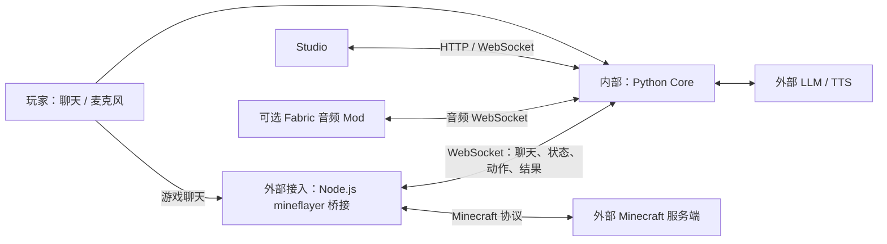

# 沃心 Voxkin

<p align="center">
  <b>面向 Minecraft 的实时语音伙伴与自主行动原型</b><br>
  对话与语音 · 游戏动作桥接 · 固定阶段任务 · 可复现评测
</p>

Voxkin 连接 Python Core、Minecraft 桥接进程与 Minecraft 世界。玩家通过游戏聊天或麦克风输入，Core 生成回复并派发受支持的动作，桥接执行后回传结果。项目探索无人干预的生存与通关，但目前不能独立通关：长任务使用固定阶段计划，尚无通用动态图执行器或自主技能生成、发布闭环。

English: [README.en.md](README.en.md).

## 当前状态

| 能力 | 状态 | 证据 |
| --- | --- | --- |
| Core 对话、语音与 Minecraft 动作桥接 | 已实现；具体引擎依赖本地配置，技能清单不代表全部经实机验证 | [状态](docs/STATUS.md)、[桥接协议](bridge/README.md)、[技能](docs/SKILLS.md) |
| S0 | 已实机验证：Normal 难度 10/10 轮完成 5/5 步 | [S0 证据](docs/evidence/S0_NORMAL_20261022.md) |
| S1 | 部分验证：白天 S0→S1 链式回归 3/3；夜间生存未验证，M3 未验收 | [S1 证据](docs/evidence/S1_NORMAL_20261022.md) |
| S2–S6、全流程 | 截至 2026-10-24 六次隔离实机链均未完成 S2；S3–S6 未运行，未完成无人干预通关 | [本轮实机记录](docs/evidence/S0_S6_CHAIN_20261024.md)、[里程碑](docs/MILESTONE.md) |
| 技能 | 技能代码已实现；除 S0/S1 证据明确覆盖的技能外，不能据技能清单或模拟测试宣称实机通过 | [技能清单与证据边界](docs/SKILLS.md) |
| Fabric 音频 Mod | 构建通过；真实客户端端到端效果未验证 | [状态](docs/STATUS.md) |

自动化测试、模拟世界测试和 Paper 实机回归不能互相替代。最终目标与验收定义见 [docs/MILESTONE.md](docs/MILESTONE.md)。

## 内外模块边界

“内 / 外”表示 Voxkin 与外部环境、服务的边界，不意味着支持插件热插拔。



| 边界 | 职责 | 代码 |
| --- | --- | --- |
| 内部 Core | 语音回合、引擎适配、动作派发与仲裁、固定任务 Runner、记忆、Studio API | [`src/voxkin/`](src/voxkin/)、[`__main__.py`](src/voxkin/__main__.py) |
| 外部游戏桥接 | mineflayer 登录、执行动作/技能、回传结果和世界状态 | [`bridge/minecraft_bridge.js`](bridge/minecraft_bridge.js)、[`bridge/skills/`](bridge/skills/) |
| 外部服务 | Minecraft、LLM、TTS；由配置或协议接入 | [`config/voxkin.example.yaml`](config/voxkin.example.yaml) |
| 可选客户端输出 | Mod 收 PCM 并在游戏客户端播放，不执行游戏动作 | [`mod/`](mod/) |

真实控制链路：输入 → Core 对话/意图 → LLM 工具调用或本地快路 → 动作仲裁/派发 → 桥接执行 → 结果回传。自主阶段任务由 `TaskRunner` 执行固定步骤，并非 LLM 动态规划的通用任务图。桥接消息结构见 [桥接协议](bridge/README.md)，阶段事实见 [当前状态](docs/STATUS.md)。

## 最小启动（测试主机）

以下以 Windows PowerShell 为例，需要 Python 3.10：

```powershell
python -m venv .venv
.\.venv\Scripts\python.exe -m pip install -e ".[dev]"
Copy-Item config\voxkin.example.yaml config\voxkin.yaml
$env:DEEPSEEK_API_KEY = "<your API key>"
.\.venv\Scripts\python.exe -m voxkin doctor
.\.venv\Scripts\python.exe -m voxkin serve
```

打开 <http://127.0.0.1:8765>。密钥可用环境变量或 Git 忽略的 `config/local.yaml` 本地覆盖；勿提交密钥。缺少有效 LLM 凭据时模型对话不可用。

### TTS / STT 是否必需

- **多人游戏听到 Voxkin 回复需要 TTS**：TTS 在 Core 主机运行；要让所有 Minecraft 客户端听到语音，还需 `audio.output: websocket` 和每位玩家的 Voxkin Fabric 音频 Mod。默认扬声器输出只在 Core 主机本地播放。
- **多人语音指令需要 STT**：Core 主机需安装 `.[stt,audio]`、Whisper 模型并连接麦克风。当前 STT 只读取 Core 主机麦克风；多人可在同一房间共用它，但每位远端玩家从自己电脑单独说话并传入 Voxkin 尚未实现。远端玩家可用 Minecraft 聊天发文字指令。
- **安装范围**：GPT-SoVITS/Genie TTS 和 faster-whisper/STT 都只装在 Voxkin 主机；参与者电脑不装这些引擎。要在游戏内听回复，每位参与者还需安装 Minecraft Fabric 音频 Mod。

### 多人局域网测试

当前 `scripts/eval_stack.ps1` 只在主持机本机启动 Studio 和 Bridge；Bridge 可通过 `-Host_` 连接局域网内的 Minecraft 测试服。若要让远端 Mod 收到语音，需在 `config/voxkin.yaml` 设置 `audio.output: websocket`、`server.host: 0.0.0.0`，重启 Core，并让客户端连 `ws://<Voxkin主机LAN地址>:8765/ws/audio`。注意 Studio API 与该音频 WebSocket 共用 8765 端口且没有认证；仅限隔离可信 LAN 并用防火墙限制来源，禁止公网暴露。

多人测试的文字交互方式是：在一台 Windows 主机启动专用 Minecraft 1.21.1 测试服务器、Core 和 Bridge，测试者从可信局域网加入并通过 Minecraft 聊天发文字指令。若要进行语音交互，还需按上方配置主机 TTS、Core 麦克风 STT，以及客户端音频 Mod 播放；远端玩家各自的麦克风输入当前未接入。服务器须设置离线模式才能接受当前默认的离线 Mineflayer bot，但离线模式无法验证玩家身份，**只允许可信、隔离的测试网，不要转发服务器端口到公网**。若服务器单独运行在另一台 LAN 机器上，Core/Bridge 仍必须在同一台 Voxkin 主机运行；桥接的 `MC_HOST` 指向服务器 LAN 地址，Core 与 Bridge 之间继续使用主机本地回环连接。

LAN 测试时在仓库根目录执行以下命令；将 `<服务器局域网地址>` 替换为专用测试服主机的 IPv4 地址。服务器端口使用默认 `25565`；若不同，请同时调整 `-McPort` 与 `MC_PORT`：

```powershell
$env:MC_HOST = "<服务器局域网地址>"
$env:MC_PORT = "25565"
$env:VOXKIN_WS = "ws://127.0.0.1:8765/ws/bridge"
.\scripts\eval_stack.ps1 -Action start -McPort 25565 -Host_ $env:MC_HOST
```

脚本会将 `-Host_` / `-McPort` 传给 Minecraft Bridge。Studio 仅绑定在主持机本机，通过 <http://127.0.0.1:8765> 查看状态；不要为了让参与者访问 Studio 而开放无认证的控制接口。结束后运行 `.\scripts\eval_stack.ps1 -Action stop`。多人输入共用同一个 Voxkin 对话与世界动作，建议轮流发指令，避免并发冲突。

## 接入 Minecraft

准备 Minecraft 1.21.1 服务端，先启动 Core，再启动桥接：

```powershell
cd bridge
npm install
$env:MC_HOST = "127.0.0.1"
$env:MC_PORT = "25565"
$env:MC_USERNAME = "Voxkin"
$env:MC_AUTH = "offline"
$env:VOXKIN_WS = "ws://127.0.0.1:8765/ws/bridge"
node minecraft_bridge.js
```

离线账号只应连接本机或可信测试服；`online-mode=false` 会削弱身份验证，不要暴露到公网。Mod 可选，虽可构建，真实客户端播放/空间音效尚未验收。完整步骤：[Minecraft 接入](docs/ENTER_MINECRAFT_CN.md)。

### 一键启动本地实机测试栈

先手动启动你准备好的 **Minecraft 1.21.1 专用测试服**，确认它监听本机 `25566` 端口；然后在仓库根目录运行：

```powershell
.\scripts\eval_stack.ps1 -Action start -McPort 25566
```

脚本会启动已配置的 GPT-SoVITS（若本机运行包存在）、Voxkin Studio 和独立模式的 Minecraft 桥接；它**不会启动、重置或创建 Minecraft 服务器/世界**。没有可用 GPT-SoVITS 时 Core 会静音降级。浏览器打开 <http://127.0.0.1:8765>，Studio 的桥接状态应显示已连接。此命令面向本机测试；多人 LAN 配置见上节。结束时运行：

```powershell
.\scripts\eval_stack.ps1 -Action stop
```

停止命令只结束脚本启动的进程，不会停止 Paper。不要把桥接连到有价值的存档或正在使用的评测世界；脚本默认使用离线用户名 `Voxkin`。如测试服端口不同，调整 `-McPort`。更多准备条件见 [Minecraft 接入](docs/ENTER_MINECRAFT_CN.md)。

## 自主通关进度

- **S0：** Normal 难度 10 次均 5/5；只证明该阶段，不证明完整自治。
- **S1：** 3 次白天 S0→S1 链式回归；三夜生存未验证，M3 未通过。
- **S2–S6：** 有计划及技能实现；截至 2026-10-24 六次隔离实机链均未完成 S2，S3–S6 未运行。死亡恢复、跨维度和末影龙战斗未最终验收。
- **G1：** 尚未进行零干预全流程通关。

路线图不是能力声明。见[状态](docs/STATUS.md)、[阶段计划](docs/plans/INDEPENDENT_RUN_ROADMAP.md)、[实机证据目录](docs/evidence/)。

## 文档

[新手上手](docs/GETTING_STARTED_CN.md) · [桥接协议](bridge/README.md) · [技能清单](docs/SKILLS.md) · [状态](docs/STATUS.md) · [里程碑](docs/MILESTONE.md) · [评测方法](docs/plans/EVALUATION.md) · [基准](docs/BENCHMARK_RESULTS.md) · [许可证分析](docs/LICENSE_ANALYSIS.md)

## 许可证

MIT，见 [LICENSE](LICENSE)。
