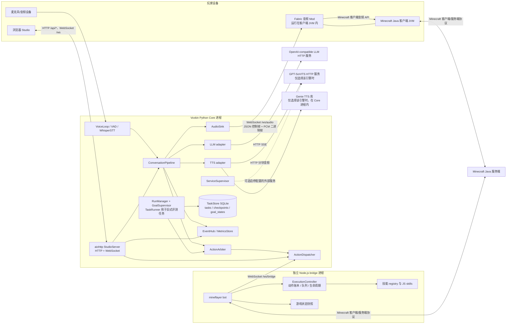
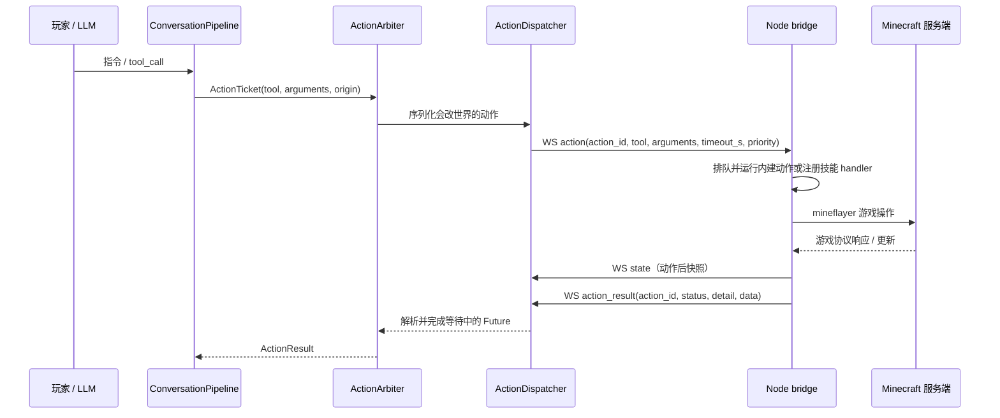

# Voxkin 架构：当前实现

> 本文描述仓库代码当前实际运行的结构，不把路线图或设计稿画成现状。`已实现` 表示当前代码有对应路径；`部分` 表示只有有限场景或单侧机制；`计划` 表示文档目标，不能据此推断运行时已支持。

## 导航

- [系统边界、所有权与状态矩阵](MODULE_BOUNDARIES.md)
- [当前运行拓扑](#当前运行拓扑)
- [一次指令的实际链路](#一次指令的实际链路)
- [任务、语音与动作控制](#任务语音与动作控制)
- [协议与进程边界](#协议与进程边界)
- [故障与未确认项](#故障与未确认项)
- [相关文档](#相关文档)

## 当前运行拓扑

下图只画已在代码中找到的调用与连接。方框中的 Python package、JS 技能文件和浏览器脚本不是独立操作系统进程；实线上的 HTTP、WebSocket 与 Minecraft 协议才跨越运行边界。

图中外部 Minecraft 服务端与运行 Voxkin Mod 的客户端是两个不同角色。Bridge 是 mineflayer 登录服务器的客户端，不是服务器端插件；Fabric Mod 加载在 Minecraft 客户端 JVM 中，不是独立的 Voxkin 服务进程。

## 一次指令的实际链路

### 输入与语音回合

玩家指令有三条已实现入口：

1. **游戏聊天**：Minecraft 服务端把聊天事件发给 mineflayer；`bridge/minecraft_bridge.js` 的 `bot.on('chat')` 发送 `{type:"chat", player, text}` 到 Core 的 `/ws/bridge`。`StudioServer.bridge_socket()` 收到后创建后台 `ConversationPipeline.respond()` 任务。
2. **麦克风**：Core 进程内的 `VoiceLoop` 从 `Microphone` 取音频，`VadSegmenter` 判定语段，`WhisperSTT.transcribe()` 在工作线程识别，随后调用同一个 `ConversationPipeline.respond()`。
3. **Studio**：浏览器可通过 HTTP `/api/say` 或 `/ws` 的 `say` 消息提交文本。`/ws` 也接收 `interrupt` 命令。

`ConversationPipeline.respond()` 拥有语音回合：构建上下文、启动 OpenAI-compatible 流、增量分句、经 TTS 与所选 `AudioSink` 播放，并将时间线/事件/记忆交给对应组件。响应中的 LLM `tool_call` 会另起后台动作任务，因此语音和 Minecraft 动作并非一个同步函数链。

### 动作与任务

标准 S0–S6 由 `RunManager` 管理生命周期，`GoalSupervisor` 是目标方法的唯一执行控制者，负责调度、Core 动作派发、未知结果对账、状态持久化与预算记账。`src/voxkin/agent/goals.py::GOALS` 是阶段验收条件的唯一声明来源；`src/voxkin/agent/goal_methods.py` 提供阶段策略、资源选择与验收辅助，不做外部 I/O，部分 helper 会更新传入的 `goal_state` 内存字典。`GoalSupervisor` 串行调用这些辅助，并统一负责调度、派发、action 对账、SQLite 持久化和预算；方法模块不持有持久化或执行所有权。S2、S3、S4 使用有限的观察驱动策略；Core 的部分 S6 方法可根据末影之眼 overhead 证据选择有界下探与框架扫描，Bridge `end.js` 提供相应执行路径。Combat 采用有界搜索并检查血量/取消；Nether 已有 portal 进入、到达坐标记录与有界巡逻策略。上述方法已进入生产代码和自动化回归，但 S4–S6 均无 Minecraft 实机阶段通过；S6 最终仍须满足末影龙击杀事件与返回主世界的验收条件。S5 已确认过门回执中的 source portal 与 arrival checkpoint 进入 SQLite goal state；换 Bridge session 后恢复为寻路线索，并在穿门前重新读取实际 portal block。刚到达且地形未 ready 时也可保存已确认坐标，但动作准入仍需 ready。普通维度 respawn 包保留 session/revision，死亡和断线才轮换生命周期；此链路已过自动化回归，尚未实机验收。动作描述、函数无异常或进度游标都不能替代目标验收。

`TaskStore` 在 `data/tasks.db` 保存任务、旧式 steps/checkpoints、事件和版本为 2 的 `goal_states` 快照。`goal_states` 保存当前目标状态、方法位置、最后观察、动作预算/计数、恢复原因以及 `pending_action`（含 action ID、会话/观察版本、参数和预期条件）。标准 S0–S6 的恢复以该快照为准；旧 `TaskRunner` checkpoint 仍用于兼容的线性评测任务，不是 GoalSupervisor 的恢复权威。

S2 依据新鲜观察选择下一项准备动作：检查食物/饥饿、材料、床、封闭庇护所、是否白天和附近危险。白天可先准备材料，夜间或危险时先建立安全点；进入夜晚后可在室内睡到天亮，或在无床时安全守夜。最终验收要求主世界、存活、正血量、食物阈值、逐格确认的封闭庇护所、人在庇护所内且可见床位在其内部；一旦观察到夜晚，还需睡眠或守夜完成证据和天亮观察。S2 是基于观察重选动作的有限控制逻辑，不是任意目标的通用规划器。

动作等待超时、断桥、死亡、抢占或未知结果时，Supervisor 保留 action ID 并先对账。Core 只有在最新 Bridge 状态 ready、存活、空闲且会话/观察版本可用时才恢复；Bridge 账本仍显示排队/运行中的旧动作时继续等待。可按新背包/世界观察安全重选的方法会核对当前净缺口；无可观察后置证据的不可重放动作转为持久 blocked。动作预算耗尽也会 blocked。`done` 与用户显式停止是持久状态：完成状态不可被断桥/死亡改写；`paused_by_user` 只能通过明确续跑入口离开。

`TaskRunner` 仍保留给旧式线性步骤任务；它使用 SQLite 检查点，不支持任意工作流图、并行分支、版本快照或持久化协程。

Bridge 通过 `bridge/skills/registry.js` 在进程启动时扫描 JS 模块并合并其 `skills` 导出。`minecraft_bridge.js` 将 Core 动作、跟随/闲逛、护甲维护和本地安全反射交给 `ExecutionController` 管理实际队列、交接与动作账本；安全动作有本地优先级，可抢占普通动作。普通动作的 `ready` 门控还要求 bot 所在位置的区块已就绪，脚下、脚部和头部方块可读，并且没有待处理的生命周期事件或安全动作；spawn/reconnect 等待区块加载后会重新检查位置再放行。Bridge 按 `action_id` 返回进度/结果，并可查询近期动作状态。该账本位于 Bridge 进程内且有界，Bridge 重启后不能当成持久执行历史。模块技能可通过受限的 `ctx.runSkill(skillId, args)` 调用同一注册表中的另一个技能；嵌套调用沿用当前动作上下文，并检查循环、最大深度与当前打断标志，不会变成独立动作或并行任务。Python 的 LLM 工具 schema 则从 `bridge/skills/manifest.json` 生成。技能代码注册与机器可读清单共同构成现有接口，但不是运行中热插拔；修改模块通常需重新加载/重启 Bridge 才会被扫描。

## 任务、语音与动作控制

| 控制对象 | 当前所有者 | 当前语义 | 状态 |
| --- | --- | --- | --- |
| 一轮语音响应、TTS 分句与打断 | Python `ConversationPipeline` | 新回合使旧回合语音失效、取消回合任务、停止 TTS 并 flush 音频 Sink；语音打断本身不等于取消已提交动作 | 已实现 |
| Core 动作准入、请求关联与取消请求 | Python `ActionArbiter` + `ActionDispatcher` | 正式 Runtime 要求有新鲜 ready 状态、Bridge session 与 revision 才发送；按 `action_id` 配对结果/状态回查，拒绝旧 session/revision 覆盖当前观察 | 已实现；Core 保存请求侧状态，不拥有实际游戏执行权 |
| 实际游戏操作、队列、交接与安全抢占 | Node `ExecutionController` | 管理 Core 请求、跟随/闲逛、护甲维护和本地安全动作；维护有界 action ledger；安全动作可优先接管 | 已实现；Bridge 账本不是持久数据库，游戏世界状态仍由服务端拥有 |
| 世界真实状态 | Minecraft 服务端 | 服务端是游戏状态权威；mineflayer 的 bot 状态与 Core 的快照是观察/缓存，不是权威数据库 | 外部权威 |
| 标准 S0–S6 目标/方法/在途动作/预算/恢复 | Core `RunManager` + `GoalSupervisor` + SQLite `goal_states` | `goals.py` 单一声明验收；`goal_methods.py` 提供阶段策略、资源选择与验收辅助（无外部 I/O；部分 helper 更新入参 `goal_state` 内存字典）；GoalSupervisor 串行调用并独占调度、Core 派发、action 对账、SQLite 持久化及预算。S2/S3/S4 与部分 S6 使用有界观察驱动策略；Combat 与 Nether 路径也有受限方法 | 生产代码与自动化回归已覆盖新增路径；S3–S6 没有完整实机阶段通过，S6 仍需 `ender_dragon_killed` 事件与主世界返回验收，S5 portal hint 的持久化与跨 session 消费已有自动化覆盖，穿门仍需 fresh blockAt 验证，尚未实机验收 |
| 旧式线性任务步骤/游标/检查点 | Core `TaskRunner` + SQLite `checkpoints` | 兼容评测任务按预定义顺序推进并保存旧式检查点 | 保留；不是标准 S0–S6 的状态权威 |
| 对话原文与摘要 | Core `MemoryStore`（可配置 SQLite） | 持久化对话上下文，不是任务检查点，也不等于技能经验库 | 已实现 |
| 临时事件与指标 | Core `EventHub` / `MetricsStore` | EventHub 为内存异步队列订阅者广播；MetricsStore 聚合有限数量的回合数据 | 已实现，非持久事件总线 |

语音回合 `ConversationPipeline.interrupt()` 只停止当前语音输出，不等同于停止游戏目标。显式 stop（Studio `/api/run/stop`、游戏聊天或语音停止意图）调用 `RunManager.request_stop()`，先将目标持久化为 `paused_by_user` 并镜像任务为 `cancelled`，再请求取消在途动作。是否已停止某个游戏动作，仍需 Bridge 的终态回执；取消/抢占本身不证明没有副作用。只有 `/api/run/resume` 的明确续跑可清除用户暂停，并先对账。

Bridge 负责实际游戏动作队列与本地接管。Core Arbiter 负责 Core 请求的准入、优先级与请求侧关联；Bridge 的 `ExecutionController` 则管理实际执行和本地反射。危险响应不依赖 Core 在线；本地避险可能抢占目标动作，Supervisor 收到事件后按最新世界观察重评目标。该结构提供了 Core/Bridge 间的动作所有权边界，但 Minecraft 服务端仍是世界状态权威。

## 协议与进程边界

| 通道 | 发起方 → 接收方 | 接口与主要载荷 | 状态 |
| --- | --- | --- | --- |
| 玩家聊天 | Minecraft 服务端 → Node Bridge | mineflayer `bot.on('chat')` 事件 | 已实现 |
| 游戏动作 | Node Bridge ↔ Minecraft 服务端 | mineflayer 使用 Minecraft 客户端协议登录并观察/操作世界 | 已实现；服务端版本与具体环境相关 |
| Core ↔ Bridge | Node Bridge ↔ Python Core | WebSocket `/ws/bridge`；含 `session_id`/递增 `revision` 的 ready 世界观察、带观察基线的动作请求、按 action ID 查询状态、动作进度/结果、取消/抢占、死亡/重生事件与 ACK | 已实现；hello/welcome 协议版本字段仍为 `1` |
| Studio 控制 | 浏览器 ↔ Python Core | HTTP `/api/*`；包括状态、说话、打断、麦克风、配置、服务与阶段任务接口 | 已实现；路由见 `StudioServer.build()` |
| Studio 实时事件 | 浏览器 ↔ Python Core | WebSocket `/ws`；客户端 `say`/`interrupt`，服务端接收 EventHub 事件 | 已实现 |
| 语音 PCM | Fabric Mod ↔ Python Core | WebSocket `/ws/audio`；服务端发 JSON `welcome`、每段 `pcm` 元数据后跟 little-endian s16le 单声道 PCM 二进制帧，以及 `flush`；Mod 解析 pong（仓库当前未见 Mod 主动发送 ping） | 代码已实现；真实客户端端到端仍未验收 |
| LLM | Python Core → 配置的模型端点 | HTTP OpenAI-compatible `/chat/completions`；流式时解析 SSE 文本与 `tool_calls` | 已实现适配器；服务端可以是外部服务或本地兼容端点，部署位置由配置决定 |
| GPT-SoVITS TTS | Python Core → 配置的 TTS HTTP API | `/openapi.json` 健康探测与 `/tts` HTTP 流式响应 | 已实现适配器；服务进程可外部启动，也可由 `ServiceSupervisor` 按配置管理 |
| Genie TTS | Python Core 内部 | 通过 Python 库 `genie_tts` 的进程内 API 合成 | 已实现适配器；不是独立 Voxkin 进程 |
| STT | Core 本地音频 → Core 本地模型 | `faster-whisper` 在 Core 进程中加载并识别；耗时调用由 VoiceLoop 放到线程执行 | 已实现，可选依赖/模型 |
| 旧 WAV 文件输出 | Python Core → 配置目录 | `MinecraftFileSink` 写 WAV 文件 | 写入端已实现；当前仓库 Fabric Mod 源码未发现该目录的文件监听/消费实现，端到端消费者未确认 |

Python package 间调用、Node 内各 JS 技能模块间调用都属于**同进程函数/对象调用**，不是 RPC 或事件服务。Core 的 Studio `EventHub` 不等于 Bridge 协议：Bridge 连接由专用 `/ws/bridge` handler 直接处理；音频 Mod 又使用单独 `/ws/audio` 连接。

## 故障与未确认项

- **动作准入与过期观察**：正式 Core Runtime 在没有 ready、session、revision 的新鲜观察时拒绝发送 Bridge action；旧 session/revision 的状态或进度不会覆盖当前世界快照。
- **Bridge 断开或动作超时**：在途动作及 action ID 保存在目标快照中，状态转为等待/恢复/未知；收到新鲜 ready 世界观察后向 Bridge 账本对账。正在运行的动作先等待，不重派；Bridge 没有终态记录时只对允许重选的方法按当前世界净缺口重算。动作没有可观察后置条件时会 blocked，不能把 Core 本地 Future 取消当成 Bridge 已取消的回执。
- **显式目标停止**：用户停止会持久化 `paused_by_user`，自动状态更新不会续跑；停止过程仍保留 pending action，只有明确 `/api/run/resume` 可对账并解除用户暂停。`done` 由 SQLite 事务同时提交目标和任务终态，后续死亡或断桥不会复活目标。
- **语音打断**：取消当前回合及音频输出，但不自动撤销已经进入 Arbiter/Bridge 的世界动作。要停止动作，走 stop/cancel 控制路径。
- **安全抢占与世界状态变化**：Bridge 本地安全动作可抢占普通动作；`preempted` 不等于无副作用。目标层等待本地安全执行结束，读取新鲜状态并核对已有后置条件，再决定继续或重选方法。
- **Fabric 客户端断开**：`/ws/audio` 客户端会自行重连；真实客户端中的播放、重连与游戏效果仍需实机验证。
- **通用动态规划与全流程验收**：S2 与 S3 分别按观察选择受限方法；其他阶段使用预定义方法。任意任务图规划、技能在线热更新、版本固定、回滚与自动能力生成都未实现，S3–S6 仍需实机验收。

没有通过只读代码核验确认的事项：部署时 Minecraft 服务端、Core、客户端是否同机；具体 LLM URL 对应的服务商/进程位置；配置的 WAV 消费者；所有 mineflayer 版本/服务器组合下的协议兼容性。拓扑中的网络连线不代表部署网络一定是本机回环。

## 相关文档

- 当前状态、测试与已知缺口：[STATUS.md](STATUS.md)
- 独立通关验收定义：[MILESTONE.md](MILESTONE.md)
- 阶段计划：[ROADMAP.md](ROADMAP.md)、[plans/INDEPENDENT_RUN_ROADMAP.md](plans/INDEPENDENT_RUN_ROADMAP.md)
- 自主运行目标设计（计划，不代表现状）：[plans/AUTONOMOUS_RUN_ARCHITECTURE.md](plans/AUTONOMOUS_RUN_ARCHITECTURE.md)
- 技能清单与验收：[SKILLS.md](SKILLS.md)、[plans/SKILL_MODULE_CONTRACT.md](plans/SKILL_MODULE_CONTRACT.md)
- 实机证据：[evidence/GOAL_REFACTOR_20261026.md](evidence/GOAL_REFACTOR_20261026.md)、[evidence/S0_NORMAL_20261022.md](evidence/S0_NORMAL_20261022.md)、[evidence/S1_NORMAL_20261022.md](evidence/S1_NORMAL_20261022.md)
- 评测策略：[plans/EVALUATION.md](plans/EVALUATION.md)、[BENCHMARK_RESULTS.md](BENCHMARK_RESULTS.md)
- 仓库审计与引擎证据：[REPO_AUDIT.md](REPO_AUDIT.md)、[TECH_EVALUATION.md](TECH_EVALUATION.md)
