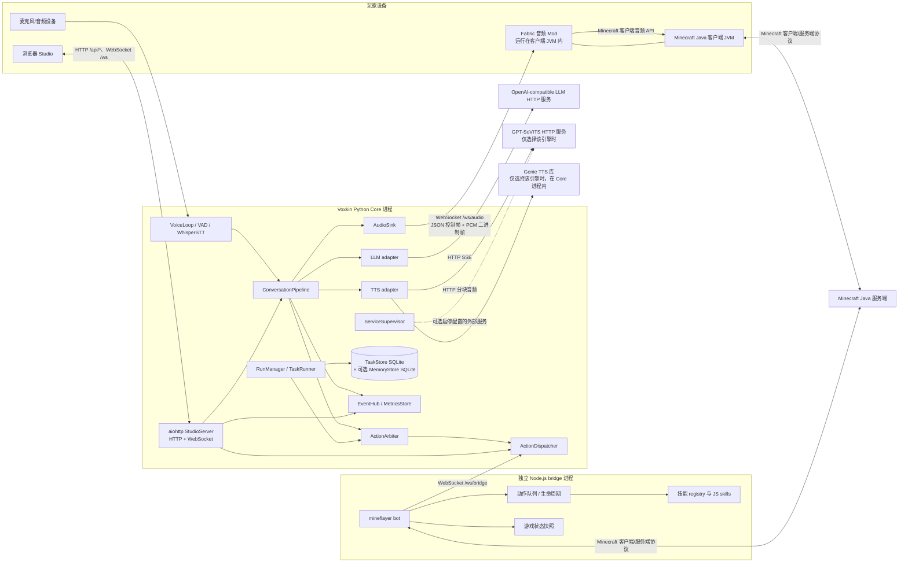
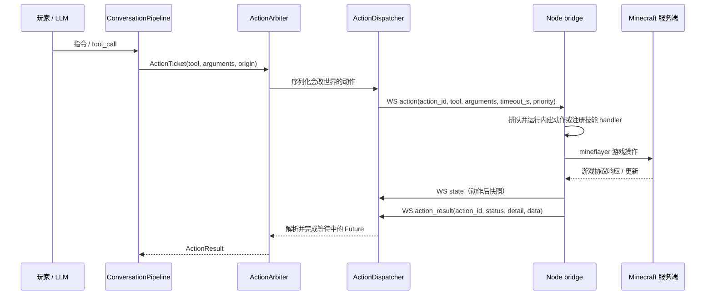

# Voxkin 架构：当前实现

> 本文描述仓库代码当前实际运行的结构，不把路线图或设计稿画成现状。`已实现` 表示当前代码有对应路径；`部分` 表示只有有限场景或单侧机制；`计划` 表示文档目标，不能据此推断运行时已支持。

## 导航

- [系统边界、所有权与状态矩阵](MODULE_BOUNDARIES.md)
- [当前运行拓扑](#当前运行拓扑)
- [一次指令的实际链路](#一次指令的实际链路)
- [任务、语音与动作控制](#任务语音与动作控制)
- [协议与进程边界](#协议与进程边界)
- [故障与未确认项](#故障与未确认项)
- [相关文档](#相关文档)

## 当前运行拓扑

下图只画已在代码中找到的调用与连接。方框中的 Python package、JS 技能文件和浏览器脚本不是独立操作系统进程；实线上的 HTTP、WebSocket 与 Minecraft 协议才跨越运行边界。

图中外部 Minecraft 服务端与运行 Voxkin Mod 的客户端是两个不同角色。Bridge 是 mineflayer 登录服务器的客户端，不是服务器端插件；Fabric Mod 加载在 Minecraft 客户端 JVM 中，不是独立的 Voxkin 服务进程。

## 一次指令的实际链路

### 输入与语音回合

玩家指令有三条已实现入口：

1. **游戏聊天**：Minecraft 服务端把聊天事件发给 mineflayer；`bridge/minecraft_bridge.js` 的 `bot.on('chat')` 发送 `{type:"chat", player, text}` 到 Core 的 `/ws/bridge`。`StudioServer.bridge_socket()` 收到后创建后台 `ConversationPipeline.respond()` 任务。
2. **麦克风**：Core 进程内的 `VoiceLoop` 从 `Microphone` 取音频，`VadSegmenter` 判定语段，`WhisperSTT.transcribe()` 在工作线程识别，随后调用同一个 `ConversationPipeline.respond()`。
3. **Studio**：浏览器可通过 HTTP `/api/say` 或 `/ws` 的 `say` 消息提交文本。`/ws` 也接收 `interrupt` 命令。

`ConversationPipeline.respond()` 拥有语音回合：构建上下文、启动 OpenAI-compatible 流、增量分句、经 TTS 与所选 `AudioSink` 播放，并将时间线/事件/记忆交给对应组件。响应中的 LLM `tool_call` 会另起后台动作任务，因此语音和 Minecraft 动作并非一个同步函数链。

### 动作与任务

自主阶段任务由 `RunManager` 创建固定阶段（S0–S6）的 `TaskRunner`；步骤定义在 `src/voxkin/agent/plans.py`，步骤通过注入的 `dispatch_task` 同样进入仲裁器和桥接。`TaskStore` 在 `data/tasks.db` 保存任务、步骤、事件与检查点；Runner 执行后读取 Bridge 最近状态，由本地 `Verifier` 判断步骤条件。

这是一种**固定计划 + 线性步骤 Runner + 检查点**，不是任意节点/边的动态图执行器。Runner 有内存 pause/resume/cancel 控制与 SQLite 检查点；HTTP 当前暴露 start/resume/stop，不暴露 pause。恢复会按已保存游标并用世界状态验证已完成步骤；这不是任意工作流的暂停/恢复语义，不支持动态图的并行、分支、循环或版本快照。

Bridge 通过 `bridge/skills/registry.js` 在进程启动时扫描 JS 模块并合并其 `skills` 导出。`minecraft_bridge.js` 先处理若干内建动作，再将其余名称映射到 `skillRegistry[tool].handler(args, buildSkillContext())`。模块技能可通过受限的 `ctx.runSkill(skillId, args)` 调用同一注册表中的另一个技能；嵌套调用沿用当前动作上下文，并检查循环、最大深度与当前打断标志，不会变成独立动作或并行任务。Python 的 LLM 工具 schema 则从 `bridge/skills/manifest.json` 生成。技能代码注册与机器可读清单共同构成现有接口，但不是运行中热插拔；修改模块通常需重新加载/重启 Bridge 才会被扫描。

## 任务、语音与动作控制

| 控制对象 | 当前所有者 | 当前语义 | 状态 |
| --- | --- | --- | --- |
| 一轮语音响应、TTS 分句与打断 | Python `ConversationPipeline` | 新回合使旧回合语音失效、取消回合任务、停止 TTS 并 flush 音频 Sink；语音打断本身不等于取消已提交动作 | 已实现 |
| Core 接收的世界写动作排队与优先级 | Python `ActionArbiter` | 对分类为会改世界的 ticket 排队/抢占/取消；只读动作可并行提交 | 已实现，能力分类依赖本地技能清单 |
| 动作 Future、超时、回执与最近 Bridge 状态 | Python `ActionDispatcher` | 以 `action_id` 配对结果；桥接断开会失败待处理 Future 并清除快照；快照超过 30 秒视为不可用 | 已实现 |
| 实际游戏操作、执行队列、当前动作与部分安全反射 | Node `minecraft_bridge.js` | 队列中一次运行一个动作；超时/取消通过 Bridge 本地中断逻辑处理；mineflayer 状态为 Bridge 观察 | 已实现，但不是 Core Arbiter 的单一状态副本 |
| 世界真实状态 | Minecraft 服务端 | 服务端是游戏状态权威；mineflayer 的 bot 状态与 Core 的快照是观察/缓存，不是权威数据库 | 外部权威 |
| 长任务步骤/游标/检查点 | Core `TaskRunner` + SQLite `TaskStore` | Runner 按预定义顺序推进并保存状态；生命周期、步骤计划与单个动作队列是不同层次 | 部分实现 |
| 对话原文与摘要 | Core `MemoryStore`（可配置 SQLite） | 持久化对话上下文，不是任务检查点，也不等于技能经验库 | 已实现 |
| 临时事件与指标 | Core `EventHub` / `MetricsStore` | EventHub 为内存异步队列订阅者广播；MetricsStore 聚合有限数量的回合数据 | 已实现，非持久事件总线 |

动作停止至少有两个不同语义：`ConversationPipeline.interrupt()` 停止当前语音回合；玩家的 stop 意图会请求 `ActionArbiter.cancel_all()`，再由 Bridge 尝试中断当前动作并清理排队动作。任务 API 的 run stop 则由 `RunManager`/`TaskRunner` 取消任务。最终游戏动作是否停下仍依赖 Bridge 收到取消并回报；Core 发出请求不等同于游戏服务器确认动作已停止。

同一 Bridge 进程还有受击逃生、跟随/闲逛等本地行为。它们部分检查 `actionBusy`、各自忙碌标志或会直接操作 mineflayer/pathfinder 控制状态；Core Arbiter 主要仲裁通过 Core 动作接口提交的 ticket。因此当前不是涵盖所有 bot 控制路径的全局、单一仲裁器。

## 协议与进程边界

| 通道 | 发起方 → 接收方 | 接口与主要载荷 | 状态 |
| --- | --- | --- | --- |
| 玩家聊天 | Minecraft 服务端 → Node Bridge | mineflayer `bot.on('chat')` 事件 | 已实现 |
| 游戏动作 | Node Bridge ↔ Minecraft 服务端 | mineflayer 使用 Minecraft 客户端协议登录并观察/操作世界 | 已实现；服务端版本与具体环境相关 |
| Core ↔ Bridge | Node Bridge ↔ Python Core | WebSocket `/ws/bridge`；JSON `hello`/`welcome`、`chat`、`state`、`action`、`action_cancel`、可选 `action_progress`、`action_result`、死亡/重生生命周期与 ACK。协议版本字段当前为 `1` | 已实现 |
| Studio 控制 | 浏览器 ↔ Python Core | HTTP `/api/*`；包括状态、说话、打断、麦克风、配置、服务与阶段任务接口 | 已实现；路由见 `StudioServer.build()` |
| Studio 实时事件 | 浏览器 ↔ Python Core | WebSocket `/ws`；客户端 `say`/`interrupt`，服务端接收 EventHub 事件 | 已实现 |
| 语音 PCM | Fabric Mod ↔ Python Core | WebSocket `/ws/audio`；服务端发 JSON `welcome`、每段 `pcm` 元数据后跟 little-endian s16le 单声道 PCM 二进制帧，以及 `flush`；Mod 解析 pong（仓库当前未见 Mod 主动发送 ping） | 代码已实现；真实客户端端到端仍未验收 |
| LLM | Python Core → 配置的模型端点 | HTTP OpenAI-compatible `/chat/completions`；流式时解析 SSE 文本与 `tool_calls` | 已实现适配器；服务端可以是外部服务或本地兼容端点，部署位置由配置决定 |
| GPT-SoVITS TTS | Python Core → 配置的 TTS HTTP API | `/openapi.json` 健康探测与 `/tts` HTTP 流式响应 | 已实现适配器；服务进程可外部启动，也可由 `ServiceSupervisor` 按配置管理 |
| Genie TTS | Python Core 内部 | 通过 Python 库 `genie_tts` 的进程内 API 合成 | 已实现适配器；不是独立 Voxkin 进程 |
| STT | Core 本地音频 → Core 本地模型 | `faster-whisper` 在 Core 进程中加载并识别；耗时调用由 VoiceLoop 放到线程执行 | 已实现，可选依赖/模型 |
| 旧 WAV 文件输出 | Python Core → 配置目录 | `MinecraftFileSink` 写 WAV 文件 | 写入端已实现；当前仓库 Fabric Mod 源码未发现该目录的文件监听/消费实现，端到端消费者未确认 |

Python package 间调用、Node 内各 JS 技能模块间调用都属于**同进程函数/对象调用**，不是 RPC 或事件服务。Core 的 Studio `EventHub` 不等于 Bridge 协议：Bridge 连接由专用 `/ws/bridge` handler 直接处理；音频 Mod 又使用单独 `/ws/audio` 连接。

## 故障与未确认项

- **LLM 请求失败或流异常**：适配器抛出 `LLMError`，当前语音回合记录失败并向 Studio 广播；不会自动把失败转成新的任务图或自修复计划。已实现的任务 Runner 有自己的步骤重试/检查点策略。
- **Bridge 断开或动作超时**：Dispatcher 将在途请求标成断连/超时类失败并释放等待；Bridge 断连会将队列中待执行动作标记断连并请求中断当前动作，随后尝试重连。Core 收到桥接回执前不能宣称游戏目标已完成。
- **语音打断**：取消当前回合及音频输出，但不自动撤销已经进入 Arbiter/Bridge 的世界动作。要停止动作，走 stop/cancel 控制路径。
- **技能被取消或世界状态突变**：Bridge 的取消/死亡生命周期处理与 Core 的 Arbiter/Runner 交互；但动作执行中游戏状态可能变化，完成与否须看返回状态及后置观察，不能只看函数无异常。
- **Fabric 客户端断开**：`/ws/audio` 客户端会自行重连；真实客户端中的播放、重连与游戏效果仍需实机验证。
- **任务图、技能在线热更新、版本固定、回滚与自动能力生成**：当前实现没有这些通用语义；相关目标见自治架构、技能模块契约与路线图文档。

没有通过只读代码核验确认的事项：部署时 Minecraft 服务端、Core、客户端是否同机；具体 LLM URL 对应的服务商/进程位置；配置的 WAV 消费者；所有 mineflayer 版本/服务器组合下的协议兼容性。拓扑中的网络连线不代表部署网络一定是本机回环。

## 相关文档

- 当前状态、测试与已知缺口：[STATUS.md](STATUS.md)
- 独立通关验收定义：[MILESTONE.md](MILESTONE.md)
- 阶段计划：[ROADMAP.md](ROADMAP.md)、[plans/INDEPENDENT_RUN_ROADMAP.md](plans/INDEPENDENT_RUN_ROADMAP.md)
- 自主运行目标设计（计划，不代表现状）：[plans/AUTONOMOUS_RUN_ARCHITECTURE.md](plans/AUTONOMOUS_RUN_ARCHITECTURE.md)
- 技能清单与验收：[SKILLS.md](SKILLS.md)、[plans/SKILL_MODULE_CONTRACT.md](plans/SKILL_MODULE_CONTRACT.md)
- 实机证据：[evidence/S0_NORMAL_20261022.md](evidence/S0_NORMAL_20261022.md)、[evidence/S1_NORMAL_20261022.md](evidence/S1_NORMAL_20261022.md)
- 评测策略：[plans/EVALUATION.md](plans/EVALUATION.md)、[BENCHMARK_RESULTS.md](BENCHMARK_RESULTS.md)
- 仓库审计与引擎证据：[REPO_AUDIT.md](REPO_AUDIT.md)、[TECH_EVALUATION.md](TECH_EVALUATION.md)
