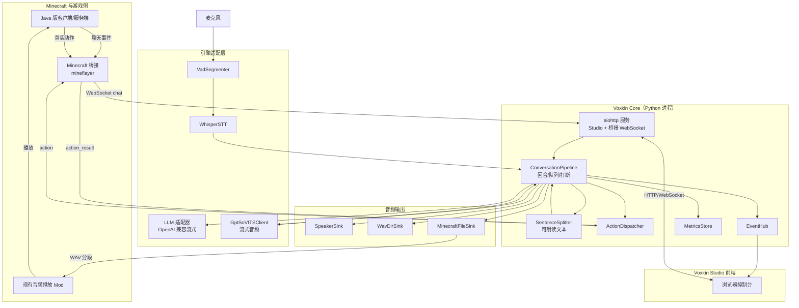
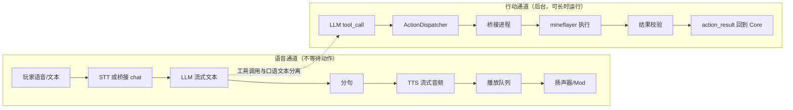
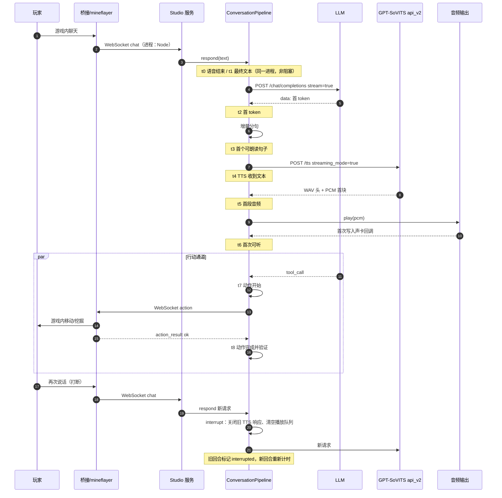

# 沃心架构

## 1. 组件

## 2. 两条并行通道

语音通道不会等待行动通道；行动结果通过事件与时间线单独记录，`t8` 只有在桥接返回成功后才写入。

## 3. 完整时序

时序说明：

| 环节 | 进程 | 接口 | 阻塞关系 |
| --- | --- | --- | --- |
| 游戏聊天采集 | Node 桥接 | mineflayer `chat` 事件 | 不阻塞 |
| 文本注入 | Core | WebSocket `/ws/bridge` | 立即返回，回合在后台任务执行 |
| LLM 流 | Core | HTTPS SSE | 只阻塞当前回合，不阻塞其他回合以外的工作 |
| 分句 | Core | 进程内 | 同步、微秒级 |
| TTS | 独立进程 | HTTP 分块响应 | 串行占用 TTS；新回合会中断旧请求 |
| 播放 | Core | PortAudio 回调 | 独立线程，队列非阻塞 |
| 动作 | Node 桥接 | WebSocket | 后台任务，不阻塞语音 |

## 4. 关键接口

- `TTSAdapter`：`initialize()`、`synthesize(text) -> AsyncIterator[np.ndarray]`、`stop()`、`describe()`。
- `AudioSink`：`start()`、`play(turn_id, pcm)`、`flush()`、`close()`、`describe()`。
- `ActionDispatcher`：`attach(sender)`、`dispatch(tool, arguments)`、`resolve(ActionResult)`。
- 桥接消息：`hello`、`chat`、`state`（桥接 → Core）；`welcome`、`action`（Core → 桥接）；`action_result`（桥接 → Core）。

## 5. 并发模型

- 一个 Core 进程、一个事件循环；TTS 合成在独立进程中执行，网络 I/O 全部异步。
- 同一时间只保留一个语音回合；新回合通过递增的 `generation` 使旧回合失效，并关闭旧 TTS HTTP 响应。
- 播放使用独立线程与有界队列；新回合开始时清空队列，避免上一轮音频拖尾。
- 动作使用后台任务集合，跨回合继续执行；Core 关闭时统一取消。
- TTS 适配器内部加锁，保证同一时刻只有一个合成会话（Genie 的全局播放器与 GPT-SoVITS 的服务端都按串行处理）。

## 6. 故障恢复

| 故障 | 行为 |
| --- | --- |
| LLM 非 200 | 抛出 `LLMError`，回合标记失败，Studio 收到 `turn_failed` |
| LLM 流中断 | 当前回合失败，已生成句子仍会播放完 |
| TTS 服务不可用 | `initialize()` 直接失败；运行中失败则回合失败并记录 |
| 桥接断开 | 未完成动作收到「桥接已断开」，不会伪造成功 |
| 播放设备不可用 | `SpeakerSink.start()` 直接抛错，可切换到 `wav_dir` |
| 用户打断 | 关闭旧 TTS 响应、清空播放队列、旧回合不再写指标以外的状态 |
