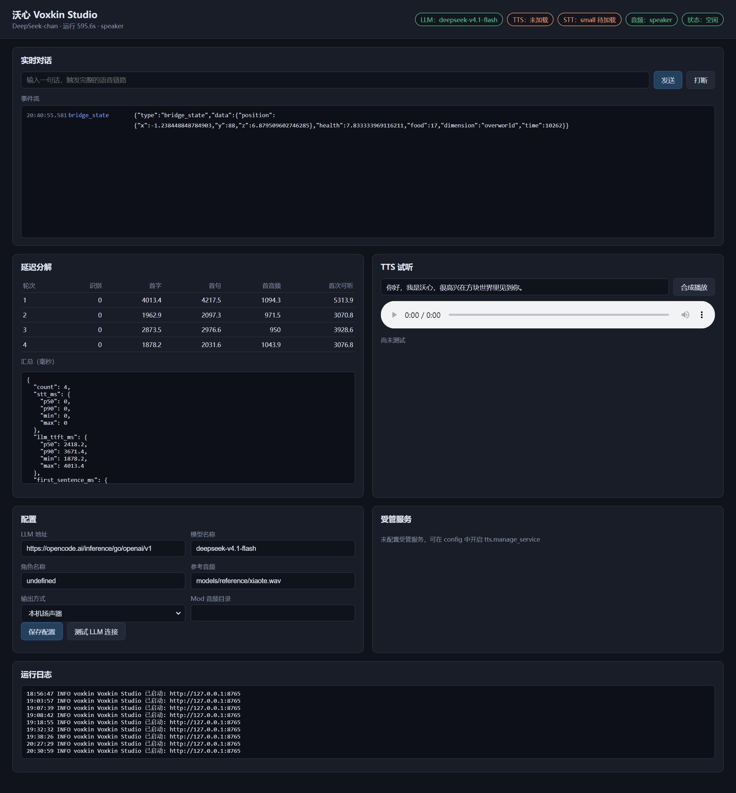

# 沃心小白版说明

这篇文档假设你没有写过代码，只想把沃心跑起来，让 Minecraft 里的角色能和你说话、帮你干活。

## 一、沃心是什么

沃心是一个住在 Minecraft 里的 AI 伙伴。你在游戏里打字或者对着麦克风说话，它会：

1. 听懂你说的话；
2. 想一想怎么回答；
3. 用你给它的音色把回答说出来；
4. 如果这件事需要在游戏里动手，它会走过去、挖方块或者停下来。

它由三个程序组成：负责思考和说话的「沃心 Core」、负责在游戏里行动的「桥接」，以及负责播放声音的「客户端 Mod」。

## 二、你需要准备什么

| 东西 | 用途 | 从哪里来 |
| --- | --- | --- |
| Windows 电脑 | 运行全部程序 | 你自己的电脑 |
| Python 3.10 | 运行沃心 Core | python.org 下载 |
| Node.js 20 以上 | 运行游戏桥接 | nodejs.org 下载 |
| JDK 21 | 编译客户端 Mod | Adoptium 下载 |
| Minecraft 1.21.1 + Fabric | 进入游戏 | 官方启动器与 Fabric 官网 |
| GPT-SoVITS 语音包 | 把文字变成声音 | 项目作者提供的整合包 |
| 模型密钥 | 让 AI 会说话 | 服务商提供 |

这些程序都装在同一台 Windows 电脑上即可，不需要服务器。

## 三、第一次运行

### 第 1 步：把项目放到电脑上

下载项目压缩包，解压到 `D:\Voxkin` 这样的短路径，不要放在中文路径或桌面深处。

打开「开始菜单」，搜索 PowerShell，右键选择「以管理员身份运行」，然后输入：

```powershell
cd D:\Voxkin
```

如果提示找不到路径，说明解压位置不对，回到文件夹里复制真实路径。

### 第 2 步：安装 Python 依赖

在 PowerShell 里依次输入：

```powershell
python -m venv .venv
.\.venv\Scripts\python.exe -m pip install -U pip
.\.venv\Scripts\python.exe -m pip install -e ".[dev]"
```

每一行都要等它跑完再输入下一行。看到 `Successfully installed` 就是成功了。

### 第 3 步：准备配置文件

```powershell
Copy-Item config\voxkin.example.yaml config\voxkin.yaml
```

用记事本打开 `config\local.yaml`（没有就新建），写入你的密钥：

```yaml
llm:
  base_url: "https://opencode.ai/inference/go/openai/v1"
  model: "deepseek-v4.1-flash"
  api_key: "你的密钥"
  headers:
    x-opencode-session: "voxkin-deepseek-chan-01"
```

密钥不要发给别人，也不要把这个文件上传到网上。

### 第 4 步：启动语音服务

找到 GPT-SoVITS 语音包的解压目录，在 PowerShell 里进入它，然后运行：

```powershell
runtime\python.exe api_v2.py -a 127.0.0.1 -p 9880 -c GPT_SoVITS\configs\tts_infer.yaml
```

第一次启动会加载模型，大约需要十几秒。看到 `Uvicorn running on http://127.0.0.1:9880` 就成功了。

这个窗口不要关。

### 第 5 步：启动沃心 Core

再开一个新的 PowerShell 窗口：

```powershell
cd D:\Voxkin
.\.venv\Scripts\python.exe -m voxkin serve
```

看到 `Voxkin Studio 已启动` 就成功了。

### 第 6 步：打开控制台

浏览器访问 <http://127.0.0.1:8765>。

在「实时对话」里输入一句话，点「发送」。如果听到角色用你训练的音色说话，说明语音链路已经通了。



## 四、直接用麦克风说话

不想进游戏也能测试。新开一个 PowerShell 窗口：

```powershell
cd D:\Voxkin
.\.venv\Scripts\python.exe -m voxkin mic
```

看到「麦克风已就绪」，直接对着麦克风说话，停顿一下，沃心就会回答。

如果它听不到你：

```powershell
.\.venv\Scripts\python.exe -m voxkin mic --listen-only
```

这个模式只显示识别结果，不回答。先确认屏幕上出现了你说的话，再换回正常模式。

声音偏小可以加 `--gain 4`；用外放音箱时加 `--no-barge-in`，否则它可能把自己的声音当成你说的话。戴耳机体验最好。

## 五、让它在游戏里出现

### 第 1 步：准备一个 Minecraft 服务器

单人游戏也可以用，但需要先开一个本地服务器。最简单的方法是用 Paper 或官方服务端，版本选 1.21.1，关闭正版验证（`online-mode=false`）。

### 第 2 步：启动桥接

新开一个 PowerShell 窗口：

```powershell
cd D:\Voxkin\bridge
npm install
$env:MC_HOST="127.0.0.1"
$env:MC_PORT="25565"
$env:MC_USERNAME="Voxkin"
node minecraft_bridge.js
```

看到「已进入世界」，说明机器人已经加入服务器。

### 第 3 步：安装客户端 Mod

1. 安装 Fabric Loader 1.21.1。
2. 把 `mod\build\libs\voxkin-audio-0.1.0.jar` 和 Fabric API 放进 `.minecraft\mods`。
3. 打开 `config\voxkin.yaml`，把 `audio.output` 改成 `websocket`。
4. 重启沃心 Core，再进入游戏。

现在你在游戏聊天框里说话，角色会用语音回答。

## 六、常见问题

**没有声音**

先看控制台右侧的延迟表有没有数字。没有数字说明语音服务没连上，回到第 4 步检查窗口是否还开着。

**提示连接 9880 失败**

语音服务没启动，或者端口被别的程序占用。关掉重复的窗口再试。

**识别总是出错**

麦克风离得太远，或者环境太吵。可以在 `config\voxkin.yaml` 里把 `stt.model` 从 `small` 改成 `medium`，代价是速度变慢。

**角色说「我去挖」，但什么都没做**

检查桥接窗口是否还在运行，以及游戏里的机器人是否真的加入了服务器。动作失败时控制台的「运行日志」会写出原因。

**端口被占用**

把 `config\voxkin.yaml` 里的 `server.port` 改成 8766，然后重新启动 Core，浏览器也跟着换端口。

## 七、几个名词的大白话解释

| 名词 | 大白话 |
| --- | --- |
| LLM | 负责思考和说话的 AI 模型 |
| STT | 把你说的话变成文字 |
| TTS | 把文字变成声音 |
| VAD | 判断你什么时候开始说、什么时候说完 |
| 桥接 | 在游戏里替角色走路和挖方块的程序 |
| WebSocket | 两个程序之间一直开着的对话通道 |

## 八、安全提醒

- 密钥只放在 `config\local.yaml`，不要提交到 GitHub。
- 不要把 8765、9880 这些端口开到公网。
- 别人给的模型文件先确认来源，再放进来。
