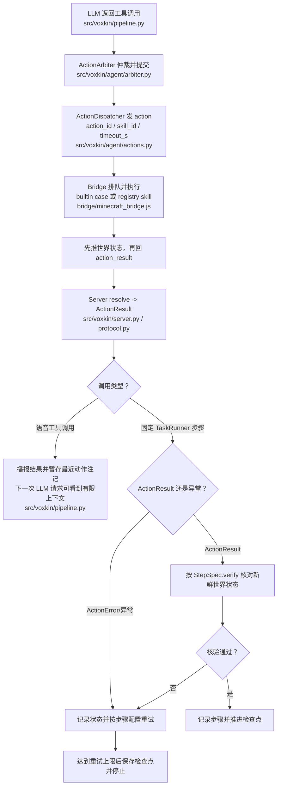

# 沃心技能总表

本文是技能清单的事实来源。技能名、分类、类型、参数、失败条件、可否取消、验收描述以 `bridge/skills/manifest.json` 为准；真实行为以 `bridge/minecraft_bridge.js` 为准；模型看到的工具定义以 `src/voxkin/agent/tools.py` 为准。

> 历史审计基线（2026-10-22 21:50）：当时记录 36 条模块技能、57 条清单技能与 245 个 Python 测试；第 2 节早期内建技能明细保留为快照。当前事实以 2026-10-24 清单为准：64 条技能（21 个内建、43 个模块），Core 暴露 63 个工具，固定 S0–S6 计划共 63 步。S0/S1 有真实服务器证据；本轮新增 `prepare_bow_arrows` 只有模拟测试，不代表 S2–S6 或全流程实机验收。

## 0. 基线与口径

### 0.1 基线

提交 `11c83c8`，加上 2026-10-22 工作区中尚未提交的改动：`bridge/minecraft_bridge.js`、`src/voxkin/agent/actions.py`、`src/voxkin/agent/run_manager.py`、`src/voxkin/agent/runner.py`、`src/voxkin/bridge/protocol.py`、`src/voxkin/runtime.py`，新增 `bridge/skills/manifest.js`、`bridge/skills/manifest.json`、`scripts/dump_manifest.js`、`src/voxkin/agent/skills.py`、`tests/test_skill_manifest.py`、`tests/test_action_status.py`。

以上提交和其后的 21 技能统计、旧行号及逐项内建技能验收指令均为 2026-10-22 的历史审计基线，不是当前 HEAD。当前数量与调用链请以本节日期的源码和 1.1 统计为准；下方基线条目保留作历史快照，不能据此推断模块技能当前缺失或按旧行号定位。

### 0.2 事实来源优先级

1. `bridge/skills/manifest.json`：技能名、分类、类型、参数、超时、能否取消、验收描述。
2. `bridge/minecraft_bridge.js`：真实行为。`runAction` 的 21 个 `case` 分支在第 280 至 386 行。
3. `src/voxkin/agent/tools.py`：模型看到的 20 个工具定义，覆盖清单里除 `chat` 之外的 20 个技能。
4. `src/voxkin/agent/skills.py`：清单读取器与 schema 生成器。`load_manifest`（第 28 行）、`skill_ids`（第 47 行）、`find_skill`（第 51 行）、`tool_schemas`（第 71 行）。

### 0.3 验收分级

| 级别 | 内容 | 适用 |
| --- | --- | --- |
| A1 | 清单与实现的一致性自检 | 全部 21 个技能 |
| A2 | Core 侧派发与状态判定 | 全部 21 个技能 |
| B | 真实 Paper 1.21.1 服务器上的行为验收 | 全部 21 个技能 |
| C | 需要仓库外的真实条件 | 仅 `chat` |

A1 命令与期望：

```
node scripts/dump_manifest.js
.\.venv\Scripts\python.exe -m pytest tests/test_skill_manifest.py -q
git diff --exit-code bridge/skills/manifest.json
```

历史基线期望：脚本打印「技能总数 21」及当时的分类数量。当前清单为 64 项，运行生成脚本会更新清单文件，不能再用旧期望值或 `git diff --exit-code` 判断当前技能是否一致。

A2 命令与期望：

```
.\.venv\Scripts\python.exe -m pytest tests/test_action_status.py tests/test_actions.py tests/test_runner.py -q
```

历史基线期望：27 个用例通过（12 + 8 + 7）。当前协议定义九种状态；当前测试数量与覆盖请按现有测试文件和本次实际运行记录为准。

B 级统一准备：

```
.\scripts\eval_stack.ps1 start
Invoke-RestMethod http://127.0.0.1:8765/api/bridge/state
```

期望：`connected` 为 `true`，`ready` 为 `true`，`age_s` 小于 15。

B 级触发：旧审计建议把技能临时写进 `src/voxkin/agent/plans.py` 再运行阶段脚本。该脚本会重置评测世界；仅可在确认使用专用、可丢弃且已备份的隔离世界后执行，不能对用户世界或不明服务器运行。

```
.\.venv\Scripts\python.exe scripts\run_stage.py --stage probe --runs 1 --difficulty normal
```

`run_stage.py` 每次运行前会删掉评测服的世界目录并重启 Paper，难度由 `--difficulty` 决定。也可以用真实模型在游戏内说一句会触发该技能的话，走 `src/voxkin/pipeline.py` 的模型工具调用路径。

B 级观察：`runs/<stage>-<时间戳>.json` 里的 `passed`、`detail`；同目录 `runs/<stage>-<时间戳>.jsonl` 里每一步的 `status`、`ok`、`detail`。

## 1. 总览与统计

### 1.1 数量

| 项 | 数量 | 依据 |
| --- | --- | --- |
| 清单技能总数 | 64 | `bridge/skills/manifest.json`，21 个内建 + 43 个模块技能（2026-10-24） |
| 桥接动作分支数 | 21 | `bridge/minecraft_bridge.js` 的内建 `case`，模块技能走注册表 default 分支 |
| Core 侧工具定义数 | 63 | `src/voxkin/agent/tools.py` 的 `build_tools()`，不含仅供游戏内调用的 `chat` |
| 阶段计划条数 | 63 | `src/voxkin/agent/plans.py`，S0–S6 当前固定计划 |
| 阶段表条数 | 7 | `src/voxkin/agent/progress.py`，S0 到 S6 |

### 1.2 按分类

| 分类 | 数量 | 技能 |
| --- | --- | --- |
| 基础类 | 13 | observe、inventory、locate_block、locate_entity、look_at_player、goto、goto_block、follow_player、come_to_player、stop、eat、sleep、chat |
| 实用类 | 9 | attack_nearest、attack_target、collect_blocks、break_block、place_block、pickup_items、craft、smelt、fill_water_bucket |
| 专精类 | 42 | 采集、合成、生存、战斗、移动、箱子、下界、末地模块；逐条见 `bridge/skills/manifest.json` |

### 1.3 按类型

| 类型 | 数量 | 技能 |
| --- | --- | --- |
| sense | 6 | observe、inventory、locate_block、locate_entity、find_diamond、list_chest |
| act | 49 | 内建动作与模块技能，逐条见 `bridge/skills/manifest.json` |
| path | 6 | goto、goto_block、follow_player、come_to_player、collect_blocks、pickup_items |
| wait | 2 | sleep、smelt |
| voice | 1 | chat |
| plan | 0 | 阶段编排放在 Core 的 `src/voxkin/agent/plans.py` |

### 1.4 按状态（2026-10-22 历史快照）

| 状态 | 数量 | 技能 |
| --- | --- | --- |
| existing | 10 | observe、locate_block、locate_entity、look_at_player、stop、eat、sleep、collect_blocks、place_block、craft |
| partial | 10 | inventory、goto、goto_block、follow_player、come_to_player、attack_nearest、attack_target、break_block、pickup_items、smelt |
| missing | 0 | 无 |
| blocked | 1 | chat |

本节的状态计数是早期 21 个内建工具的审计快照，不代表当前全部 64 项技能状态；当前技能定义与实现以清单及各模块源码为准。

## 2. 技能总表

第 2.1 与 2.2 节的逐项内建技能描述、状态和行号保留自 2026-10-22 的 21 技能审计快照；后续代码可能已改变。它们不完整覆盖当前 64 项清单，也不能取代当前事实。当前技能 ID、参数和能力描述以 `bridge/skills/manifest.json` 为准；当前实现须查看对应的内建分支或 `bridge/skills/*.js`。当前真实服务器证据只包括第 7 节列出的记录。

历史快照中的每条包含来源位置、当时实际行为、当时已知缺失能力与建议验收方法。

### 2.1 基础类

#### observe

| 项 | 值 |
| --- | --- |
| 分类 / 类型 | 基础类 / sense |
| 状态 | existing |
| 桥接分支 | `bridge/minecraft_bridge.js:314` |
| 实现函数 | `bridge/minecraft_bridge.js:1726` `observeSurroundings` |
| Core 工具 | `src/voxkin/agent/tools.py:276` |

当前行为：半径截断到 1 至 64 格。输出一段中文文本，包含维度、坐标、朝向、血量、饥饿值、天数与时刻、昼夜、天气、手持物、护甲槽、背包前 8 项、附近玩家与敌对生物各取最近的 4 个。传 `block` 时追加该方块在半径内的 3 个坐标。方块 ID 不在注册表里就抛出「未知方块」。

缺失能力：没有附近方块的完整清单，只能按指定方块 ID 查；没有装备槽逐项明细。

验收方法：B 级，用 `observe` 加 `{"radius": 16}` 触发。期望 detail 里同时出现坐标、血量、饥饿值、天数时刻、背包摘要、附近玩家或敌对生物段落；再传 `{"block": "iron_ore"}` 一次，期望追加 3 个坐标或明确说附近没有。

#### inventory

| 项 | 值 |
| --- | --- |
| 分类 / 类型 | 基础类 / sense |
| 状态 | partial |
| 桥接分支 | `bridge/minecraft_bridge.js:307` |
| 实现函数 | `bridge/minecraft_bridge.js:310`（内联） |
| Core 工具 | `src/voxkin/agent/tools.py:98` |

当前行为：读 `bot.inventory.items()`，把每种物品拼成「名字 x数量」，用顿号连接后截断到 400 字；背包为空时返回「背包是空的」。

缺失能力：中文标签用的是 `blockLabel`（`bridge/minecraft_bridge.js:59`），只覆盖方块 ID。`stick`、`coal`、`raw_iron`、`cooked_beef` 这类非方块物品会原样显示英文 ID。`observe` 用的 `itemLabel`（第 122 行）能翻译工具、盔甲与食物，两处口径不同。结果超过 400 字会被截断，后面的物品直接看不见。

验收方法：B 级，背包里放 1 个木棍与 1 个煤再触发。期望 detail 里出现中文名，`stick`、`coal` 这两个英文 ID 不出现在结果里；放 30 种物品时 detail 长度到 400 字后被截断并记录这一事实。

#### locate_block

| 项 | 值 |
| --- | --- |
| 分类 / 类型 | 基础类 / sense |
| 状态 | existing |
| 桥接分支 | `bridge/minecraft_bridge.js:359` |
| 实现函数 | `bridge/minecraft_bridge.js:1791` `locateBlock` |
| Core 工具 | `src/voxkin/agent/tools.py:298` |

当前行为：按方块 ID 在半径内查找，半径截断到 1 至 64 格，候选数截断到 1 至 16 个。按距离升序排列，返回每个候选的坐标、距离与带符号的垂直差，并单独指出最近的一个。方块 ID 未知抛出「未知方块」，半径内没有抛出「附近 N 格内没有 X」。

缺失能力：只查已加载区块内的方块，地下 64 格以外或未加载区块里的矿脉找不到；不区分基岩变体，`deepslate` 与 `diamond_ore` 需要分别查。

验收方法：B 级，在出生点附近找 `oak_log`。期望 detail 给出「找到 N 个橡木，最近的是 (x, y, z)，距离 D 格，垂直差 +E」；再查一个不存在的方块 ID，期望抛出「未知方块」。

#### locate_entity

| 项 | 值 |
| --- | --- |
| 分类 / 类型 | 基础类 / sense |
| 状态 | existing |
| 桥接分支 | `bridge/minecraft_bridge.js:362` |
| 实现函数 | `bridge/minecraft_bridge.js:1876` `locateEntity` |
| Core 工具 | `src/voxkin/agent/tools.py:327` |

当前行为：在半径内搜索实体，半径截断到 1 至 64 格，候选数截断到 1 至 16 个，按类型、名字过滤。类型支持 `player`、`mob`、`animal`、`hostile`、`item`、`object`、`projectile`、`vehicle`，`hostile` 额外匹配敌对生物名单。玩家用真实用户名显示。返回名字、类型、距离与坐标。找不到抛出「附近 N 格内没有符合条件的实体」。

缺失能力：看不到视距外的实体；掉落物的类型判断依赖 mineflayer 实体名，跨版本可能变。

验收方法：B 级，在服务器里放一只僵尸再触发 `{"type": "hostile"}`。期望 detail 列出名字、类型「敌对生物」、距离与坐标；再触发 `{"type": "player"}`，期望在玩家离开视距后明确说没有符合条件的实体。

#### look_at_player

| 项 | 值 |
| --- | --- |
| 分类 / 类型 | 基础类 / act |
| 状态 | existing |
| 桥接分支 | `bridge/minecraft_bridge.js:374` |
| 实现函数 | `bridge/minecraft_bridge.js:375`（内联） |
| Core 工具 | `src/voxkin/agent/tools.py:54` |

当前行为：按 `player` 参数从 `bot.players` 取玩家实体，把视线对准玩家头顶 1.6 格的位置。玩家不存在或实体未加载抛出「找不到玩家 X」。

缺失能力：只认精确用户名，`resolvePlayer`（`bridge/minecraft_bridge.js:2421`）的「回退到最近玩家」在这里不生效，所以名字写错就直接失败。独立通关场景没有玩家，这个技能用不上。

验收方法：B 级，用 `bridge/work/test_player.mjs` 起一个名为 `Steve` 的测试玩家连上评测服，再触发 `{"player": "Steve"}`。期望 detail 是「已看向玩家」，且服务端侧能看到 bot 的 yaw 指向 Steve；传错名字期望抛出「找不到玩家」。

#### goto

| 项 | 值 |
| --- | --- |
| 分类 / 类型 | 基础类 / path |
| 状态 | partial |
| 桥接分支 | `bridge/minecraft_bridge.js:344` |
| 实现函数 | `bridge/minecraft_bridge.js:467` `goTo`、`bridge/minecraft_bridge.js:426` `travelTo` |
| Core 工具 | `src/voxkin/agent/tools.py:30` |

当前行为：校验三个坐标是有限数，等区块加载最多 5 秒。水平距离超过 32 格时按 32 格一段推进，最多 10 段。先用 `GoalNear` 到达，失败后改用 `GoalXZ` 再试一次。成功后返回实际距离与垂直差，垂直差大于 2 格时额外说明可能在目标上方或下方。坐标无效抛出「坐标无效」，两种目标都走不到抛出「走不过去」。

缺失能力：`GoalXZ` 兜底成功时不校验最终距离，走不到目标点也可能返回成功，detail 里的距离会很大。清单的验收描述要求距离落在 2 格半径附近，代码没有这条约束。寻路失败时的最后一条错误信息不写进 detail。

验收方法：B 级，指定一个隔水的坐标。期望 detail 里的距离明显大于 2 格时这条技能应判为失败；当前实现会返回成功，验收要记录这个偏差作为补齐依据。

#### goto_block

| 项 | 值 |
| --- | --- |
| 分类 / 类型 | 基础类 / path |
| 状态 | partial |
| 桥接分支 | `bridge/minecraft_bridge.js:356` |
| 实现函数 | `bridge/minecraft_bridge.js:923` `gotoBlock` |
| Core 工具 | `src/voxkin/agent/tools.py:193` |

当前行为：用 `findBlockPosition`（`bridge/minecraft_bridge.js:2566`）找半径内最近的一个目标方块，再走 `travelTo` 过去，返回距离。垂直差大于 2 格时说明在上方或下方。方块 ID 未知抛出「未知方块」，半径内没有抛出「附近 N 格内没有 X」。

缺失能力：只找最近的一个候选，不返回其它候选的位置，目标被占住或走不到时没有第二个选择。距离校验的缺失与 `goto` 相同。

验收方法：B 级，在附近放置一块石头再触发 `{"block": "stone", "range": 32}`。期望 detail 报出距离；再指定一个 64 格内不存在的方块，期望抛出「附近 N 格内没有石头」。

#### follow_player

| 项 | 值 |
| --- | --- |
| 分类 / 类型 | 基础类 / path |
| 状态 | partial |
| 桥接分支 | `bridge/minecraft_bridge.js:289` |
| 实现函数 | `bridge/minecraft_bridge.js:2615` `startFollow`、`bridge/minecraft_bridge.js:2633` `tickFollow` |
| Core 工具 | `src/voxkin/agent/tools.py:66` |

当前行为：解析目标玩家，按名字匹配或回退到最近玩家，保持距离截断到 1 至 6 格，创建跟随目标交给 pathfinder，每 250 毫秒刷新一次。距离小于 `distance + 0.2` 时停寻路并每 1.2 秒转身看玩家，大于 `distance + 1.2` 时恢复跟随，大于 `distance + 8` 开小跑，小于 `distance + 4` 改回走路。跟满 5 分钟自动停止。

缺失能力：`VOXKIN_INDEPENDENT=1` 时直接抛出「独立模式不跟随玩家」，独立通关场景用不上。玩家在视距外时 `resolvePlayer` 会要求玩家发坐标，违反零干预。Core 侧没有停止跟随的手段，只能靠桥接自己 5 分钟到点。

验收方法：B 级，用 `bridge/work/test_player.mjs` 起测试玩家，触发 `{"distance": 3}`。期望 10 秒内距离稳定在 3 格附近；发「别跟」到游戏内聊天，期望桥接停掉跟随。

#### come_to_player

| 项 | 值 |
| --- | --- |
| 分类 / 类型 | 基础类 / path |
| 状态 | partial |
| 桥接分支 | `bridge/minecraft_bridge.js:297` |
| 实现函数 | `bridge/minecraft_bridge.js:300`（内联） |
| Core 工具 | `src/voxkin/agent/tools.py:85` |

当前行为：解析目标玩家，取玩家当前坐标，按分段寻路走到 2 格内，返回距离。垂直差大于 2 格时说明在上方或下方。

缺失能力：独立模式下没有禁用这段逻辑。`resolvePlayer` 在玩家存在但视距外时会向玩家发「请发一下坐标」，违反零干预要求；`checkPlayerDistance`（`bridge/minecraft_bridge.js:2552`）有 `INDEPENDENT` 保护，这里的调用链没有。

验收方法：B 级，独立模式下让测试玩家走出视距，再触发 `come_to_player`。期望 bridge 日志里没有「你在哪？可以发一下坐标吗？」这类聊天；当前实现会出现，验收要记录这个偏差。

#### stop

| 项 | 值 |
| --- | --- |
| 分类 / 类型 | 基础类 / act |
| 状态 | existing |
| 桥接分支 | `bridge/minecraft_bridge.js:285` |
| 实现函数 | `bridge/minecraft_bridge.js:2681` `stopFollow`；队列清空在 `bridge/minecraft_bridge.js:217` `enqueueAction` |
| Core 工具 | `src/voxkin/agent/tools.py:46` |

当前行为：收到 `stop` 时先把动作队列里所有待执行动作清空，逐个回「被停止指令取消」，状态 `cancelled`（`bridge/minecraft_bridge.js:221`），再通过 `interruptCurrent`（`bridge/minecraft_bridge.js:206`）设置 `interrupted` 标志、停 pathfinder、停挖掘、清控制状态，最后自己插到队列最前面执行，停掉跟随。

缺失能力：桥接本地 `stop`、Core 取消在途动作与阶段任务停止是不同控制路径，尚未统一为一个全局任务取消语义；取消请求发出也不等于每个技能都已在世界侧安全收敛。实现证据见第 5 节。

验收方法：B 级，在一次 `collect_blocks` 执行中发 `stop`。期望队列里后续动作全部回「被停止指令取消」，桥接日志出现「打断当前动作」，JSONL 里对应步骤的 `status` 是 `cancelled`。

#### eat

| 项 | 值 |
| --- | --- |
| 分类 / 类型 | 基础类 / act |
| 状态 | existing |
| 桥接分支 | `bridge/minecraft_bridge.js:317` |
| 实现函数 | `bridge/minecraft_bridge.js:1572` `eatFood` |
| Core 工具 | `src/voxkin/agent/tools.py:254` |

当前行为：数量截断到 1 至 16 个。不指定物品时从背包里挑质量最高的可吃食物，金苹果除外。每次吃之前记录数量、饥饿值、血量，吃完最多等 1 秒，检测到任一项变化才算这一次成功。返回吃了几个、饥饿值变化、血量变化，数量不够时说明原因。

缺失能力：没有把「吃饱」与「低血量急救」分成两种策略；不检查食物的附加效果。

验收方法：B 级，把饥饿值降到 10 并放 3 个熟牛肉，触发 `eat`。期望 detail 报出「吃了 3 个熟牛肉」与饥饿值从 10 变成多少；饥饿值满时触发，期望抛出「现在不饿，饥饿值已经满了，先不吃东西」。

#### sleep

| 项 | 值 |
| --- | --- |
| 分类 / 类型 | 基础类 / wait |
| 状态 | existing |
| 桥接分支 | `bridge/minecraft_bridge.js:381` |
| 实现函数 | `bridge/minecraft_bridge.js:1947` `sleepInBed` |
| Core 工具 | `src/voxkin/agent/tools.py:359` |

当前行为：下界拒绝（床会爆炸），末地拒绝，已经在睡觉拒绝，不是夜晚也没有雷暴拒绝。找 16 格内的床，8 格内有敌对生物就拒绝，走不到床边就拒绝，走到床边后重新检查时刻与敌对生物，躺下后检查 `bot.isSleeping` 或游戏时间是否推进到白天。

缺失能力：没有放床的动作，床必须先由 `place_block` 放好；羊毛来自哪种生物、怎么找羊都不在技能范围内。

验收方法：B 级，夜晚在评测服放一张床再触发 `sleep`。期望 detail 报「已经躺在床上睡着了」或「天亮了」；8 格内放一只僵尸，期望抛出「附近有僵尸，距离 D 格，先清掉再睡」。

#### chat

| 项 | 值 |
| --- | --- |
| 分类 / 类型 | 基础类 / voice |
| 状态 | blocked |
| 桥接分支 | `bridge/minecraft_bridge.js:281` |
| 实现函数 | `bridge/minecraft_bridge.js:282`（内联） |
| Core 工具 | 无。`src/voxkin/agent/tools.py:5` 里没有 `chat` |

当前行为：把 `text` 转成字符串后调用 `bot.chat` 发送，返回「已发送聊天消息」。

缺失能力：Core 侧不把它交给模型，模型只能用 TTS 说话，所以这条技能只能由外部直接发动作触发。发送后没有任何回执，无法从桥接侧确认消息出现在聊天频道。

验收方法：C 级。需要第二个客户端或真人玩家观察游戏内聊天栏。仓库内只有 `bridge/work/test_player.mjs` 这个机器人，它能发消息但读不到聊天频道。补齐回执之前，这条技能的验收只能靠人工观察。

### 2.2 实用类

#### attack_nearest

| 项 | 值 |
| --- | --- |
| 分类 / 类型 | 实用类 / act |
| 状态 | partial |
| 桥接分支 | `bridge/minecraft_bridge.js:320` |
| 实现函数 | `bridge/minecraft_bridge.js:2074` `attackEntity` |
| Core 工具 | `src/voxkin/agent/tools.py:106` |

当前行为：范围截断到 3 至 32 格，找最近的敌对生物。目标是苦力怕时后撤 12 格并结束。装备背包里的剑或斧。目标在 6 格外且有弓与箭时改用弓箭并按飞行时间算提前量，目标在飞行时用弓射击，进入 3.5 格内切近战。距离大于 3 格时靠近。每 600 毫秒攻击一次，最多 20 次，自身血量降到 4 以下或目标消失时结束。

缺失能力：目标还活着时返回「攻击了 X N 次，它还在」，`runAction`（`bridge/minecraft_bridge.js:387`）把它回成 `succeeded`，Core 侧据此认为动作成功。世界里生物还活着，阶段判定却会继续往下走。

验收方法：B 级，召唤一只僵尸并把它降到 1 点血，触发 `attack_nearest`。期望 detail 报「击败了僵尸，N 次攻击」；在僵尸有 20 点血时触发并让它逃走，期望动作的状态是失败。

#### attack_target

| 项 | 值 |
| --- | --- |
| 分类 / 类型 | 实用类 / act |
| 状态 | partial |
| 桥接分支 | `bridge/minecraft_bridge.js:332` |
| 实现函数 | `bridge/minecraft_bridge.js:2074` `attackEntity`；目标筛选在 `bridge/minecraft_bridge.js:2395` `findAttackTarget` |
| Core 工具 | `src/voxkin/agent/tools.py:124` |

当前行为：按实体 ID、名字或类型筛选目标，范围截断到 3 至 32 格。目标是玩家直接拒绝，抛出「不攻击玩家」。目标是苦力怕时后撤 12 格并结束，其余走与 `attack_nearest` 相同的攻击循环。

缺失能力：与 `attack_nearest` 相同，目标还活着时报 `succeeded`。另外实体 ID 在 mineflayer 的会话内有效，重连后失效，ID 不可当稳定标识。

验收方法：B 级，同时召唤两只僵尸，用 `{"name": "zombie", "type": "hostile"}` 触发一次，期望只打其中符合条件的那只；用 `{"type": "player"}` 触发，期望抛出「不攻击玩家」。

#### collect_blocks

| 项 | 值 |
| --- | --- |
| 分类 / 类型 | 实用类 / path |
| 状态 | existing |
| 桥接分支 | `bridge/minecraft_bridge.js:347` |
| 实现函数 | `bridge/minecraft_bridge.js:746` `collectBlocks` |
| Core 工具 | `src/voxkin/agent/tools.py:9` |

当前行为：半径截断到 8 至 64 格，方块 ID 未知抛出「未知方块」。先看背包里已有的数量，够数就直接返回。附近没有目标方块时最多等 6 轮区块加载。目标按距离和高度排序，走过去后重新读一次方块确认没被别人挖掉，按方块自动换工具，挖完等掉落物实体出现再捡起。数量不够时抛出「只拿到 N 个 X，还差 M 个」，桥接把它回成 `partial`。

缺失能力：找矿只搜水平半径内的方块，地下深层矿脉找不到；搜索结果里没有按矿种分级；采集中被怪打断只能等战斗结束或撤退，没有绕行。

验收方法：B 级，触发 `{"block": "oak_log", "count": 3, "range": 64}`。期望 detail 是「获得 3 个橡木，背包共 3 个」，且背包里确实有 3 个原木。这条在真实服务器上跑通过，证据见 `docs/evidence/S0_20261022.md` 与 `docs/evidence/S0_NORMAL_20261022.md`。

#### break_block

| 项 | 值 |
| --- | --- |
| 分类 / 类型 | 实用类 / act |
| 状态 | partial |
| 桥接分支 | `bridge/minecraft_bridge.js:350` |
| 实现函数 | `bridge/minecraft_bridge.js:861` `breakBlock` |
| Core 工具 | `src/voxkin/agent/tools.py:154` |

当前行为：给方块 ID 时找半径内最近的一个，给坐标时直接用坐标，两种都没给抛出「需要方块名或坐标」。目标位置没有方块抛出「目标位置没有方块」，距离超过 4 格先走过去，按方块换工具，不能挖时抛出「现在不能挖 X」，挖完返回方块名与坐标。

缺失能力：挖完不检查目标位置是否真的变成空气，挖到一半被打断也会报成功。函数体里没有 `interrupted` 检查，清单宣称可以取消，靠的是 pathfinder 被停后抛出错误间接实现。寻路失败的错误信息只写进日志，不进 detail。

验收方法：B 级，指定一块石头触发。期望 detail 报出坐标，且服务端侧该位置变成空气；在挖硬石头上触发 `stop`，期望动作的状态是 `cancelled`。

#### place_block

| 项 | 值 |
| --- | --- |
| 分类 / 类型 | 实用类 / act |
| 状态 | existing |
| 桥接分支 | `bridge/minecraft_bridge.js:353` |
| 实现函数 | `bridge/minecraft_bridge.js:882` `placeBlock` |
| Core 工具 | `src/voxkin/agent/tools.py:176` |

当前行为：坐标必须是有限数，目标位置已有方块抛出「目标位置已经有方块」，背包里没有该方块抛出「背包里没有 X」。距离超过 4 格先走过去。依次尝试六个面，找到能依附的固体方块就放置，放完最多等 1 秒确认位置上的方块名正确。六个面都失败抛出「周围没有可以依附的方块」。

缺失能力：只能放绝对坐标，不能放相对位置，例如脚下或正前方；一次只放一个。

验收方法：B 级，在平地上放一块圆石并指定目标坐标。期望 detail 报「放置 圆石 于 (x, y, z)」，服务端侧该位置是圆石；指定一个已有方块的位置，期望抛出「目标位置已经有方块」。

#### pickup_items

| 项 | 值 |
| --- | --- |
| 分类 / 类型 | 实用类 / path |
| 状态 | partial |
| 桥接分支 | `bridge/minecraft_bridge.js:365` |
| 实现函数 | `bridge/minecraft_bridge.js:933` `pickupItems` |
| Core 工具 | `src/voxkin/agent/tools.py:213` |

当前行为：范围截断到 3 至 32 格，找范围内最近的掉落物实体，记录它的物品名与当前背包数量，走到 1 格内等 500 毫秒后比较数量。捡到就返回「捡起了 N 个 X」。

缺失能力：没捡到时返回「走到了掉落物旁边，但还没有捡起」，`runAction` 把它回成 `succeeded`，Core 侧据此认为动作成功。掉落物只捡最近的实体，不会把范围内全部捡走。

验收方法：B 级，挖一块方块让掉落物落在地上，触发 `pickup_items`。期望 detail 报「捡起了 N 个」；把掉落物放在够不到的位置触发，期望动作被判为失败。

#### craft

| 项 | 值 |
| --- | --- |
| 分类 / 类型 | 实用类 / act |
| 状态 | existing |
| 桥接分支 | `bridge/minecraft_bridge.js:368` |
| 实现函数 | `bridge/minecraft_bridge.js:1352` `craftItem` |
| Core 工具 | `src/voxkin/agent/tools.py:231` |

当前行为：物品 ID 未知抛出「未知物品」，数量截断到 1 至 64 个。先用 2×2 背包格判定能否完成，材料不够就直接报缺什么，一个物品都不动。需要工作台的配方先按工作台配方核对材料，再找 32 格内已放下的工作台，没有就检查背包里有没有，有就放一个。合成走自己操作合成窗口的流程，每次点击之间留 80 毫秒。产出数量与预期对不上时让服务端重发一次背包再核对。放在地上的工作台用完后回收。

缺失能力：只按第一个找到的配方做，没有「当前材料能做什么」的查询入口；材料清单只写在错误文本里，没有结构化字段。回收工作台靠 `bot.dig`，没有先换镐，回收失败只写日志。

验收方法：B 级，触发 `{"item": "oak_planks", "count": 12}`。期望 detail 报「合成 12 个 oak_planks」，背包里确实有 12 个木板；材料不足时触发，期望 detail 报缺什么并且背包物品数量不变。这条在真实服务器上跑通过，证据见 `docs/evidence/S0_20261022.md` 与 `docs/evidence/S0_NORMAL_20261022.md`。

#### smelt

| 项 | 值 |
| --- | --- |
| 分类 / 类型 | 实用类 / wait |
| 状态 | partial |
| 桥接分支 | `bridge/minecraft_bridge.js:371` |
| 实现函数 | `bridge/minecraft_bridge.js:1484` `smeltItem` |
| Core 工具 | `src/voxkin/agent/tools.py:367` |

当前行为：物品 ID 未知抛出「未知物品」，原料不够抛出「背包里只有 N 个 X」。找 16 格内的熔炉，没有就检查背包里有没有熔炉并放一个。走到熔炉 3 格内，打开熔炉放入原料，从煤、木炭、橡木板、桦木板、木棍里挑燃料，煤按 8 个物品 1 个燃料、木板按 1.5 个物品 1 个燃料计算用量。每秒检查一次产出，最多等 90 秒，取出产物后返回新增数量与总数。放在地上的熔炉用完挖回。

缺失能力：产物表是硬编码白名单（`bridge/minecraft_bridge.js:1460`），表外的原料会把产物名当成原料名，数量对不上。回收熔炉的 `bot.dig` 没有先换镐，回收失败只写日志，熔炉会留在世界里。燃料只从背包取，不会用身旁的煤炭堆。

验收方法：B 级，准备 4 个粗铁与 1 个煤，触发 `{"item": "raw_iron", "count": 4}`。期望 detail 报「熔炼出 4 个 铁锭，背包共 4 个」，且世界里没有留下熔炉；背包里没有燃料时触发，期望抛出「没有燃料（煤、木炭或木板）」。

### 2.3 专精类

当前清单有 42 项专精技能，包括采集、制作、生存、战斗、移动、存储、下界和末地模块；逐项以 `bridge/skills/manifest.json` 为准。旧版 `bridge/skills/README.md` 中的 53 项是设计草案，不代表当前已实现能力。本类仍需逐项实机验收；固定 S0–S6 计划不等于开放式任务规划。

## 3. 状态定义

| 状态 | 判定标准 |
| --- | --- |
| existing | 清单条目、桥接分支、Core 侧工具定义三者齐全（`chat` 除外，它是桥接专有）；实现与清单的 `execution_steps` 逐条对应；清单列出的失败条件在代码里真的会抛出；动作成功与否能从 `detail` 或世界状态读出来。 |
| partial | 要素齐全，但存在下列一种情况：行为与清单声明不一致；动作失败时仍回 `succeeded`；缺少后置校验；只能在部分场景使用，例如独立模式禁用，或独立模式下会向玩家求助。 |
| missing | 清单里有条目，但桥接没有分支，或 Core 侧没有工具定义，模型无法调用。 |
| blocked | 实现存在，行为本身可以从代码里读出来，但验收必须在仓库外的真实环境完成，需要第二个客户端、真实模型接口或真实玩家在场。 |

状态判定只依据代码与仓库内的证据。真实服务器跑过的技能会在第 2 节标注，其余技能的状态表示实现完整度，不代表已经跑过。

## 4. 结构化动作状态机

### 4.1 九档状态的判定依据

状态词表定义在 `src/voxkin/bridge/protocol.py:7`，共九档。

| 状态 | 判定依据 | 产生位置 | 当前是否可达 |
| --- | --- | --- | --- |
| accepted | 动作已被 Core 收下并登记成待执行 | `ActionArbiter` 将请求放入在途票据和写世界队列；但没有发 `accepted` 状态帧 | 运行时有内部登记，协议状态不可达 |
| running | 动作已经在桥接进程里开始执行 | Bridge 对非 sense/voice 动作发 `action_progress` 启动帧；部分动作还报告细粒度进展。Core 解析并向 Studio 广播 | 有运行进度事件，但不等于统一终态机 |
| succeeded | 桥接技能返回成功 | 内建分支或模块技能完成后由 `reply` 回结果；Core `ActionResult.from_message` 解析 | 可达；不等于完整阶段目标或通关已完成 |
| partial | 技能只完成部分工作，仍把结构化结果交给调用方 | 模块技能可显式返回 `partial`；Core 阶段验证也能依观察到的进度分类为 `partial` | 可达；派发器允许结果返回，但阶段 Runner 仍按 verifier 决定是否过步 |
| failed | 动作失败、超时或异常 | Bridge 兜底状态、deadline，或 Core 等待超时；`statusForError` 仍有按错误文本分类的路径 | 可达 |
| cancelled | 动作被新指令取消、被停止指令清出队列，或任务被取消 | Core `ActionArbiter`/`ActionDispatcher` 可按 `action_id` 或全量发 `action_cancel`；桥接停止寻路/挖掘并回结果；部分技能通过 `ctx.interrupted` 协作式退出。死亡与断线使用各自状态 | 可达，但技能取消检查点与回执语义仍不完全统一 |
| disconnected | Core 与 Bridge 或 bot 与 Minecraft 的连接中断 | `ActionDispatcher.detach()`、Bridge `world_unavailable` 分支；在途动作会被失败并清空世界快照 | 可达 |
| blocked | 缺少外部条件，动作无法开始或注定无法完成 | bot 未进世界、状态过期/不完整、材料或目标不足等路径；具体状态可能由 Core 或 Bridge 给出 | 可达；不同错误路径的归类仍依赖部分文本匹配 |
| dead | Minecraft 角色死亡，动作不应继续写世界 | Bridge death 生命周期事件令 Core 标记 `alive=false`、失败在途动作并取消仲裁动作；`ActionArbiter` 也会拒绝死亡状态下的世界写入 | 可达；死亡恢复与重生续跑尚无真实服务器验收 |

`partial` 与 `blocked` 不应混为一谈：协议把 `succeeded`、`partial` 视作成功结果类别，但 `ActionResult.ok` 可单独为 false；`ActionDispatcher` 对 `partial` 特判为返回调用方，而 `blocked` 通常作为 `ActionError` 抛出。阶段 Runner 随后应用步骤级 verifier。

协议列出 `accepted`、`running`，但它们不是 `action_result` 终态：Core 没有 `accepted` 回执，`running` 仅由可选 `action_progress` 事件体现。状态可见性是“队列/仲裁器内部登记 + 部分动作进度事件 + 最终结果”，不是所有动作都有统一的生命周期帧。

### 4.2 执行与结果链路



链路上已知的三处偏差：

1. 桥接的 `statusForError` 靠错误文本匹配判定状态。同一句话在不同技能里的含义可能不同，「熔炼了粗铁，但没有取到铁锭」会被判成 `blocked`，实际是 `failed`。
2. `reply` 把 `detail` 截断到 500 字，超长原因会丢掉。
3. 动作结果会以受限的 `[最近动作]` 系统消息注入之后一次模型请求（`src/voxkin/pipeline.py:135`、`:140-146`）；注入后清空，最多保留 5 条，不能视为同一模型回合内的显式工具结果续调协议，也不保证模型会据此重规划。固定 `TaskRunner` 的失败会记录检查点并停止或按步骤重试，不会自动改写计划。

真实运行的 JSONL 里每一步都带 `status`、`skill_id` 与 `action_id`，见 `docs/evidence/S0_NORMAL_20261022.md` 第 10 次运行的完整记录。

## 5. 取消与互斥规则

### 5.1 必须抢占的指令

| 指令 | 抢占范围 | 依据 |
| --- | --- | --- |
| `stop` | 最高优先级；清空桥接待执行队列并尝试取消正在运行的动作；活动阶段任务另由 `RunManager.stop()` 取消 | `src/voxkin/agent/arbiter.py:16-20,243-285`、`src/voxkin/server.py:358-364`、`bridge/minecraft_bridge.js:384-410,426-439` |
| 生存反射 | 安全优先级；符合条件时可抢占当前可取消动作 | `src/voxkin/agent/arbiter.py:16-20,40-52,243-254`；技能元数据的 `cancellable` 决定一般动作是否允许被更高优先级动作抢占 |
| 新的玩家指令 | 规则快路以 `player`/`fast_path` 来源获得高于阶段任务的优先级，并且只在当前动作可取消时抢占；普通 LLM 工具调用仍按其来源/技能类型取默认优先级，不保证因“来自新玩家回合”而抢占 | `src/voxkin/agent/arbiter.py:40-52,243-254`、`src/voxkin/pipeline.py:658-672` |

Core `ActionArbiter` 只把清单 `type` 为 `act` 或 `path` 的技能当成写世界动作并串行仲裁（`src/voxkin/agent/arbiter.py:33-35,55-60`）；`sleep`、`smelt` 的类型是 `wait`，因此不占 Core 的世界写入锁，尽管它们会改变游戏世界。Bridge `pumpActions` 仍会把收到的动作串行执行，但 Core 对 `wait` 并发请求不做互斥。普通 LLM 工具调用的 `origin` 默认是 `llm`，只有标成 `player`/`fast_path` 的快路请求才有玩家优先级；新语音回合本身不必然抢占正在运行的阶段任务。Bridge 根据清单 `cancellable` 决定一般高优先级动作能否抢占当前动作；显式 stop/取消与安全/死亡路径另有处理。

### 5.2 抢占的收敛过程

1. `ActionArbiter.cancel()` 或 `cancel_all()` 通知 Core 等待者并向桥接发带 `action_id` 的取消消息；桥接可移除对应排队项或调用 `interruptAction`（`src/voxkin/agent/arbiter.py:256-285`、`src/voxkin/agent/actions.py:166-205`、`bridge/minecraft_bridge.js:384-412`）。
2. `interruptAction` 停 pathfinder、停止挖掘并清控制状态；技能还需在自身检查点观察 `ctx.interrupted` 或中断状态才能安全收尾（`bridge/minecraft_bridge.js:362-381`、`bridge/skill_invoker.js`）。
3. 阶段任务被取消时，`TaskRunner` 在步骤循环处保存检查点并结束为 `cancelled`；死亡/断线则通过单独的生命周期与状态处理（`src/voxkin/agent/runner.py:201-220,334-372`、`src/voxkin/server.py:367-413`）。

### 5.3 超时的收敛

`runAction` 在开始时按 `timeout_s` 设置一个截止定时器，取值截断到 5 至 300 秒。到点后设置中断状态并停 pathfinder、停挖掘、清控制状态；桥接以 `failed` 回报超时。Core 侧另有等待超时，会尝试向 Bridge 发送取消，然后以 `failed` 收场；取消消息与 Bridge deadline 同时触发时仍可能存在竞态。

### 5.4 互斥与残留

- 动作开始时会停掉跟随与闲逛；桥接在动作收尾后重置当前动作状态。
- `ActionDispatcher.cancel()` 会发协议取消消息并唤醒等待者；`ActionArbiter` 负责写世界动作的串行与取消路由。`TaskRunner.cancel()` 本身是任务标志，`RunManager.stop()` 会进一步取消动作；两层语义仍需分别理解。
- 死亡恢复不是掉落物恢复：当前代码请求重生、保存/校验步骤检查点，但没有自动寻找或回收死亡掉落物。

### 5.5 当前限制

- 取消协议已从 Core 传到桥接并按 `action_id` 路由；但停止游戏动作、取消玩家语音回合、取消 `TaskRunner` 阶段任务是不同入口。不是所有技能都实现了密集的中断检查，取消后置状态仍需逐技能测试。
- Core `ActionArbiter` 对写世界动作互斥、对只读动作放行；桥接 `pumpActions` 串行派发。生存反射只能抢占清单标记为可取消的当前技能，死亡与断线另有中断处理。
- 取消等待可区分收到桥接结果与取消无回执；但 Core 等待超时后取消与桥接自身 deadline 仍可能竞态，不能仅凭发送了取消就证明游戏动作已停止。

## 6. 独立通关缺口与验收状态

下面区分“代码不存在”和“代码存在但无真实服务器验收”。本清单不把已有实现重复列作待开发功能；按独立通关依赖排序，先完成阶段实机验证，再集中处理恢复、战斗和端到端胜利判定。

| 序 | 缺口/状态 | 当前代码事实 | 仍需做什么 | 主要证据 |
| --- | --- | --- | --- | --- |
| 1 | 阶段计划实机验收 | 固定 `PLANS` 有 S0–S6 共 63 步；S0、S1 有真实服务器证据。S2–S6 尚无完整验收，新增路线主要由模拟测试支持 | 在专用、可重置评测世界逐阶段跑并记录失败原因；不以 mock 通过替代 | `src/voxkin/agent/plans.py`、`docs/evidence/S0_NORMAL_20261022.md`、`docs/evidence/S1_NORMAL_20261022.md` |
| 2 | 死亡恢复的真实世界行为 | Bridge 已请求重生并上报带 lifecycle ID 的 death/respawn；Core 取消在途动作、保存阶段检查点，并只在新鲜世界状态能证明当前步骤完成时续跑。无法确认时 fail-closed 暂停。未实现死亡掉落物回收策略 | 实测 `/kill`、掉落保留/消失、重连、恢复后物资/位置对账；明确安全放弃或回收规则 | `bridge/minecraft_bridge.js:3258-3295`、`src/voxkin/server.py:367-405`、`src/voxkin/agent/run_manager.py:95-188`、`tests/test_run_manager.py` |
| 3 | S2–S4 生存与资源链路 | 已有 `safe_descend`、`strip_mine`、`deep_mine`、`find_diamond`、箱子存取/盘点、装备与进食等实现；这不证明在自然生成世界可稳定寻路、挖到并取回所需资源 | 先在 Normal 难度验证矿道、熔炼/装备、过夜和庇护所组合；观测死亡率、资源缺口和恢复行为 | `bridge/skills/gather.js`、`bridge/skills/storage.js`、`bridge/skills/survival.js`、`docs/STATUS.md` |
| 4 | S5 下界资源获取 | 已有黑曜石采集/浇铸、造门、维度往返、堡垒探索、烈焰人与末影人技能；仍无 S5 真实服务器阶段记录 | 验证从自然出生/检查点到够用的烈焰棒与珍珠，包含迷路、补给、返回主世界 | `bridge/skills/nether.js`、`bridge/skills/combat.js`、`src/voxkin/agent/plans.py` |
| 5 | S6 要塞与末地通关 | `fight_dragon` 要求 `result_event: ender_dragon_killed`；Bridge 仅在龙血归零或同时观察到龙缺席与返回门时报告事件。Runner 验收后把事件写入当前任务 SQLite 历史，阶段状态和断点恢复会按该历史消费。仍无末地实机证据 | 在隔离世界实测定位/进门/水晶/龙战/返回，并确认事件来自可信世界观察 | `bridge/skills/end.js`、`src/voxkin/agent/plans.py`、`src/voxkin/agent/runner.py`、`src/voxkin/agent/run_manager.py`、`src/voxkin/agent/progress.py` |
| 6 | 战斗动作语义与目标完成核验 | 内建 `attackEntity` 最多挥击 20 次；若目标仍有效会返回“攻击了…它还在”，调用层仍可能将这次攻击尝试作为 `succeeded` 回报。专精 `fight_blaze`、`hunt_enderman`、`fight_dragon` 则有各自更具体的状态/产物检查，但尚未实机验收 | 对需要击杀的计划步骤明确核对目标消失、战利品或胜利事件；不要将“完成攻击调用”等同“击杀成功” | `bridge/minecraft_bridge.js:2505-2561`、`bridge/skills/combat.js`、`bridge/skills/end.js` |
| 7 | 用户目标到开放任务规划 | 模型可调用清单工具，模块技能可用 `ctx.runSkill` 嵌套；S0–S6 仍由固定 `StepSpec` 列表驱动，没有通用动态计划生成、验证与修复引擎 | 通关之前可先提升固定计划和阶段验收；动态组合属于后续能力建设，不是现阶段“技能不存在”的问题 | `src/voxkin/agent/plans.py`、`src/voxkin/agent/runner.py`、`bridge/skill_invoker.js` |
| 8 | 单技能/长链路评估覆盖 | 有模块模拟测试、动作/阶段日志和 `/api/run/*` 阶段入口；该 API 启动的是固定阶段，不是任意技能的一次性评估端点。大部分技能没有真实服务器验收，S0/S1 固定路线也不包含全局无人干预长跑 | 建立可复现的隔离世界运行、逐技能调用/结果核验、动作/死亡/资源日志和版本标记，并按阶段回归 | `bridge/tests/`、`scripts/run_stage.py`、`src/voxkin/server.py`、`docs/plans/EVALUATION.md` |
| 9 | 客户端 Mod 空间音频 | Mod 已编译且 WebSocket PCM 推送已实现，真实 Minecraft 客户端中的距离衰减与方向效果尚未验证 | 在目标客户端验证音量衰减、方向和移动跟随 | `mod/`、`docs/STATUS.md` |

早期审计中提到的“箱子技能”“清单 dispatch”“死亡/重生协议”已有实现；动作结果有受限的跨回合注记回填；但 `craft.js` 的 `missingFor` 等只是内部配方辅助函数，尚无可供模型独立调用的“当前能做什么/结构化缺料”查询工具；也没有任意技能的专用 HTTP 评测端点。仍需区分可执行代码、自动化替身验证、协议能力与真实服务器通关证据。

## 7. 已执行的测试与结果

### 7.1 本次实跑

以下是 2026-10-22 的历史运行记录，不是本轮执行结果。不要把历史通过数、语法检查、smoke test 或模拟 bot 测试写成 Minecraft 实机验收。

命令：

```
.\.venv\Scripts\python.exe -m pytest tests -q
```

结果：这是 2026-10-22 的历史测试结果，不代表本轮或当前代码的测试结果。

各测试文件的用例数：

| 测试文件 | 用例数 | 内容 |
| --- | --- | --- |
| `tests/test_action_status.py` | 12 | 状态解析、派发返回、桥接缺失判 blocked、Runner 记录状态、cancelled 停步、partial 与 blocked 判定、桥接源码含结构化状态字段 |
| `tests/test_actions.py` | 8 | 动作派发与超时 |
| `tests/test_runner.py` | 7 | 步骤循环、检查点、重试 |
| `tests/test_skill_manifest.py` | 5 | 清单与 JSON 一致、清单覆盖桥接全部分支、工具定义与清单参数一致、schema 生成、验收描述非空 |
| `tests/test_plans.py` | 7 | S0–S6 计划覆盖、工具名与参数、判定类型、超时余量 |
| `tests/test_tools.py` | 23 | 工具定义格式与参数边界 |
| `tests/test_intent.py` | 13 | 意图到工具的路由 |
| `tests/test_text.py` | 14 | 可朗读文本过滤与增量分句 |
| `tests/test_stt_filter.py` | 17 | 识别结果过滤 |
| `tests/test_progress.py` | 6 | 阶段表与缺料计算 |
| `tests/test_bridge.py` | 7 | WebSocket 协议与派发 |
| `tests/test_world_state.py` | 6 | 世界状态解析 |
| `tests/test_memory.py` | 7 | 对话存储与检索 |
| `tests/test_config.py` | 5 | 配置加载与保存 |
| `tests/test_events.py` | 5 | 时间线与指标 |
| `tests/test_pipeline.py` | 5 | 回合管线与打断 |
| `tests/test_vad.py` | 5 | 能量端点检测 |
| `tests/test_services.py` | 4 | 外部服务启停 |
| `tests/test_silent_tts.py` | 4 | 静音 TTS 适配器 |
| `tests/test_normalize.py` | 3 | 繁简转换 |
| `tests/test_action_notes.py` | 2 | 动作结果注入上下文 |
| `tests/test_run_manager.py` | 2 | 阶段运行管理 |
| `tests/test_tasks.py` | 2 | 任务与检查点存储 |

### 7.2 替身与真实运行

| 类别 | 内容 |
| --- | --- |
| 确定性替身 | `tests/support.py` 的 `ToneTTS` 产生等幅 PCM，用于验证管线时序与队列。`tests/test_bridge.py`、`tests/test_pipeline.py`、`tests/test_action_notes.py` 用它代替真实 TTS。`tests/test_action_status.py` 的 `test_bridge_reports_structured_status` 只检查桥接源码里存在 `statusForError` 与 `status` 字段，不执行桥接。 |
| 真实服务器 | `docs/evidence/S0_20261022.md`：Paper 1.21.1-133，seed 20261022，Peaceful 难度，`VOXKIN_INDEPENDENT=1`，连续两次跑完 S0 的 5 步，task_id 37 与 38，用时 52.4 秒与 32.6 秒。 |
| 真实服务器 | `docs/evidence/S0_NORMAL_20261022.md`：同一套环境，Normal 难度，怪物生成开启，`.\.venv\Scripts\python.exe scripts\run_stage.py --stage S0 --runs 10 --difficulty normal` 连续 10 次全部 5/5 通过，用时 34.3 到 38.5 秒，P50 36.4 秒。阶段计划是固定规则，没有调用 LLM。这两条证据覆盖 `collect_blocks` 与 `craft`。 |
| 真实服务器 | `docs/evidence/S1_NORMAL_20261022.md`：同一评测世界接在 S0 后跑 S1，Paper 1.21.1-133、Normal、seed 20261022，5/5 步、78.9 秒；`mine_collect` 与 3 次 `craft` 均一次成功。阶段计划是固定规则，没有调用 LLM。 |
| 真实服务器 | `docs/evidence/S1_NORMAL_20261022.md`：同一评测世界接在 S0 后跑 S1，Paper 1.21.1-133、Normal、seed 20261022；另有 3 轮白天 S0→S1 链式回归。`mine_collect` 与 `craft` 在这些特定计划步骤成功；固定计划没有调用 LLM。 |
| 真实服务器 | `docs/evidence/S0_S6_CHAIN_20261024.md`：六次隔离链均未完成 S2。原两次 S0→S6 运行分别在 S2 死亡、剪羊搜索失败；两次旧版随机搜索在 S2 未找到羊/因敌对停止；两次最新路线复测分别在 S1 死亡、S2 第 3/16 步断桥，均未运行最新 `shear_sheep` 搜索。S3–S6 没有运行。这是失败/未覆盖证据，不是技能通过结论。 |
| 真实模型 | `docs/BENCHMARK_RESULTS.md:93`：真实模型在游戏内聊天里返回 `collect_blocks` 调用，桥接执行并回报「挖到 3 个 泥土」。 |
| 未验证 | 除证据文档明确覆盖的 S0/S1 计划操作外，其余技能没有真实服务器验收记录；2026-10-24 六次链式实测均未完成 S2，S3–S6 未运行。`shear_sheep` 最新安全随机路线、`collect_flint`、`prepare_bow_arrows` 等虽有模拟 bot 测试，但不能据此声称实机可用。技能实现、自动化/模拟测试、Minecraft 实机通过是三种不同状态。 |

### 7.3 文档与代码的偏差

| 项 | 现状 | 证据 |
| --- | --- | --- |
| 技能清单来源 | 模块文件已落地：`combat.js`、`craft.js`、`gather.js`、`movement.js`、`nether.js`、`storage.js`、`survival.js`、`end.js` 与 `manifest.js`、`registry.js`；当前清单 64 条（21 个内建 + 43 个模块技能），Core 暴露 63 个工具。以 `manifest.json` 为准 | `bridge/skills/` 目录与 `src/voxkin/agent/tools.py` |
| 清单驱动的 dispatch | `bridge/skills/registry.js` 已存在，`runAction` 的 default 分支查注册表；仍有 21 个内建 `case` 分支 | `bridge/minecraft_bridge.js` |
| 工具定义来源 | `src/voxkin/agent/tools.py` 已改为 `build_tools()`，从清单生成；`src/voxkin/pipeline.py` 使用 `MINECRAFT_TOOLS` | `src/voxkin/pipeline.py` |
| 测试数量 | Python 全量 323 项、Bridge 模拟测试 93 项通过；均为本地测试，不是 Minecraft 实机验收 | `docs/STATUS.md` 记录命令及 pytest 插件加载问题；本轮实际测试输出 |
| 阶段模板 | `PLANS` 已有 S0–S6 共 63 步；S0/S1 有分段实跑记录，S2–S6 未完成实机验收 | `src/voxkin/agent/plans.py` |
| 阶段产出 | S2 产出 `bed` 与 `cooked_beef`，S3 产出 `shield`，S4 产出 `diamond_pickaxe`，计划已按这些产出写死；S6 消费并持久化结构化 `ender_dragon_killed` 事件，阶段状态通过当前任务历史判断 | `src/voxkin/agent/progress.py`、`src/voxkin/agent/runner.py`、`src/voxkin/agent/run_manager.py` |
