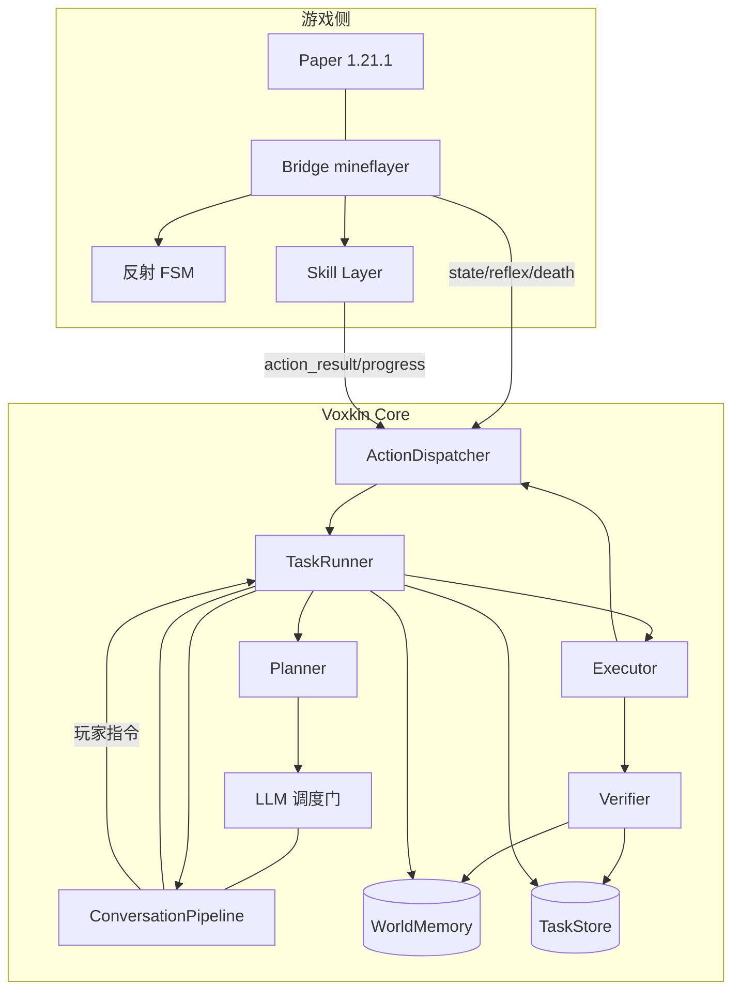

# 自治通关架构：沃心独立完成 Minecraft

设计稿，只读分析产出，未改生产代码。证据为 2026-10-21 工作区快照的 `文件:行号`，范围对应 `docs/MILESTONE.md:9-29`。

## 0. 结论

| 项 | 选择 | 依据 |
| --- | --- | --- |
| 任务模型 | HTN + 方法白名单，LLM 只做方法选择、参数绑定与失败重规划 | 通关顺序固定且分层，完成条件可机器判定（`src/voxkin/agent/progress.py:15-65`、`:82-83`） |
| 决策分层 | bridge 反射 100ms、TaskRunner 调度 1s、Planner 规划 30–120s | 真实 LLM 首 token p50 2594.7ms（`docs/BENCHMARK_RESULTS.md:86`） |
| 执行主体 | Core 的 TaskRunner；bridge 只执行一个 skill 并回报结构化证据 | 桥接动作串行，长任务没有 step 级取消（`bridge/minecraft_bridge.js:154-165`、`src/voxkin/agent/actions.py:71-88`） |
| 首个切片 | 空背包 → 木镐 → 石镐 → 熔炉 → 铁镐（S0–S3），零干预 | 现有动作只覆盖采集、移动与放置（`src/voxkin/agent/tools.py:5-192`） |

## 1. 现状与差距

| 能力 | 现状 | 证据 | 影响 |
| --- | --- | --- | --- |
| 阶段表 | S0–S6；`is_complete` 只比对背包；无运行路径导入 | `progress.py:15-65`、`:82-83`；`tests/test_progress.py:3` | 无前置条件、调度与恢复 |
| 动作集 | 12 个：采集、移动、放置、背包、攻击、拾取 | `src/voxkin/agent/tools.py:5-192`、`bridge/minecraft_bridge.js:188-266` | 无 craft、smelt、chest、sleep、portal、bow |
| 动作队列 | 单队列串行；attack_nearest、stop 插队并打断当前动作；统一 120s 超时 | `bridge/minecraft_bridge.js:66`、`:70`、`:144-165`；`src/voxkin/agent/actions.py:20` | 无 step 级取消与进度；探索类超时 |
| 状态帧 | 5s 一帧：位置、朝向、维度、时间、天气、血量、饥饿、玩家 | `bridge/minecraft_bridge.js:1027`、`:1106-1124` | 缺背包、耐久、脚下方块、死亡坐标 |
| 死亡 | `death` 事件停跟随与闲逛；重生由 mineflayer 默认完成 | `bridge/minecraft_bridge.js:1071-1077`、`node_modules/mineflayer/lib/loader.js:75` | 不回收掉落物、不恢复任务 |
| 反射 | 受击反击、低血后撤、进食、苦力怕避让 | `bridge/minecraft_bridge.js:616-659`、`:661-693` | 与任务无仲裁协议 |
| 记忆 | 只有对话记忆；播报走 `announce` | `src/voxkin/memory.py:66-97`、`src/voxkin/pipeline.py:273-284` | 无地点、箱子、探索覆盖 |

## 2. 总体架构

| 组件 | 职责 | 不负责 |
| --- | --- | --- |
| Core | 进程、配置、事件总线、语音回合 | 单步动作细节 |
| TaskRunner | 队列、抢占仲裁、检查点、恢复、阶段推进 | 生成计划内容 |
| Planner | 方法选择、参数绑定、失败重规划 | 逐 tick 控制 |
| Executor | 把 Step 变成 skill 调用，收集前后证据 | 判定成功与否 |
| Verifier | 规则判定、证据落库、失败分类 | 调用模型 |
| Skill Layer + Bridge | 可取消的游戏操作单元；mineflayer 连接、本地反射、状态上报 | 任务级决策 |
| Memory | 对话记忆、世界记忆、任务存储 | 参与实时控制 |



- 数据流：`observe` 拉取背包、方块、实体、区块 → Executor 调 skill → bridge 回报结果与进度 → 再 observe → Verifier 判定 → TaskRunner 写检查点并推进阶段；同一时刻只有一个 running step，语音通道不等待任务。
- 证据只认结构化 `observe` 与事件，`detail` 是中文可朗读文本（`bridge/minecraft_bridge.js:278-289`），不参与判定。

## 3. 任务模型

| 模型 | 表达力 | 运行时与持久化 | 重规划 | 结论 |
| --- | --- | --- | --- | --- |
| Goal tree | 目标分解强，顺序与效果弱 | 只需目标集合 | 重选子目标 | 适合配方依赖，单用缺顺序语义 |
| Behavior tree | 反应式控制强 | tick 状态难持久化 | 结构重组成本高 | 适合反射，不适合多小时任务 |
| HTN | 方法分层，前置与效果显式 | 任务网络可序列化 | 重选方法即可 | 采用 |
| 状态机 | 转移清晰 | 状态少易存 | 组合爆炸 | 只用于 bridge 反射（`bridge/minecraft_bridge.js:616-693`） |

- 选 HTN：S0–S6 是分层目标（`progress.py:15-65`），完成条件可判定（`progress.py:82-83`），能一一映射为方法；前置与效果交给 Verifier 检查，满足「每步可机器检查」（`docs/PROGRESSION_AGENT.md:92`）。
- LLM 输出被方法白名单约束，失败只重选未完成子任务，`docs/PROGRESSION_AGENT.md:17-19` 的规划/执行/验证分工保持不变。

| 结构 | 字段 |
| --- | --- |
| Task | `id`、`parent`、`method`、`goal(Predicate)`、`status`（pending/ready/running/done/failed/blocked）、`priority`、`attempts/max`、`deadline`、`checkpoint` |
| Step | `id`、`task_id`、`ordinal`、`skill`、`args`、`pre[]`、`post[]`、`verify`、`timeout_s`、`retry`、`on_failure`、`idem_key`、`restartable` |
| Predicate / Effect | `kind`（item/block/dim/pos/time/vitals/flag/entity）、`args`、`negate`；Effect 另含 `expected` |
| Retry / Replan | Retry：`max`、`backoff_s[]`、`mutators[]`（半径×2、换目标点、换工具）、`classes`（transient/permanent/unsafe）；Replan：`scope`（step/task/stage）、`budget`、`context_delta`、`trigger` |

## 4. 三个模型的契约

**Planner**：阶段入口、replan、阶段失败恢复时调用；≤1 次/2min、≤3 次/阶段、≤60 次/小时。输入：
```json
{"stage":"S3","goal":"iron_pickaxe>=1","inventory":{"raw_iron":5,"coal":3},"state":{"pos":[12,64,-3],"dim":"overworld","health":18,"food":17,"time":6000},"world":{"base":[10,64,0],"known":[{"kind":"furnace","pos":[11,64,1]}]},"skills":["craft","smelt","collect_blocks","goto"],"recent":[{"step":"smelt iron_ingot","ok":false,"reason":"no fuel"}],"budget":{"max_steps":5}}
```
**Planner 输出**：
```json
{"stage":"S3","reason":"缺燃料","steps":[{"skill":"collect_blocks","args":{"block":"coal_ore","count":8},"pre":[{"kind":"item","args":{"id":"wooden_pickaxe","n":1}}],"post":[{"kind":"item","args":{"id":"coal","n":8}}],"verify":"inv_delta","timeout_s":90,"on_failure":"replan"}],"fallbacks":["用木板烧铁"]}
```
- 校验与预算：JSON schema；`skill` 在 manifest；`post` 非空且规则已知；步数 ≤5；阶段不回退，非法时带错误重问 1 次，再失败用方法库默认展开；上下文 system ≤200 token、输入 ≤900、输出 ≤500，不注入完整对话历史（`docs/PROGRESSION_AGENT.md:93`）。

**Executor**：默认 scripted，方法库给出 skill 与 args；LLM 模式仅在 skill 返回 `needs_decision` 时启用（≤1 次 LLM、≤4 次工具调用、≤30s）。
```text
step = queue.next_ready()
if not verifier.pre_ok(step): return replan(step)
if step.restartable and verifier.post_ok(step): return done(step)
for attempt in 1..step.retry.max:
    e0 = observe(); dispatch(step.skill, step.args); e1 = observe()
    if verifier.check(step, e0, e1): return done(step, e1)
    if step.on_failure == "report": return report(step, e1)
    step.args = step.retry.mutate(step.args, attempt)
return replan(step)
```

**Verifier**：

| rule | 判定 | 证据来源 |
| --- | --- | --- |
| `inv_delta` / `item_present` | 前后差值或当前数量达标 | `observe.inventory` |
| `block_placed` / `block_gone` | 坐标方块等于目标 / 为空气 | `observe.blocks` |
| `dimension` / `position` | 维度等于目标 / 与目标距离 ≤ r | `state` |
| `entity_count` | 目标实体消失或击杀数达标 | 事件 + `observe.entities` |
| `container` / `flag` | 槽位含指定物品 / 世界记忆标记成立 | `observe.container`、WorldMemory |
| `survived` | 步骤期间无死亡、无关键掉落 | 事件流 |

```json
{"step_id":"s-S3-2","ts":1729500000.0,"rule":"inv_delta","subject":"iron_ingot","before":0,"after":3,"source":"observe","ok":true,"attempt":1}
```

失败关闭：缺证据视为未通过，`detail` 文本不参与，每次尝试都留证（`docs/PROGRESSION_AGENT.md:56-58`）。

**预算**：

| 项 | 值 | 理由 |
| --- | --- | --- |
| Planner 调用 | ≤3/阶段、≤60/小时 | 每次首 token ≥2.6s |
| Executor LLM | ≤1/step、≤40/小时 | 全程数百步 |
| 上下文 | Planner ≤1200 token、Executor ≤900 | 现有对话预算 900（`src/voxkin/config.py:111`） |
| 工具调用 | ≤4/step、并发 1 | 桥接串行（`bridge/minecraft_bridge.js:154-165`） |
| 重试与运行 | step 2（transient 3）、task 3、replan 3/阶段；12h 软上限 | 防无限重试，到点进安全态并报告 |

## 5. 世界记忆

地点类型：`base`、`bed`、`table`、`furnace`、`chest`、`portal`、`stronghold`、`village`、`spawner`、`waypoint`、`water`、`lava`、`death_spot`。存 `data/voxkin.db`，与对话记忆共用 WAL（`src/voxkin/memory.py:69-70`）：
```sql
CREATE TABLE places(id INTEGER PRIMARY KEY, run_id TEXT, kind TEXT, name TEXT, dim TEXT, x REAL, y REAL, z REAL, payload TEXT, confidence REAL, first_seen REAL, last_seen REAL, visits INTEGER, status TEXT);
CREATE UNIQUE INDEX ux_places ON places(run_id, dim, round(x), round(y), round(z), kind);
CREATE TABLE containers(id INTEGER PRIMARY KEY, place_id INTEGER, slots TEXT, updated_at REAL);
CREATE TABLE cells(id INTEGER PRIMARY KEY, run_id TEXT, dim TEXT, cx INTEGER, cz INTEGER, status TEXT, scanned_at REAL, note TEXT);
CREATE UNIQUE INDEX ux_cells ON cells(run_id, dim, cx, cz);
CREATE TABLE routes(id INTEGER PRIMARY KEY, run_id TEXT, src INTEGER, dst INTEGER, dim TEXT, waypoints TEXT, distance REAL, status TEXT);
CREATE TABLE dangers(id INTEGER PRIMARY KEY, run_id TEXT, kind TEXT, dim TEXT, x REAL, y REAL, z REAL, radius REAL, severity INTEGER, expires_at REAL);
```

- 查询优先：任何「找 X」先查 `places`/`containers`，半径内命中就复用，未命中才 `findBlocks`；bridge 只上报事实，Verifier 与 TaskRunner 写库。
- 覆盖栅格：主世界每 64×64 格一个 cell，扫描后写 `status=scanned`；下一探索点按「邻接未扫描 cell 数 / 距离」打分。
- 负结果与路线：搜索失败写 `cells.note`，60min 内不重复搜索；成功路径写 `routes`，连续 2 次失败标 `degraded`。
- 传送门与死亡点：`portal` 记录对端 place，坐标按 ×8 换算存 `payload`；`death_spot` 记坐标、维度、时间与背包摘要，回收决策据此做；Planner 只读摘要。

## 6. 恢复机制

| 故障 | 检测信号 | 阈值 | 恢复动作 | 升级 |
| --- | --- | --- | --- | --- |
| 死亡 | `death` 事件（`bridge/minecraft_bridge.js:1071-1077`）；health=0；y<−60 | 即时 | mineflayer 默认重生（`loader.js:75`）；写 death_spot；重生后重新 observe | 同点 10min 内 3 次死亡 → 划危险区、换路线、报告 |
| 卡住 | 位移 <0.3 格且 skill 运行中；pathfinder 无路径 | 3s | 跳 → 侧移 → 重算（canDig=false）→ 扩 searchRadius → 允许挖 → 换目标（`docs/research/PLAYER_LIKENESS.md:171`） | 同一目标 3 次 → 放弃并写 cell 阻塞 |
| 岩浆/火 | `inLava` 或脚下 lava/fire；血量连续下降 | 100ms 反射 | jump + 向最近固体移动；有水桶先放水；寻路已避开 lava（`bridge/minecraft_bridge.js:1000-1017`） | 4s 未脱困 → 撤离并报告 |
| 饥饿 | `state.food`（`bridge/minecraft_bridge.js:1114`） | 1s | ≤14 进食（`:690-692`）；≤6 停战；无食物 → 觅食任务插队 | food=0 且 5min 无食物 → 暂停危险任务并报告 |
| 夜晚 | `state.time` 13000–23000（`src/voxkin/world_state.py:47-63`） | 5s | 有床 → sleep；无床 → 三格掩体；夜里不开始远距离探索 | 连续两夜未解决 → 建临时庇护所 |
| 服务器重启 | bridge `end`（`bridge/minecraft_bridge.js:1081-1085`）；Core 收到断开（`src/voxkin/agent/actions.py:54-62`） | 即时 | 进 bridge_lost，保留 checkpoint；3/6/12/24s 退避重连；重连后 observe 再验证 | 10min 未恢复 → 报告并暂停 |
| 桥接断线 | pending action 抛「桥接已断开」（`actions.py:59-61`） | 即时 | 当前 step 标 unknown，不计 failed；不重放 consumable 步骤 | 同上 |
| 区块未加载 | `blockAt` 返回 null；observe 空缺；travelTo 已等区块（`bridge/minecraft_bridge.js:293-295`） | 5s | 等待 5s → 前进 8 格 → 重试 observe；未知方块不挖 | 同坐标 3 次 → 换入口或路线 |
| 背包满 | `used_slots ≥ 36` 或 `emptySlotCount=0` | 1s | 存入已知 chest；无 chest 按白名单丢弃（泥土、沙砾、超额圆石）；关键物品禁丢 | 腾不出 3 格 → 回基地并报告 |
| 工具损坏 | `held.remaining < 10%` 或物品消失 | 事件 + 1s | 换同级备用 → 升下一档 → 触发做工具任务 | 无材料无备用 → 回基地取并报告 |

## 7. 长任务执行

| 优先级 | 来源 | 例子 | 对任务的影响 |
| --- | --- | --- | --- |
| 0 | bridge 反射 | 岩浆、溺水、坠落、低血 | 取消当前 skill；step 标 interrupted |
| 1 | 玩家 | 对话、stop、follow | 立即暂停；stop 取消；玩家 30s 无新指令后恢复 |
| 2 | bridge 战斗/进食 | 夜间刷怪、food≤14 | 暂停 ≤60s；5min 内 >3 次 → 改走安全路线 |
| 3 | TaskRunner | 挖矿、合成、探索 | 正常执行 |
| 4 | 闲逛 | 空闲 | 仅无任务时（`bridge/minecraft_bridge.js:815-824`） |

- 仲裁点唯一：抢占先写 run_state（running/paused/preempted/blocked），再决定是否发 cancel。
- 语音打断不取消动作：`pipeline.interrupt` 只取消 `_active_tasks`（`src/voxkin/pipeline.py:136-139`），动作在 `_background_tasks`（`:201-206`）；玩家说停必须显式派发 stop。
- 暂停不打断 skill，等其返回或 cancel 生效（≤2s）；恢复先 observe 再重验最后 5 个 done step；检查点写 `{run_id, stage, task_id, step_ordinal, attempt, inventory_digest, last_evidence_id}`，`idem_key` 唯一索引，执行前 `post_ok` 则跳过，点门、交易、投眼、睡觉等 consumable 步骤必须先 verify。

| 现有机制 | 位置 | 冲突 | 配合方式 |
| --- | --- | --- | --- |
| 单队列串行 + 120s 超时 | `bridge/minecraft_bridge.js:154-165`；`src/voxkin/agent/actions.py:20` | 长 skill 独占，探索类必超时 | skill 硬上限 110s；per-tool timeout + 分段进度 |
| 优先动作插入 | `bridge/minecraft_bridge.js:70`、`:144-152` | 只覆盖 attack_nearest、stop | 扩为 cancel、stop、observe 三类 |
| 无取消令牌 | `bridge/minecraft_bridge.js:133-142` | 靠 interrupted 轮询 | 每个 skill 子循环检查 cancel token |
| 无进度事件 | `bridge/minecraft_bridge.js:278-289` | 无法检查点 | 新增 skill_progress（phase、pct、at） |

## 8. 终局流程

| # | 步骤 | 前置条件 | 所需技能 | 失败回退 | 完成判定 |
| --- | --- | --- | --- | --- | --- |
| 1 | 下界门并进入 | 10 obsidian、flint_and_steel、diamond_pickaxe、食物 ≥8 | craft、place_block、use_on_block、goto、portal_enter | 无黑曜石 → 岩浆浇铸；无打火石 → 铁+燧石；门被毁 → 重建 | 门激活且 dimension=the_nether |
| 2 | 找下界要塞 | 下界石砖方块 | explore、scan、break_block | 30min 未找到 → 回主世界换方向 | places 记录 fortress |
| 3 | 烈焰棒 ≥7 | 石剑以上、可选抗火 | attack_nearest(blaze)、pickup | 低血 → 撤退重进；刷怪笼旁建掩体 | 背包 blaze_rod ≥7（`progress.py:56`） |
| 4 | 末影珍珠 ≥16 | 铁剑、夜晚或诡异森林 | attack_nearest(enderman)、pickup | 不足 → 猪灵以物易物或延长猎杀 | 背包 ender_pearl ≥16 |
| 5 | 合成末影之眼 | 烈焰粉 + 珍珠 | craft | 粉不足 → 补烈焰棒 | eye_of_ender ≥12 |
| 6 | 定位要塞 | 12 眼、两点以上三角测量 | throw_eye、goto、dig_down | 眼碎 → 补眼；无信号 → 换点重测 | 找到 end_portal_frame |
| 7 | 激活末地门 | 12 眼、frame 有空位 | place_block、use_on | 眼不足 → 回第 5 步 | flag:end_portal_lit |
| 8 | 末地平台 | 落点 (100,49,0) | place_block、goto、bridge | 无方块 → 拆平台边缘 | 抵达主岛 |
| 9 | 摧毁水晶 | 弓 + 箭，或方块 + 剑 | shoot、build、attack | 无弓 → 攀柱近战 | 10 个 crystal 消失 |
| 10 | 击败末影龙 | 铁装、剑、食物、水桶 | attack_entity、retreat、place_block | 低血 → 掩体回血；龙息 → 离开 | 龙死亡 + 出口传送门出现 |

## 9. 安全边界

| 边界 | 检查点 | 违反时 |
| --- | --- | --- |
| 不作弊 | bridge 拒绝 `/` 开头聊天与任何命令包；无 give/setblock/tp 路径 | 拒绝并报告 |
| 不改规则 | 不调用 difficulty、gamerule | 拒绝 |
| 不破坏基地 | 基地 bbox 内 place/break 白名单；床、箱、熔炉、传送门为保护方块 | 阻止并换点 |
| 不丢关键物品 | keep 列表：钻石、下界合金、烈焰棒、珍珠、眼、附魔工具、盾 | 丢弃前拦截 |
| 不无限重试 | step/task/replan 三级上限 + 全局熔断 | 进安全态并报告 |
| 不越权 | 只操作已加载区块；不读种子、不接外部地图 | 拒绝 |

必须停下并向旁观者报告（不要求人操作）：连续 3 次阶段失败、同一步失败 5 次、同点 10min 内 3 次死亡、10min 无可用方法、安全规则拒绝所有选项、服务器踢出或封禁、LLM 不可用超过 10min。报告走 `announce` + Studio 事件 + `data/runs/<run_id>/report.json`；报告后进入安全活动（进食、回基地、躲藏），继续等待，不空转重试。

## 10. 模块布局

| 文件 | 动作 | 职责 | 复用 |
| --- | --- | --- | --- |
| `src/voxkin/agent/tasks.py`、`methods.py` | 新增 | Task/Step/Predicate/Retry 数据类；S0–S6 方法库与默认展开 | `progress.py:15-65` |
| `src/voxkin/agent/runner.py` | 新增 | 队列、仲裁、检查点、恢复 | `actions.py`、`pipeline.py` |
| `src/voxkin/agent/planner.py`、`verifier.py` | 新增 | 提示、JSON schema、校验、降级；规则表、证据格式 | `llm/base.py`、`events.py` |
| `src/voxkin/agent/world_memory.py`、`task_store.py` | 新增 | places/containers/cells/routes/dangers；tasks/steps/evidence/checkpoints | `memory.py:66-97` |
| `src/voxkin/agent/progress.py` | 修改 | 增加前置条件；拆分 S5/S6 子阶段 | 现有 STAGES |
| `src/voxkin/agent/tools.py`、`actions.py` | 修改 | 新工具 schema（craft、smelt、sleep、chest、portal、bow、observe、cancel）；cancel、observe、per-tool timeout | 现有 12 个工具、`dispatch` |
| `src/voxkin/server.py`、`runtime.py` | 修改 | `/api/run/*`、bridge 新消息类型；组装 TaskRunner 与两个 store | 现有 WebSocket、`create()` |
| `src/voxkin/pipeline.py`、`config.py`、`llm/openai_compat.py` | 修改 | 玩家指令 → runner.preempt；AutonomyConfig；单次调用覆盖 temperature/max_tokens | `announce`、dataclass、`stream_chat` |
| `bridge/minecraft_bridge.js` | 修改 | 分发到 skills、取消令牌、状态扩展 | 现有 switch |
| `bridge/skills/*.js`、`manifest.json` | 新增 | craft/smelt/chest/sleep/portal/combat/observe/build/shoot；技能清单与版本 | mineflayer 内置 API |

mineflayer 4.39 已内置 `bot.craft`/`recipesFor`（`bridge/node_modules/mineflayer/lib/plugins/craft.js:243-245`）、`openFurnace`（`furnace.js:120`）、`sleep`（`bed.js:192`）、`openContainer`（`chest.js:30-31`），技能层无需新增 npm 依赖（`docs/research/SKILL_CATALOG.md:248`）。

## 11. 最大风险

| # | 风险 | 可能性 | 影响 | 早期验证 |
| --- | --- | --- | --- | --- |
| 1 | 技能缺口使 S0 走不出去 | 高 | 致命 | 桥接冒烟：原木→木板→工作台→木镐，连跑 30 次 |
| 2 | 长任务与串行队列冲突 | 高 | 高 | 10min 挖矿中注入玩家 stop，测取消 ≤2s |
| 3 | Planner JSON 失效率高 | 中高 | 高 | 离线回放 50 个历史状态，统计 schema 通过率与可执行率 |
| 4 | 死亡丢失关键装备 | 中高 | 高 | 强制死亡 20 次，统计回收率与阶段回退 |
| 5 | 下界/末地寻路失败 | 高 | 高 | 门往返 5 次；要塞定位 3 次 |
| 6 | 观察数据不足导致误判 | 中 | 高 | 对照 observe 与游戏内实际背包、方块 |
| 7 | 反射与任务互相打断 | 中 | 中 | 夜间刷怪 + 挖矿 1h，统计抢占次数 |
| 8 | 长跑资源增长与单次 run 过长 | 中高 | 中 | 24h 合成轨迹压测 DB 与日志；S0–S3 计时后外推 |

验证顺序：按 1→2→3→4→5 设置门禁，任一项未通过不进入下一阶段；S0–S3 纵向切片零干预跑通是进入 S4–S6 的唯一前置。
