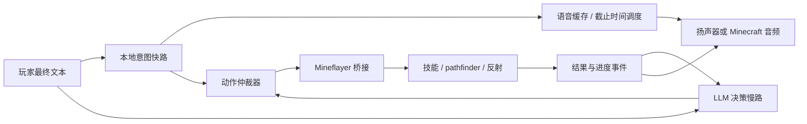
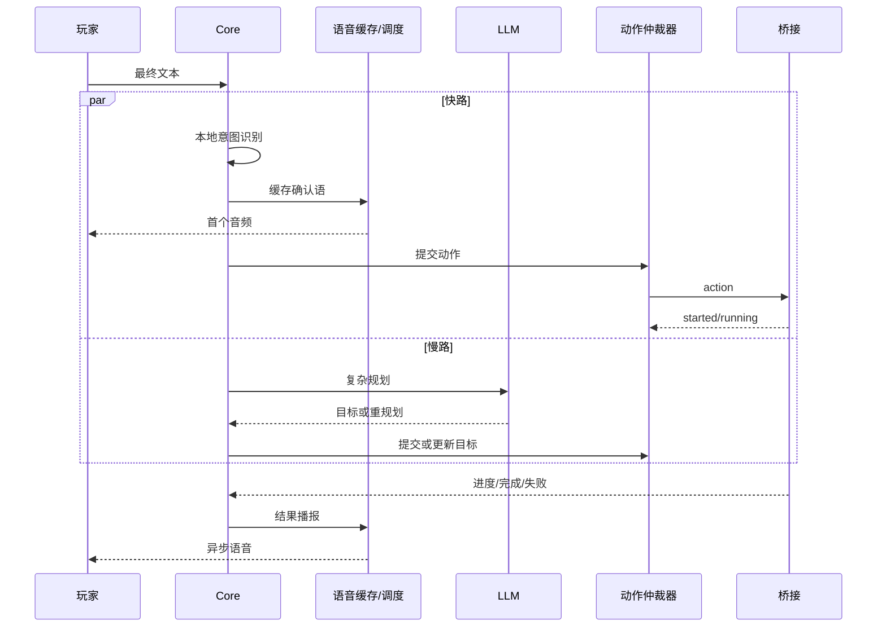

# 实时语音与动作并行计划

状态：阶段 0、阶段 1 与阶段 2 的最小闭环已实施；阶段 3 起未实施
更新时间：2026-10-22 23:40
适用对象：任何接手 Voxkin 的代码 Agent、评审者和后续维护者
基线：`develop`，提交 `11c83c8` 加当前未提交工作区

> 给接手者的一句话：这份计划不是要求“让 TTS 更快”，而是把首音从 LLM 和 TTS 的冷启动路径上拿下来，让动作在本地立即开始。挖泥土只是验收样本，不是专用分支。

## 当前实施状态（2026-10-22 晚）

已落地并有测试覆盖的部分：

| 阶段 | 状态 | 落地位置 |
| --- | --- | --- |
| 阶段 0 指标与契约 | 已完成 | `src/voxkin/events.py`（新增观测点与 `FULL_TURN_MARKS`）、`src/voxkin/pipeline.py`（逐点打标）、`scripts/latency_scenarios.py`（六个合成场景） |
| 阶段 1 语音缓存 | 已完成 | `src/voxkin/voice/phrase_catalog.py`、`src/voxkin/voice/cache.py`、`scripts/build_voice_cache.py`、配置项 `voice_cache` |
| 阶段 2 快路与并行 | 最小闭环已完成 | `src/voxkin/intent.py`（`IntentPlan`）、`src/voxkin/pipeline.py`（`_run_fast_path`）、配置项 `fast_path` |
| 阶段 3 仲裁与取消 | 未实施 | 桥接仍用旧的动作队列与 `interruptCurrent` |

本轮新增的观测点：`t_cmd_final`、`t_intent_done`、`t_ack_ready`、`t_audio_start`、`t_action_submit`、`t_action_start`。旧的 `t0`–`t8` 全部保留，`t6_playback_start` 与 `t_audio_start`、`t7_action_start` 与 `t_action_start` 共享同一时间戳。

已经能断言的事实：

- 缓存命中时确认语不调用 `TTSAdapter.synthesize()`，动作与确认语并行提交。
- 缓存缺失时确认语走动态合成，并受 `voice_cache.ack_deadline_ms` 约束；超时记 `deadline_exceeded`，合成失败记 `tts_unavailable`，不伪造成功。
- 同一回合里模型返回与快路相同的调用时只执行一次，重复项记 `deduped_actions`。
- 能力询问（「你会挖泥土吗」）不触发动作；「别挖了」判为停止。

还没有的事实：真实 TTS 与真实扬声器下的首音延迟、缓存命中的真实收益。这两项在 [../BENCHMARK_RESULTS.md](../BENCHMARK_RESULTS.md) 的未测量项里，不要当成已完成。

## 0. 30 秒摘要（先读这里）

1. 当前链路已经能让语音与动作在工具调用后并行，但“第一个音”仍要等 LLM 首 token、首个可朗读句子和 TTS 首块。
2. 真实模型基准里首次可听从 `3134.9 ms` 到 `4434.9 ms`；本地测试 LLM 为 `964 ms`。动作开始时间在真实模型下约 `3489 ms`，在本地模型下约 `151 ms`，说明主要成本在远程决策，不在 Mineflayer。
3. 目标是把玩家说完后的反馈拆成三条并行路径：

```text
语音快路：最终文本 -> 本地意图 -> 预合成确认语 -> 音频输出
决策慢路：最终文本 -> LLM -> 复杂目标、解释、失败重规划
执行快路：本地意图或 LLM 目标 -> 动作仲裁器 -> Mineflayer 技能
```

4. “硬保证首音”只能来自预合成缓存加截止时间兜底；动态 TTS 只能优化首块，不能承诺网络、GPU、排队都稳定时仍在固定上限内。
5. 第一件要写的不是缓存，而是**指标和契约**：先让每个阶段都有可重复的时间戳，再改行为。当前没有“玩家说完 -> 本地意图 -> 缓存首音 -> 动作提交”的完整证据链。
6. 第一组最小闭环是：高频意图目录、缓存读取、截止时间兜底、动作并行提交、语音/动作取消分离。它必须对所有技能生效，不能只对 `collect_blocks` 生效。

## 1. 文档定位

本文解决的是 Voxkin 的实时体验底座，不替代以下文档：

| 文档 | 负责内容 |
| --- | --- |
| `docs/ARCHITECTURE.md` | 现有组件、数据流、时序和故障恢复 |
| `docs/MILESTONE.md` | 独立通关的最终验收 |
| `docs/plans/INDEPENDENT_RUN_ROADMAP.md` | S0–S6 的任务阶段 |
| `docs/plans/AUTONOMOUS_RUN_ARCHITECTURE.md` | 自主循环、检查点与恢复 |
| `docs/plans/EVALUATION.md` | 阶段评测方法 |
| `docs/research/MINDCRAFT_SKILL_MAP.md` | MindCraft 技能分解与 Voxkin 对照 |
| `docs/research/AUTONOMY_MODES.md` | 本地反射、优先级和验收场景 |
| `docs/BENCHMARK_RESULTS.md` | 所有已测量的数字和复现命令 |

本文只提出**目标架构、接口边界、阶段任务和验收条件**。没有在本文件里宣称任何优化已经完成；是否完成以代码、测试和 `docs/BENCHMARK_RESULTS.md` 的真实记录为准。

## 2. 目标与非目标

### 2.1 目标

- 玩家说完后，常用命令的确认语在本地缓存命中时快速起播。
- 动作派发不等待确认语播放完成，语音播放也不等待长动作完成。
- 保留 Mineflayer 的本地感知、寻路、采集、战斗和技能清单，不把逐 tick 控制搬到云端 LLM。
- 让全部技能共享同一套首音、动作提交、优先级、取消和结果回报机制。
- 用可重复的 p50/p95 数据判断优化是否有效，而不是凭演示观感。
- 在 TTS 服务不可用、缓存缺失、桥接断开时如实降级，不伪造成功。

### 2.2 非目标

- 不在本计划中替换 GPT-SoVITS、训练新音色或引入新的 TTS 引擎。
- 不重写 Mineflayer，也不把整个 MindCraft 项目复制进来。
- 不承诺“任意动态文本、任意网络状况下固定 100 ms 首音”；动态路径只做上限目标和超时兜底。
- 不让两个会修改世界的技能同时运行。寻路、挖掘、放置、合成等物理动作仍要保持单一写入者。
- 不为了某个技能写专用快速分支。新增技能通过意图目录、技能清单和仲裁器自动接入。
- 不在没有真实服务器或真实 TTS 证据时，把目标值写进 README 的“已实现”栏。

## 3. 指标口径

### 3.1 时间点

现有 `src/voxkin/events.py` 已有 `t0_speech_end` 到 `t8_action_done` 的时间线。实施时**保留已有名字**，补充或派生下列观测点，避免破坏现有 Studio 和测试：

| 名称 | 含义 | 起点建议 |
| --- | --- | --- |
| `t_cmd_final` | 最终文本确定 | STT 最终结果或桥接 chat 到达 |
| `t_intent_done` | 本地规则意图完成 | 规则分类返回 |
| `t_ack_ready` | 确认语音频可交给输出 | 缓存命中或 TTS 首块到齐 |
| `t_audio_start` | 音频第一次真正写入输出 | `AudioSink` 播放开始回调 |
| `t_action_submit` | 动作消息已发给桥接 | `ActionDispatcher.dispatch_result` 发帧前 |
| `t_action_start` | 桥接开始执行 | `action_result` 之前的状态/日志，未实现前可用 `action_started` 事件估算 |
| `t_stop_sent` | 停止/取消请求发出 | Core 或桥接收到 stop |
| `t_stop_done` | 当前移动/挖掘已停 | 桥接停止 pathfinder、挖掘和控制状态 |
| `t_action_done` | 动作有了可验证结果 | 现有 `t8_action_done` 或结构化结果 |

### 3.2 关键定义

- **首音延迟**：`t_audio_start - t_cmd_final`。如果音频文件开头有静音，缓存构建阶段必须裁掉或记录静音长度；不能用“WAV 文件创建时间”冒充首音。
- **缓存命中**：同一 voice、规范化文本、采样率和音频格式的缓存存在且校验通过，播放路径没有调用 TTS。
- **动态路径**：没有缓存命中，必须调用 TTS；只报告真实首块和首次可听，不把完整 WAV 生成时间当成首块时间。
- **动作延迟**：`t_action_submit - t_cmd_final`，以及 `t_action_start - t_cmd_final`。二者分开记录，避免把桥接排队的等待算成网络延迟。
- **停止延迟**：`t_stop_done - t_stop_sent`。停止必须能中断寻路、挖掘和控制状态，不是仅仅清空待执行队列。
- **冷启动**：TTS 或桥接进程刚启动后的第一次请求。**预热**：模型、HTTP 连接和音频输出已初始化后的请求。两者分开统计。
- **硬保证**：在截止时间到达时，动态音频没有准备好就播放缓存兜底；不允许无限等待。硬保证不是“动态 TTS 永不超时”。

### 3.3 目标预算

以下是实施目标，不是当前已实现数据。所有数字都要在真实服务上复测后才能进入 README 状态栏。

| 指标 | 目标 | 说明 |
| --- | --- | --- |
| 缓存确认语首音 p95 | `<= 250 ms` | 从最终文本到音频输出开始，包含本地意图和输出设备 |
| 动态 TTS 首次可听 p95 | `<= 1200 ms` | 预热、短首句、本机 GPU；作为硬上限，不承诺远程网络 |
| 动态 TTS 首块 p95 | 先做到 `<= 800 ms`，再冲 `<= 500 ms` | 与 `docs/ROADMAP.md` 的 P0 目标对齐；按 12 字以内首句测量 |
| 已知意图动作提交 p95 | `<= 50 ms` | 桥接已连接，不含实际寻路和动作执行 |
| stop 到停止移动/挖掘 p95 | `<= 200 ms` | 桥接本地处理 |
| stop 到结构化 `cancelled` 结果 p95 | `<= 1000 ms` | Core 不能只能等到超时 |
| 本地安全反射 p95 | `<= 300 ms` | 受击、苦力怕、岩浆、溺水等，不经过 LLM |
| 动作开始受语音阻塞的时间 | `0 ms` | 语音可在播放，动作已提交；不能串行等待 |

目标预算分为“缓存路径”和“动态路径”。把两者混在一起报告会让首音数据失真。

## 4. 当前资产与代码事实

### 4.1 已有能力

| 区域 | 现状 | 关键位置 |
| --- | --- | --- |
| 对话管线 | LLM 流式文本、增量分句、TTS 队列、打断、动作后台任务 | `src/voxkin/pipeline.py` |
| 文本分句 | 按终止标点分句，超过上限才找软停顿 | `src/voxkin/text.py` |
| TTS | GPT-SoVITS `streaming_mode=true`，WAV 头解析和 PCM 流 | `src/voxkin/tts/gpt_sovits.py` |
| 意图规则 | 9 类高置信度规则：停止、跟随、过来、攻击、威胁、进食、睡觉、背包、观察 | `src/voxkin/intent.py` |
| 意图接入 | 当前只在桥接 chat 到达时用 `is_stop` 停止自主任务 | `src/voxkin/server.py:316` |
| 动作派发 | 技能清单校验、超时、结构化结果、桥接回包 | `src/voxkin/agent/actions.py` |
| 技能清单 | 57 个技能，21 个桥接内建加 36 个模块技能，带 `intent_examples` | `bridge/skills/manifest.json` |
| 桥接执行 | Mineflayer、pathfinder、采集、合成、战斗、环境反射 | `bridge/minecraft_bridge.js` |
| 技能模块 | 独立 ESM 模块，通过 `ctx` 复用桥接能力 | `bridge/skills/*.js`、`docs/plans/SKILL_MODULE_CONTRACT.md` |
| 音频输出 | 扬声器、WAV 目录、Minecraft 文件、WebSocket PCM | `src/voxkin/audio/sinks.py`、`src/voxkin/audio/websocket.py` |
| 测试 | 202 个 Python 测试通过（2026-10-22 复跑） | `pytest tests -q`；见 `docs/STATUS.md` |

### 4.2 现有语音链路的具体阻塞

- `src/voxkin/pipeline.py:189` 先向 LLM 发起流式请求，首 token 决定首句出现时间。
- `src/voxkin/pipeline.py:209` 只有收到 tool call 才创建动作后台任务；本地规则即使识别出“挖泥土”，也不会立即派发。
- `src/voxkin/pipeline.py:357` 的 `_run_action` 在动作开始时才生成确认语；确认语仍然进入 TTS，而不是缓存播放。
- `src/voxkin/pipeline.py:133` 的 `interrupt()` 取消当前 LLM/TTS 活动任务并清空播放，但后台动作不在 `_active_tasks` 中；语音打断和任务取消没有统一契约。
- `src/voxkin/tts/gpt_sovits.py` 内部有串行锁；同一时刻只有一个合成会话，TTS 服务繁忙时动态路径没有独立的缓存兜底。
- `src/voxkin/audio/sinks.py:202` 的 `MinecraftFileSink.play()` 会按时长等待下一次允许写入；它会阻塞 TTS worker 的下一句生产，而不是把“生成”和“输出”彻底解耦。

### 4.3 现有桥接与 MindCraft 的差距

- `bridge/minecraft_bridge.js:237` 的 `pumpActions()` 串行执行动作，这对物理世界是正确约束，但当前只有 `attack_nearest` 和 `stop` 属于优先级动作。
- `bridge/minecraft_bridge.js:2488` 的 `survivalTick()` 在 `actionBusy` 时直接返回；长时间采集期间，普通生存扫描无法工作。
- `bridge/minecraft_bridge.js:2353` 的 `escapeEnvironment()` 在 `actionBusy` 时也直接返回。
- 受击事件 `onDamaged()` 可以触发 `defendAgainst()`，但可能与当前动作并行操作 pathfinder；需要统一抢占令牌，而不是依赖零散布尔量。
- 结果返回已经支持 `accepted/running/succeeded/partial/failed/cancelled/disconnected/blocked`，但 Core 没有用 `action_id` 做主动取消；桥接的当前动作也没有统一 `currentActionId`。

### 4.4 可用的 TTS 与试听资产

- 运行包：`work/gpt_sovits_full/GPTheresaV3.2/GPT-SoVITS-v2pro-20250604`
- 参考音频：`models/reference/xiaote.wav`
- 参考文本：见 `config/voxkin.yaml` 的 `tts.reference_text`
- 模型服务地址：`http://127.0.0.1:9880`
- 探索性试听：`work/voice_samples/`，含 4 条 32 kHz 单声道 16 bit WAV 和 `samples.json`
- 这些文件在 `work/` 下，默认不提交，也不能当作仓库正式资产。缓存构建脚本必须能从配置和参考音频重新生成它们。

### 4.5 工作区约束

当前工作区在 `develop`，`HEAD` 为 `11c83c8`，带多项未提交改动。后续 Agent 必须遵守：

- 不执行 `git reset --hard` 或 `git clean -fd`。
- 不覆盖用户已有改动，先读 `git diff` 和 `git status --short`。
- 不把 `work/`、`models/`、日志、语音缓存或密钥提交。
- 一次提交只做一个目的；本计划先写文档，不混入行为代码。

## 5. 问题拆解

### 5.1 首音等待链

当前真实链路近似为：

```text
玩家说完
  -> STT 最终文本
  -> LLM 首 token
  -> 首个可朗读句子
  -> TTS 首块
  -> 音频输出开始
```

这里每一段都可能成为上限：网络和模型决定前两段，TTS 排队决定后两段。把 TTS 的 0.5 秒优化到 0.3 秒，仍然无法阻止 LLM 偶发 3 秒。

### 5.2 动作等待链

当前动作只有在 LLM 发出 tool call 后才开始。对常见命令来说，这是不必要的高层往返；对复杂任务，LLM 仍然应该参与规划。因此需要把“已知意图的本地派发”和“未知/复杂目标的模型规划”分开。

### 5.3 执行与语音的耦合

确认语、结果播报和动作状态目前都走同一个 `announce()` 与句子队列。动作开始可能先等确认语进入队列，动作完成播报又可能和下一轮语音竞争。需要把“语音请求”和“动作请求”建模成两个独立的可取消对象，并使用同一个 `turn_id/action_id` 关联。

### 5.4 打断语义不清

玩家说“别说了”和“停下”不是同一件事：

- “别说了”：停止当前音频和 LLM 流，不应停止正在挖矿的动作。
- “停下/取消”：停止音频，同时停止当前动作和排队动作。
- 新命令：如果与当前动作互斥，抢占旧动作；旧动作的完成结果不得污染新回合。

### 5.5 本地反射被长动作压住

MindCraft 的快来自本地行为和反射循环，而不是单次 LLM 调用更快。Voxkin 已有 Mineflayer 和技能，但长动作期间 `survivalTick` 被跳过，且多个布尔忙碌标志可能竞争。应该保留“一个物理动作写入者”，但让安全反射拥有抢占权。

## 6. 目标架构

### 6.1 三条通道



- **快路**只做高置信度、低歧义的意图；不能把所有自然语言都塞进正则。
- **慢路**负责目标分解、复杂条件、失败重规划和自然语言解释；它不阻塞快路已确定的动作。
- **执行路**保留本地技能和反射；Core 只下发目标和参数，不下发逐 tick 控制。

### 6.2 目标时序



### 6.3 不可破坏的约束

- 在同一时刻，会改变世界的动作只能有一个；排队可以是多个，但执行必须串行。
- 安全反射优先级高于玩家任务和自主任务；反射不经过 LLM。
- 首音缓存命中不调用 LLM 和 TTS；动态路径必须有超时兜底。
- 旧动作的完成事件必须带 `action_id` 和 `turn_id`；新回合不得消费旧动作结果。
- 语音取消和动作取消是两种独立操作，API 必须显式区分。
- 任何优化都必须通过两个以上不相关技能验证，防止只修“挖泥土”。

## 7. 建议组件与接口

以下文件名为建议，落地时可按现有结构微调；接口语义必须保留。所有新增类型先写测试，再接入 `pipeline.py`。

### 7.1 新增：`src/voxkin/voice/phrase_catalog.py`

职责：定义通用短语目录，不生成音频。

建议字段：

```text
phrase_id       稳定标识，例如 ack.collect_blocks
intent_id       对应 intent 或 skill
priority        0=停止/安全，1=接令，2=进度，3=结果，4=闲聊
variants        同义措辞列表
required_slots  需要填入的参数，例如 block/count
fallback        TTS 不可用或缓存缺失时的最短句
```

短语目录从 `bridge/skills/manifest.json` 的 `intent_examples` 和 `src/voxkin/intent.py` 派生，禁止在管线里写 `if "挖泥土"`。

### 7.2 新增：`src/voxkin/voice/cache.py`

职责：缓存构建、加载、校验、预加载和播放决策。

建议接口：

```python
class SpeechCache:
    async def load(self, root: Path, voice_id: str) -> None: ...
    def lookup(self, key: str) -> SpeechClip | None: ...
    async def put(self, key: str, text: str, chunks: Iterable[np.ndarray]) -> SpeechClip: ...
    def describe(self) -> dict: ...
```

`SpeechClip` 至少包含：`key`、`text`、`pcm`（`np.int16`）、`sample_rate`、`sha256`、`duration_s`、`lead_silence_ms`、`voice_id`。缓存文件格式建议为 WAV + sidecar JSON；运行时加载后转成 `int16` 数组，避免播放时解码。

缓存根目录建议为 `work/voice_cache/<voice_id>/`，不提交仓库。缓存内容必须记录生成时的参考音频哈希、参考文本、TTS 引擎、采样率和文本；任一不匹配就视为 miss。

### 7.3 修改：`src/voxkin/intent.py`

保留现有高置信度规则，并扩展为结构化结果。建议新增字段而不是立即改掉现有字段，降低回归风险：

```python
@dataclass(frozen=True)
class IntentPlan:
    intent_id: str
    skill_id: str
    arguments: dict[str, Any]
    confidence: float
    ack_key: str
    source: str  # "rule" | "llm"
    dedupe_key: str
```

首批应覆盖的意图：停止、跟随、过来、攻击、进食、睡觉、背包、观察、采集、前往、掉落物拾取。复杂目标（例如“先做木镐再去挖石头”）仍交给 LLM。规则不能确定时就返回 `None`，不要强行猜测。

### 7.4 新增：`src/voxkin/agent/arbiter.py`

职责：接收动作请求、去重、排优先级、调用 `ActionDispatcher`、暴露取消入口。物理动作单写入者由它保证。

建议接口：

```python
class ActionArbiter:
    async def submit(self, ticket: ActionTicket) -> ActionResult: ...
    async def cancel(self, action_id: str, reason: str) -> None: ...
    def status(self) -> dict: ...
```

`ActionTicket` 至少包含：`action_id`、`skill_id`、`arguments`、`priority`、`cancellable`、`preemptible`、`turn_id`、`origin`、`deadline_s`。

### 7.5 修改：`src/voxkin/pipeline.py`

建议把一次回合拆成四个可独立取消的任务：

1. `fast_path`：意图识别、确认语缓存、动作提交。
2. `llm_path`：仅处理未知或复杂请求，或在快路动作后补充自然语言。
3. `speech_path`：缓存播放、动态 TTS、句子预取和输出队列。
4. `action_events`：动作进度、失败、完成和取消的关联。

`respond()` 不应因为 `fast_path` 成功就跳过整个 LLM；它应允许 LLM 并行工作，后续文本作为补充，而不是阻塞动作。

### 7.6 修改：`src/voxkin/agent/actions.py` 与 `src/voxkin/bridge/protocol.py`

- 增加 `ActionDispatcher.cancel(action_id, reason)`。
- 增加桥接消息 `action_cancel`，字段至少包含 `action_id`、`reason`、`turn_id`。
- 增加 `action_progress`，让长动作能把进度送到 Studio 和语音层；不是每个技能都必须实现，但不能伪造。
- 现有七档状态不删除，不重命名；`accepted/running` 的来源要补齐。

### 7.7 修改：`bridge/minecraft_bridge.js`

- 为当前动作保存 `currentActionId`，取消时按 id 匹配，避免旧取消误伤新动作。
- 将 `interruptCurrent` 改成统一的 `interruptAction(reason, action_id)`，统一停止 pathfinder、挖掘、控制状态和战斗。
- 保持 `actionQueue` 串行执行会修改世界的动作。
- 把 `PRIORITY_ACTIONS` 从硬编码两个动作扩展为优先级表，来源使用技能清单的 `type`、`cancellable` 和本地安全分类。
- 本地反射 tick 不应被 `actionBusy` 完全挡住；安全反射可设置取消令牌并请求仲裁器抢占。

## 8. 优先级与取消语义

### 8.1 建议优先级

| 优先级 | 类别 | 例子 | 执行位置 | 是否可抢占 |
| --- | --- | --- | --- | --- |
| 0 | 立即生存 | 岩浆、溺水、坠落、苦力怕贴脸、低血 | 桥接本地 | 抢占全部 |
| 1 | 显式停止 | “停下”“取消当前”“别动了” | 桥接 + Core | 抢占语音和动作 |
| 2 | 玩家当前指令 | “挖三块泥土”“跟我来” | Core + 桥接 | 抢占自主任务 |
| 3 | 当前任务步骤 | S0 采集木头、合成木镐 | 仲裁器 | 可被 0/1/2 抢占 |
| 4 | 自主行为 | 闲逛、拾取掉落物、观察 | 桥接/Core | 可被 0/1/2 抢占 |
| 5 | 闲聊与报告 | 叙述、总结、完成播报 | 语音层 | 不抢占动作 |

数值越小优先级越高。`safety` 和 `stop` 是本地路径，不等待模型。

### 8.2 取消矩阵

| 玩家表达 | 停止语音 | 停止当前动作 | 清空动作队列 | 说明 |
| --- | --- | --- | --- | --- |
| “别说了” / 语音打断 | 是 | 否 | 否 | 只影响说话 |
| “停下” / “站住” | 是 | 是 | 是 | 当前动作必须返回 `cancelled` |
| 新互斥指令 | 是（旧回合） | 视优先级 | 旧任务取消 | 旧结果不得写入新回合 |
| 桥接断开 | 是 | 是 | 是 | 返回 `disconnected`，不伪造成功 |
| 服务器关闭 | 是 | 是 | 是 | 保留 checkpoint，不宣告任务完成 |

### 8.3 去重与竞态

- 快路已提交的动作，如果 LLM 稍后返回相同 `skill_id + arguments`，必须在同一回合内去重。
- 去重键建议为 `skill_id + normalized_arguments + turn_id`；不同回合不能误判为重复。
- 旧动作的 `action_result` 必须按 `action_id` 路由；如果 `turn_id` 已过期，只记录事件，不播报给新回合。
- 任何取消都递增本地取消纪元；异步技能必须检查取消纪元，不能只依赖 `interrupted` 全局布尔值。

## 9. 分阶段实施

每个阶段都必须有独立的测试和可回滚点。未通过当前阶段验收，不进入下一阶段；不要把阶段 0 的测量和阶段 5 的反射混在一次大改里。

### 阶段 0：指标、契约与基线

**目标**：先能准确看见延迟，再改行为。

任务：

- 在 `src/voxkin/events.py` 增加本文 3.1 节的时间点，保留旧时间线。
- 在 `src/voxkin/pipeline.py` 记录 `t_cmd_final`、`t_intent_done`、`t_ack_ready`、`t_audio_start`、`t_action_submit`、`t_action_start`。
- 增加一个可重复的合成场景脚本，覆盖“缓存未命中、缓存命中、动作成功、动作失败、停止、TTS 不可用”六种情况（路径可先放 `scripts/` 或 `work/`，不能把临时脚本冒充正式入口）。
- 在 `tests/test_events.py`、`tests/test_pipeline.py` 加确定性测试替身，验证时间标记，不依赖真实模型。
- 把当前 `202 passed` 作为基线写入本文或状态记录；不要改动业务行为。

验收：

- 现有测试全绿，新增指标测试通过。
- 一次合成回合能导出完整时间线，缺失字段会明确失败。
- 真实模型、真实 TTS、真实服务器分别有独立记录；没有测量时写“未测量”。

### 阶段 1：通用语音缓存

**目标**：把高频确认语从动态 TTS 路径搬到可验证缓存。

任务：

- 新增短语目录和缓存模块；从 manifest 的 `intent_examples`、`src/voxkin/intent.py` 和技能清单生成候选短语。
- 新增 `scripts/build_voice_cache.py`，通过配置的 TTS 适配器生成缓存、裁剪首尾静音、写 sidecar 元数据。
- 启动时异步加载缓存；Studio 展示缓存版本、voice、命中数和 miss 数。
- `pipeline` 增加 `speak_cached` 与截止时间兜底；缓存 miss 时才调用动态 TTS。
- TTS 不可用时，已缓存确认语仍应能播放，动态部分如实降级。
- 缓存根目录使用 `work/voice_cache/`，默认不提交；测试使用 `tests/support.py` 的确定性替身，不依赖真实模型。

验收：

- 至少 20 条通用短语可缓存；“停止/攻击/采集/跟随/过来/进食/睡觉/观察/背包”各至少有 1 条。
- 命中缓存时不调用 `TTSAdapter.synthesize()`；用测试替身可以断言调用次数为 0。
- 缓存损坏、哈希不匹配、voice 不匹配时自动 miss，并记录原因。
- 第一次可听延迟在测试 sink 上达到目标；真实扬声器/真实 TTS 的结论必须在 `docs/BENCHMARK_RESULTS.md` 单独记录。

### 阶段 2：快速意图与并行派发

**目标**：常见指令不等待云端模型，动作与首音同时开始；未知/复杂请求保持原路径。

任务：

- 扩展现有规则意图，输出 `IntentPlan`，覆盖低歧义命令和参数；高置信度阈值建议：会修改世界的动作 `>= 0.9`，只读查询 `>= 0.75`。
- 参数解析复用 manifest 的 `parameters` 和共享词表；不要在 Python 管线写一套与桥接不一致的中文映射。
- `pipeline.respond()` 先跑快路：命中则提交动作、播放缓存确认语；同时启动可选的 LLM 补充路径。
- 快路和 LLM 路径共享 `turn_id` 与去重表；LLM 重复 tool call 不得重复执行。
- 未命中/低置信度时播放通用兜底确认语（若配置允许），然后走原 LLM 路径；不能把“我会挖泥土”误判成实际动作。
- 复杂目标（建造、长链任务、带条件请求）必须走 LLM；规则只处理明确命令。

验收：

- 至少用 `collect_blocks`、`follow_player`、`stop`、`eat` 四个互不相关技能验证，不允许只测挖泥土。
- 已知意图的动作提交 p95 达到目标；语音与动作时间线重叠。
- LLM 随后返回同义 tool call 时只执行一次。
- 未知语句仍产生正常 LLM 回合，不误执行动作。
- “你会挖矿吗”这类能力询问不能被当成动作。

### 阶段 3：动作仲裁、停止与取消

**目标**：停止请求有明确回执，长动作可被安全抢占，旧结果不污染新回合。

任务：

- 新增动作仲裁器，管理优先级、排队、当前动作、取消纪元和结果路由。
- `ActionDispatcher` 增加按 `action_id` 取消；协议增加 `action_cancel` 和必要的 `action_progress`。
- 桥接保存 `currentActionId`，按 id 停止 pathfinder、挖掘、控制状态和战斗；旧动作返回 `cancelled`，不能返回成功。
- 区分语音打断和动作取消：`pipeline.interrupt()` 默认只处理语音；`stop` 意图显式取消动作。
- 如果 LLM 正在规划时玩家发出 stop，仲裁器必须让旧规划失效；新回合不消费旧 tool call。

验收：

- 10 分钟长采集中注入 stop，桥接在目标时间内停止并返回 `cancelled`。
- 语音打断后动作继续；动作完成后不把结果播报进已被取代的回合。
- 两个互斥动作不会并行修改世界；排队动作可用 stop 清空。
- 停止回执和超时是两条可区分的结果，不允许只有“等到超时”。

### 阶段 4：TTS 首句、预取与输出解耦

**目标**：动态文本也尽量快；缓存和 TTS 都不被阻塞式输出拖住。

任务：

- 为 `SentenceSplitter` 增加首句策略：首句在逗号/软停顿处可切，首句建议 6–12 字；后续句子仍可到现有 30 字上限。
- 保持 GPT-SoVITS HTTP 连接常驻；TTS worker 在当前音频播放时预取下一条句子的音频。
- 把 `MinecraftFileSink.play()` 的时长等待移出 TTS worker：使用独立的输出 writer 和有界队列，队列溢出时优先丢旧的非确认音频。
- 对扬声器 sink 保持非阻塞队列；对 WebSocket sink 保持 turn_id/flush 语义。
- 动态 TTS 失败时可播放同音色缓存兜底；不得合成“已完成”假话。

验收：

- 12 字以内首句的 TTS 首块 p95 先达到 800 ms，再评估 500 ms 目标。
- 播放第一句时已开始预取第二句；句间无可观测的重复停等。
- `MinecraftFileSink` 不阻塞下一句合成；音频顺序和打断行为保持。

### 阶段 5：本地反射与 MindCraft 对齐

**目标**：长动作期间也能本地避险和反击，且不与当前动作抢 pathfinder。

任务：

- 在桥接增加统一的 100 ms `reflexTick` 或事件驱动反射层；不经过 LLM，不阻塞 WebSocket。
- 统一处理受击、低血、苦力怕、岩浆/火/溺水、饥饿；安全反射请求仲裁器抢占当前动作。
- 让 `survivalTick` 的“动作忙时直接 return”改为“写抢占请求”，由仲裁器决定是否中断。
- 保留一个物理动作写入者；反射抢占时先停止 pathfinder、挖掘和控制状态，再启动反射动作。
- 参考 `docs/research/AUTONOMY_MODES.md` 的验收场景 1–10，至少实现受击、苦力怕、低血、岩浆、饥饿五类。

验收：

- 受击到反击/后撤 p95 <= 300 ms；苦力怕贴脸 500 ms 内后撤；低血 2 秒内停止任务。
- 没有 LLM 请求参与安全反射。
- 长采集期间注入怪物，反射能抢占；抢占后旧任务状态为 `cancelled` 或 `partial`，不伪称完成。
- 反射不会破坏背包、方块或已放置结构。

### 阶段 6：端到端基准与发布

**目标**：把目标数字变成可复核事实，再决定是否默认开启。

任务：

- 运行冷启动/预热各至少 5 轮，真实模型、真实 TTS、真实 Paper 服务器分开记录。
- 覆盖缓存命中、缓存 miss、TTS 不可用、桥接断开、旧结果、stop、长动作、低血、苦力怕。
- 把结果写入 `docs/BENCHMARK_RESULTS.md`，注明命令、设备、冷/热、样本数和失败数。
- 用配置开关逐步启用：先 `voice.fast_ack`，再 `actions.cancel_on_stop`，再 `bridge.reflex_preempt`；每步有回滚。
- 更新 README 的现状表时只引用已测数据；目标值放在“计划”文档，不放在“已完成”栏。

验收：

- 202 个以上 Python 测试通过；桥接新增测试通过；真实服务器回归通过。
- 至少 20 个不同自然语言命令，覆盖 4 个以上技能，缓存命中率和误触发率有记录。
- 没有重复动作、没有旧结果串台、没有停止后继续寻路或挖掘。
- 用户确认体验后，才可以把目标预算下降为 README 的现状指标。

## 10. 验收矩阵

| 场景 | 期望 | 测试层 | 目标 |
| --- | --- | --- | --- |
| “挖三块泥土”缓存命中 | 确认语先响，动作同时提交 | 管线 + fake sink | 首音 p95 <= 250 ms |
| 陌生复杂请求 | 走 LLM，不误动作 | 管线 + fake LLM | 行为不退化 |
| LLM 返回与快路相同 tool call | 只执行一次 | 管线 | 无重复副作用 |
| TTS 不可用 | 缓存确认语仍可播放，动态部分降级 | 管线 + fake TTS | 不伪造成功 |
| 缓存文件损坏 | 自动 miss 并记录 | 缓存单测 | 不播放坏音频 |
| stop 注入长采集 | 停止移动/挖掘并返回 cancelled | 桥接集成 | <= 200 ms 移动停止，<= 1 s 回执 |
| “别说了” | 只停语音，动作继续 | 管线 + 桥接 | 动作不被取消 |
| 新互斥命令 | 旧动作取消，旧结果不串台 | 管线 + fake bridge | 无旧结果污染 |
| 受击/苦力怕 | 本地反射，不调用 LLM | 桥接 + mock bot | <= 300/500 ms |
| 岩浆/溺水 | 安全反射抢占 | 桥接 + mock bot | <= 300/500 ms |
| 桥接断开 | 动作返回 disconnected，任务可续跑 | Core + fake bridge | 不伪造成功 |
| 1 小时长跑 | 内存、日志、队列稳定 | 压力测试 | 无无限增长 |

## 11. 测试与证据规则

- 单元测试可以使用 `tests/support.py` 的确定性替身；缓存命中与动作竞态必须用替身断言，不能依赖真实模型。
- 真实 TTS、真实扬声器和真实服务器证据必须写入 `docs/BENCHMARK_RESULTS.md`，并注明冷启动/预热、样本数、设备与失败数。
- 合成音频只能证明输出链路，不证明语义正确；关键短语要做识别回读或人工试听。
- 不以“文件已生成”代替“内容正确”；不以“测试通过”代替“真实服务器验收”。
- 新增行为先加测试，再加配置开关；失败时默认退回旧路径。
- 文档中的目标值必须标“目标”，实测值必须标“实测”；两者不能混写。

## 12. 风险与反过拟合规则

| 风险 | 早期信号 | 应对 |
| --- | --- | --- |
| 规则意图误触发 | “你会挖矿吗”执行了动作 | 置信度阈值、疑问句/能力询问排除、未知走 LLM |
| 缓存与音色不一致 | 首音和后续句子明显换声 | voice_id、参考音频哈希、引擎版本写入缓存键 |
| 缓存占满磁盘/内存 | 启动变慢、加载失败 | 只缓存高频短语；容量上限和 LRU；启动异步加载 |
| 输出 sink 阻塞 TTS | 句间长停顿、TTS worker 空转 | 独立 writer、有界队列、优先级丢弃 |
| LLM 与快路重复动作 | 挖两次、放两次 | `dedupe_key`、同回合去重表、动作票据 |
| 取消误伤新动作 | stop 后新动作被旧取消标记停掉 | `action_id`/纪元匹配，禁止全局布尔值 |
| 反射抢 pathfinder | 动作抖动、走一半回头 | 单一物理写入者、取消确认后再启动反射 |
| 只为某个技能优化 | 只有挖泥土快，其他仍慢 | 每个阶段至少两个互不相关技能验收 |

## 13. 立即执行的下一步

按顺序执行，不要跳到阶段 4：

1. **阶段 0**：补时间线与合成基线测试；确认 `202 passed` 在改动后仍然成立。
2. **阶段 1**：先写短语目录和缓存格式，不接行为；用 fake TTS 验证命中、miss、损坏和降级。
3. **阶段 2**：从现有 `intent.py` 扩展一个结构化 `IntentPlan`，先接 `stop`、`follow_player`、`collect_blocks`、`eat` 四个技能。
4. **阶段 3**：再接动作仲裁与 `action_cancel`；在此之前不要删除旧的 `announce()` 路径，保留可回滚开关。
5. **阶段 5**：最后改桥接反射，因为它的竞态风险最高；先有 Core 侧指标和取消契约。

本轮交付的下一步不是继续生成语音，而是：**把阶段 0 的时间线和阶段 1 的缓存契约写成代码与测试**。如果时间有限，优先完成“缓存命中 + 截止时间兜底 + 动作并行提交”，这三件事决定首音是否真的不再依赖 LLM。

## 14. 参考

- [现有架构](../ARCHITECTURE.md)
- [基准结果](../BENCHMARK_RESULTS.md)
- [当前状态](../STATUS.md)
- [路线图](../ROADMAP.md)
- [技能总表](../SKILLS.md)
- [技能模块契约](SKILL_MODULE_CONTRACT.md)
- [自主行为与反射](../research/AUTONOMY_MODES.md)
- [MindCraft 技能映射](../research/MINDCRAFT_SKILL_MAP.md)
