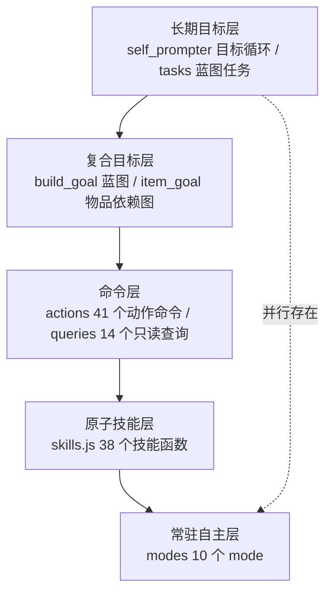

# MindCraft 技能分解映射（Voxkin 视角）

## 0. 文档范围与证据约定

- 本文回答一个问题：MindCraft 的哪些做法可以支撑 Voxkin 的技能分解与全链路通透性。
- MindCraft 侧的全部行号转录自下列四份审计文档，审计对象为 `work/reference/mindcraft`，HEAD `f6a9556`（`docs/research/MINDCRAFT_AUDIT.md` 第 0 节）。本文不新增 MindCraft 源码行号、函数名或文件内容；审计文档未记录的内容一律标注「审计文档未覆盖」。
- 引用格式：`文件:行号` 相对 MindCraft 仓库根目录；Voxkin 侧相对本仓库根目录。证据位置写「文档名 + 小节名」。
- Voxkin 侧行号取 2026-10-22 工作区快照。`src/voxkin/bridge/protocol.py`、`src/voxkin/agent/actions.py`、`src/voxkin/agent/runner.py`、`src/voxkin/agent/run_manager.py`、`src/voxkin/runtime.py` 当前带未提交改动，本文按改动后的内容描述。
- 许可与上游维护的判断沿用 `docs/research/MINDCRAFT_REUSE.md` 第 6 节，本文不新增许可结论。
- `bridge/skills/manifest.js`（912 行，21 个技能）与 `bridge/skills/manifest.json` 已经存在，`scripts/dump_manifest.js` 负责校验并导出 JSON，`src/voxkin/agent/skills.py` 负责读清单并生成 tool schema。`bridge/skills/index.js` 尚未存在，`src/voxkin/agent/tools.py` 仍手写自己的 schema 列表。本文按 2026-10-22 工作区快照描述这两类现状。

## 1. 结论

### 1.1 能拿过来的

1. **技能清单与注册表**：MindCraft 把 41 个动作命令与 14 个查询命令合并成一份清单，再由清单装配执行入口与提示词里的命令文档（`docs/research/MINDCRAFT_AUDIT.md` 第 5 节；`docs/research/MINDCRAFT_REUSE.md` 第 2 节）。Voxkin 已经按这个思路写下 `bridge/skills/manifest.js`，`scripts/dump_manifest.js` 校验后导出 `bridge/skills/manifest.json`，`src/voxkin/agent/skills.py:71` 的 `tool_schemas` 能从清单生成 function schema。剩下的是 dispatch 注册表与 `src/voxkin/agent/tools.py:5` 的接入。
2. **技能级依赖与缺料查询**：MindCraft 有物品依赖图与获取顺序（`src/agent/npc/item_goal.js:148-174,295-354`），也有缺料清单与可合成项查询（`src/agent/commands/queries.js:270`、`src/agent/library/world.js:285`）。Voxkin 的 `src/voxkin/agent/progress.py` 只到阶段级的 `requires`/`produces`，技能级的消耗与产出没有任何地方声明。
3. **动作生命周期**：互斥单槽、协作式停止与超时、目标循环的失败上限，这三块都有明确实现（`docs/research/MINDCRAFT_AUDIT.md` 第 6.2、6.3、7 节）。Voxkin 的 `ActionDispatcher` 有超时和状态词表，没有抢占取消的入口。

### 1.2 不拿过来的

1. **整条 agent 回合循环与 `speak` 整段 TTS**：MindCraft 的管线以完整字符串为唯一数据形态，完整回复才进入 TTS（`docs/research/MINDCRAFT_AUDIT.md` 第 9 节；`docs/research/MINDCRAFT_REUSE.md` 第 7 节）。Voxkin 的语音链路按流式文本加分句 TTS 工作，搬进来会破坏首句合成时机。
2. **`!cmd(args)` 正则命令入口**：Voxkin 走 function calling，正则解析同一段文本只会增加歧义（`docs/research/MINDCRAFT_REUSE.md` 第 7 节；`docs/research/SKILL_CATALOG.md` 第 4 节末条）。
3. **`skills.js` 整包复制**：38 个技能函数与 5 个 mineflayer 插件、`bot.modes`、`bot.output` 深度耦合，桥接侧依赖版本也不同（`docs/research/MINDCRAFT_REUSE.md` 第 0、2、9 节）。

## 2. MindCraft 技能分解方式与 Voxkin 的对应关系

### 2.1 三层分解在 MindCraft 里的样子

MindCraft 的五层之间靠字符串传递：命令层用 `!cmd(args)` 文本识别（`src/agent/commands/index.js:29,97-174`），结果以 `Command output: ...` 的 system 消息写回 history（`src/agent/agent.js:367-368`），复合层用 `agent.actions.runAction` 调用下层（`docs/research/MINDCRAFT_REUSE.md` 第 2 节 `item_goal.js` 行）。每一层的输出都是文本，没有结构化的类型、依赖或状态字段。

### 2.2 对照表

| MindCraft 概念 | Voxkin 落点 | 差距 |
| --- | --- | --- |
| 原子技能：`skills.js` 的 38 个技能函数（`docs/research/SKILL_CATALOG.md` 第 1 节） | 清单字段 `skill_id`、`group`、`type`、`description`、`parameters`、`timeout_s`、`cancellable`、`verifies`（`bridge/skills/manifest.js:6-8`；`group` 对应基础类、实用类、专精类三层，`bridge/skills/README.md:9-13`；`type` 对应 sense、act、path、wait、voice、plan 六种，`:17-24`）；Core 侧 `src/voxkin/agent/skills.py:71` 的 `tool_schemas` 生成 function schema | 清单字段名与 `bridge/skills/README.md:100` 的七项约定不一致（README 写「名字、参数、是否可打断」，实现用 `skill_id`、`parameters`、`cancellable`）；清单没有 `deps`，也没有 `produces` 与 `consumes` 两项物品依赖；`bridge/minecraft_bridge.js:280-386` 的 21 个 `case` 与清单并存，dispatch 仍靠 switch；`src/voxkin/agent/tools.py:5` 仍手写 20 条 schema，没有改用 `skills.py` |
| 命令包装：`actions.js` 的 41 个 `!` 动作命令，每条带 name、description、perform（`docs/research/MINDCRAFT_AUDIT.md` 第 5 节；`docs/research/MINDCRAFT_REUSE.md` 第 2 节） | 清单字段 `skill_id`、`description` 与 `intent_examples`（`bridge/skills/manifest.js:6-10`）；Core 侧 `src/voxkin/agent/skills.py:71` 生成的 description | MindCraft 的命令条目自带执行函数，Voxkin 的清单条目只描述行为，执行函数仍在 `bridge/minecraft_bridge.js` 的 switch 里；`intent_examples` 与 `execution_steps` 两组文案尚未进入提示词 |
| 只读查询：`queries.js` 的 14 个查询（`docs/research/MINDCRAFT_REUSE.md` 第 2 节；`docs/research/MINDCRAFT_AUDIT.md` 第 5 节） | 清单字段 `type: sense`（`bridge/skills/manifest.js:7`；六种取值见 `bridge/skills/README.md:17-24`）；Core 侧 `observe`、`locate_block`、`locate_entity`、`inventory` 四个技能；bridge 侧 `bridge/minecraft_bridge.js:314,359,362,307` | MindCraft 的查询与动作共用一份命令注册；Voxkin 的清单已带 `group` 与 `type`，但 `src/voxkin/agent/tools.py:5` 仍把全部技能平铺成一个列表，上层按类型筛选要自己读清单 |
| 复合目标：`build_goal.js:20-78`、`item_goal.js:148-174,295-354`、`controller.js:41-79`（`docs/research/MINDCRAFT_REUSE.md` 第 2 节） | 清单字段 `type: plan`；Core 侧 `src/voxkin/agent/plans.py:48` 的 `PLANS` 与 `src/voxkin/agent/runner.py:18` 的 `StepSpec`；bridge 侧由 plan 类技能自行编排其它技能 | 清单里 21 个技能的类型分布是 sense 4、act 8、path 6、wait 2、voice 1，没有 plan，也没有专精类；`plans.py` 只有 `S0` 一个键；`StepSpec` 不声明技能类型、依赖与产出 |
| 长期目标循环：`self_prompter.js:56-87,89-102`（`docs/research/MINDCRAFT_REUSE.md` 第 2 节） | Core 侧 `src/voxkin/agent/progress.py:16` 的 `STAGES`（S0-S6，含 goals、requires、produces、event）、`src/voxkin/agent/tasks.py:33` 的 `TaskStore`（tasks、steps、events、checkpoints 四表）、`src/voxkin/agent/runner.py:88` 的 `TaskRunner` | MindCraft 的目标是自然语言字符串加固定 prompt 模板；Voxkin 的阶段是结构化对象，但阶段到步骤的展开仍写死在 `plans.py`；`runner.py:89-92` 的类注释写明 Planner 暂由调用方给出 StepSpec 列表，LLM 规划器尚未接入 |
| 任务制：`tasks/construction_tasks.js:73-160`、`tasks/tasks.js:234-302`（`docs/research/MINDCRAFT_REUSE.md` 第 2 节） | Core 侧 `TaskStore` 的 steps 表与 checkpoints 表（`src/voxkin/agent/tasks.py:45-74`） | MindCraft 的任务带蓝图校验、分层检查与任务超时；Voxkin 的 `TaskStore` 只存步骤文本与结果，没有分层结构与任务级超时，预算由 `StepSpec.timeout_s` 单步承担 |
| 自主行为 mode：`modes.js` 的 10 个 mode，字段 `on`/`active`/`paused`/`update`，列表顺序即优先级（`docs/research/AUTONOMY_MODES.md` 第 1 节） | bridge 侧本地反射与空闲自主；Core 侧只下发目标级指令（`docs/research/AUTONOMY_MODES.md` 第 6 节） | MindCraft 的 mode 用 `interrupts` 字段声明可打断范围；Voxkin 侧尚无 mode 清单与 interrupts 声明，该项在 `docs/research/AUTONOMY_MODES.md` 第 8 节列为未确认 |
| 动作互斥与超时：`action_manager.js:4,26-37,87-90,168-175`（`docs/research/MINDCRAFT_AUDIT.md` 第 6.2、6.3 节） | bridge 侧 `bridge/minecraft_bridge.js:145` 的 `actionBusy`、`:141` 的 `interrupted`、`:256` 的 `timeoutMs`；Core 侧 `src/voxkin/agent/actions.py:21` 的 `ActionDispatcher`、`src/voxkin/agent/runner.py:18` 的 `retries` 与 `timeout_s` | MindCraft 的 `ActionManager.stop()` 是 10 秒轮询后强杀的协作式停止；`ActionDispatcher` 只有 dispatch，没有 cancel（`docs/research/AUTONOMY_MODES.md` 第 6 节） |
| 动作结果回填：`Command output: ...` 的 system 消息（`src/agent/agent.js:367-368`） | Core 侧 `src/voxkin/bridge/protocol.py:7` 的 `ACTION_STATUSES` 七档状态、`:40` 的 `ActionResult`（ok、detail、status、skill_id、data）；`src/voxkin/agent/actions.py:81` 的 `dispatch_result`；`src/voxkin/agent/runner.py:67` 的 `classify` 与 `:142` 的 `_verify_with_wait` | 状态词表只在 Python 侧定义；bridge 侧 `reply()`（`bridge/minecraft_bridge.js:399`）只回 `action_id`、`ok`、`detail`，没有 `status`、`skill_id`、`data`，Python 侧靠 `from_message` 的兜底分支补齐；`skill_id` 目前只是 `tool` 的副本；清单里每个技能的 `verifies` 与 `failure_conditions` 还没有接到 `src/voxkin/agent/runner.py:27` 的 `Verifier` 上，判定规则仍是 `StepSpec.verify` 里手写的 always、inventory、position、dimension、health、food 六类 |
| 世界状态读取：`full_state.js:12-108`、`world.js:118-160,262-309`（`docs/research/MINDCRAFT_REUSE.md` 第 2 节） | bridge 侧 `bridge/minecraft_bridge.js:2508` 的 `sendState()`；Core 侧 `src/voxkin/agent/actions.py:41` 的 `update_state` 与 `:45` 的 `state_snapshot(max_age_s=30)` | MindCraft 的状态对象覆盖位置、装备、附近实体与模式摘要；Voxkin 的 state 帧缺少装备槽与手持分项；`state_snapshot` 超过 30 秒直接返回空字典，判定层区分不出「没有状态」和「状态过期」 |
| 中断标志：`bot.interrupt_code`（`docs/research/MINDCRAFT_AUDIT.md` 第 7 节） | bridge 侧 `bridge/minecraft_bridge.js:141` 的 `interrupted`；Core 侧 `src/voxkin/bridge/protocol.py:17` 的 `SUCCESS_STATUSES` 与 `src/voxkin/agent/actions.py:10` 的 `ActionError.status` | MindCraft 的中断由回合内的 `stop()` 触发，等 10 秒再强杀进程；Voxkin 的 bridge 在超时时自行置 `interrupted` 并停寻路，没有对外的取消通道，`cancelled` 只能由 bridge 主动回报 |
| 记忆地点：`memory_bank.js:6-12`（`docs/research/MINDCRAFT_REUSE.md` 第 2 节） | `bridge/skills/README.md:112` 把 `waypoint_save` 与 `waypoint_goto` 规划在 tasks.js 模块，清单里还没有这两个技能；Core 侧 `src/voxkin/agent/tasks.py` 的 SQLite 存储 | MindCraft 的 memory_bank 是 25 行的 JSON 文件存取，`docs/research/MINDCRAFT_REUSE.md` 第 2 节判定可直接 require；Voxkin 尚无 waypoint 技能，也没有跨重启的坐标存储表 |
| 提示词占位符：`prompter.js:137-204` 的 profile 模板与 `$STATS`、`$SELF_PROMPT` 注入（`docs/research/MINDCRAFT_REUSE.md` 第 2 节 `prompter.js` 行） | Core 侧 `src/voxkin/memory.py` 的上下文构建与预算裁剪 | MindCraft 把模板、状态、记忆、指令文档统一注入同一段 system prompt；Voxkin 按预算分段裁剪，没有统一的模板占位符机制 |

## 3. 可以直接迁移的机制

### 3.1 技能清单与注册表

- **机制是什么**：把技能定义收敛到一份声明式清单，清单同时驱动执行分发与上层可见的接口描述，避免同一个技能在执行层与调用层各写一份。
- **MindCraft 怎么做的**：`src/agent/commands/index.js:7-11` 合并 `actionsList` 与 `queryList`，每条命令带 name、description、perform；`getCommandDocs`（`:246-257`）从同一份清单生成注入提示词的文档。
- **证据位置**：`docs/research/MINDCRAFT_AUDIT.md` 第 5 节；`docs/research/MINDCRAFT_REUSE.md` 第 2 节 `commands/index.js` 行。
- **改哪些文件**：`bridge/skills/manifest.js` 与 `scripts/dump_manifest.js` 已经存在且带完整字段校验（`scripts/dump_manifest.js:67`），`src/voxkin/agent/skills.py:28` 读清单并校验必填字段。要补的是 `bridge/skills/index.js` 的 dispatch 注册表、`src/voxkin/agent/tools.py:5` 改为引用 `src/voxkin/agent/skills.py:71` 的 `tool_schemas`、`bridge/minecraft_bridge.js:280` 的 switch 改为查表，以及清单字段名与 `bridge/skills/README.md:100` 的七项约定统一。
- **验收方法**：新增一个技能只改清单一处，`bridge/minecraft_bridge.js` 的 `case` 数量不变；Python 与 JS 两端的工具名集合相等；`docs/plans/INDEPENDENT_RUN_ROADMAP.md` 第 5 节 M2 第 1 项要求「旧工具行为不变」，第 3 节要求每次提交跑 manifest schema 校验，两条都要通过。

### 3.2 技能级依赖声明与缺料查询

- **机制是什么**：每个技能声明消耗什么、产出什么，并提供「还缺什么」的查询接口，让上层能算出可执行的下一步。
- **MindCraft 怎么做的**：`src/agent/library/world.js:262` 汇总背包数量，`:285` 列出当前材料能做的物品，`src/agent/commands/queries.js:270` 输出目标物品的缺料清单。
- **证据位置**：`docs/research/SKILL_CATALOG.md` 第 1 节「合成 / 熔炼」与「背包 / 箱子」两组；`docs/research/MINDCRAFT_REUSE.md` 第 5 节 craft 行。
- **改哪些文件**：`bridge/skills/manifest.js` 增加 `produces` 与 `consumes` 字段，并同步 `scripts/dump_manifest.js:11` 的必填字段表；新建 `bridge/skills/craft.js` 实现缺料计算；清单里补 `craftable` 与 `craft_plan` 两个 sense 技能；`src/voxkin/agent/progress.py` 的 `Stage.requires` 复用同一份物品依赖。
- **验收方法**：背包有 2 个 oak_log 时，`craft_plan wooden_pickaxe` 返回还缺 2 个 oak_log；`craftable` 返回木棍与工作台；材料不足时 `craft` 直接返回缺口数量，并且不放置工作台。

### 3.3 物品依赖图与步骤展开

- **机制是什么**：给定目标物品，展开成「先获取前置物品、再合成目标」的有序步骤序列，每一步都能单独执行与判定。
- **MindCraft 怎么做的**：`src/agent/npc/item_goal.js:148-174,295-354` 的物品依赖图与获取顺序，`src/agent/npc/controller.js:41-79` 的目标编排。
- **证据位置**：`docs/research/MINDCRAFT_REUSE.md` 第 2 节 `item_goal.js` 行，结论是「只仿照设计（依赖图算法可移植）」。
- **改哪些文件**：`src/voxkin/agent/plans.py` 增加由 manifest 的 `produces`/`consumes` 构建依赖图并展开步骤的函数；`src/voxkin/agent/progress.py` 的 `STAGES` 改为引用同一份依赖，避免阶段表与依赖图两处手写。
- **验收方法**：以 `wooden_pickaxe` 为目标展开出的步骤序列里，`craft crafting_table` 排在 `craft wooden_pickaxe` 之前，每个中间产物都有对应步骤；序列里没有目标不需要的分支。

### 3.4 工作台与熔炉的自动放置与回收

- **机制是什么**：合成需要 3x3 工作台时自动放置、用完回收；熔炉同理，并按燃料热值估算用量。
- **MindCraft 怎么做的**：`src/agent/library/skills.js:36-115` 的 `craftRecipe`，工作台放置与回收在 `:56-83`；`:142-273` 的 `smeltItem`，燃料换算在 `:204-226`。
- **证据位置**：`docs/research/SKILL_CATALOG.md` 第 1 节「合成 / 熔炼」组；`docs/research/MINDCRAFT_REUSE.md` 第 5 节 craft 行（同时提醒删掉 `bot.armorManager.equipAll()`）。
- **改哪些文件**：新建 `bridge/skills/craft.js`；`bridge/minecraft_bridge.js:368` 的 `craft` 分支与 `:371` 的 `smelt` 分支改为调用技能模块。
- **验收方法**：背包 4 个 oak_log 合成 crafting_table 成功后，crafting_table 回到背包；合成 wooden_pickaxe 成功后工作台回到背包，背包里只剩预期产物；熔炉烧 3 个 raw_iron 产出 3 个 iron_ingot 且熔炉清空。

### 3.5 动作互斥、停止与抢占

- **机制是什么**：同一时间只允许一个命令执行；抢占时先请求停止，最多等固定秒数，仍不停就强制结束当前动作。
- **MindCraft 怎么做的**：`src/agent/action_manager.js:4` 的 `executing` 单槽，`:26-37` 的 stop 10 秒轮询与强杀，`:87-90` 的执行前抢占，`:168-175` 的分钟级超时。
- **证据位置**：`docs/research/MINDCRAFT_AUDIT.md` 第 6.2 节串行化与互斥点表、第 6.3 节回合内阻塞点、第 7 节任务取消与中断。
- **改哪些文件**：`bridge/minecraft_bridge.js` 把 `actionBusy` 标志（`:145`）换成由注册表派生的占用表，并接受 Core 下发的取消消息；`src/voxkin/agent/actions.py` 增加 `cancel(action_id)`。
- **验收方法**：下发 `follow_player` 后立即下发 `stop`，1 秒内 bridge 停住寻路并回报 `cancelled`；两个并发动作请求里第二个必须等待或被拒绝，不得同时改世界。`docs/research/AUTONOMY_MODES.md` 第 6 节已指出 `ActionDispatcher` 缺 cancel，这是该条的前置缺口。

### 3.6 目标循环的失败上限与阶段预算

- **机制是什么**：自主目标循环连续若干次没有产出有效动作就停止；玩家下发动作时立刻让位；整个阶段另有时间预算。
- **MindCraft 怎么做的**：`src/agent/self_prompter.js:63-78` 连续 3 次没有 `!command` 就停止，`:139-145` 玩家命令触发 stopLoop，`:89-106` 空闲后重启；`src/agent/modes.js:306-309` 在 mode 执行前先 stopLoop。
- **证据位置**：`docs/research/MINDCRAFT_REUSE.md` 第 2 节 self_prompter 行，结论是「只仿照设计（空闲重启与失败上限）」；`docs/research/AUTONOMY_MODES.md` 第 3.1 节。
- **改哪些文件**：`src/voxkin/agent/runner.py:157` 的 `TaskRunner.run` 增加「连续无进展次数」预算与阶段级时间预算；`src/voxkin/agent/tasks.py:198` 的 `log_event` 记录预算消耗。
- **验收方法**：同一步骤连续 3 次判定失败后任务进入 `blocked` 并写 checkpoint，不继续消耗后续步骤；`docs/plans/INDEPENDENT_RUN_ROADMAP.md` 第 4.2 节的「10 分钟无进展则暂停并记录」可作为阶段级预算的验收口径。

### 3.7 自主行为的优先级仲裁与 interrupts 声明

- **机制是什么**：常驻行为按固定优先级排序，每个行为显式声明能打断哪些当前动作；不产生动作的行为不占仲裁位。
- **MindCraft 怎么做的**：`src/agent/modes.js:13-24` 定义 mode 字段与列表顺序即优先级，`:403-409` 的仲裁规则取首个 active 的 mode，`:310-315` 动作结束后复位 active，`:361-379` 的 unPauseAll 恢复暂停项。
- **证据位置**：`docs/research/AUTONOMY_MODES.md` 第 1 节 mode 清单表与仲裁说明、第 4 节 Voxkin 优先级表（写明 MindCraft 的顺序可作对照、不照搬）。
- **改哪些文件**：bridge 侧新增反射与自主清单文件，与 `bridge/skills/manifest.js` 同源；`src/voxkin/agent/tools.py` 增加下发目标级指令的入口，Core 只下发目标与参数。
- **验收方法**：12 格外的 hostile 只警戒不交战，进入 6 格且距玩家 4 格内才交战（`docs/research/AUTONOMY_MODES.md` 第 7 节场景 6）；被反射打断的动作不残留 pause 状态（同文档第 1 节末段）。

### 3.8 蓝图逐格建造与缺料统计

- **机制是什么**：按蓝图逐格放置，放置前统计材料缺口，完成后报告已放块数与剩余缺口。
- **MindCraft 怎么做的**：`src/agent/npc/build_goal.js:20-78` 按 y 层逐格放置，`src/agent/npc/controller.js:174` 的 `BuildGoal.executeNext` 汇总结果。
- **证据位置**：`docs/research/SKILL_CATALOG.md` 第 1 节「建造 / 放置」组（detail 示例「摆了 12 块，缺 8 个 oak_planks」）与第 4 节（蓝图只有 4 个内置 JSON，无外部导入与完工校验）；`docs/research/MINDCRAFT_REUSE.md` 第 2 节 build_goal 行、第 5 节 place/build 行。
- **改哪些文件**：新建 `bridge/skills/build.js`；`src/voxkin/agent/tools.py` 增加 `build_blueprint`；蓝图格式需要 Voxkin 自定义，MindCraft 的格式不通用。
- **验收方法**：给一张 42 格的墙蓝图与 24 个 oak_planks，detail 报「摆了 18 块，缺 24 个 oak_planks」；缺料时先返回缺口数量再放置，不出现悬空块。

### 3.9 记忆地点存取

- **机制是什么**：给坐标命名并持久化，之后按名字取回。
- **MindCraft 怎么做的**：`src/agent/memory_bank.js:6-12`，25 行实现，无 npm 依赖。
- **证据位置**：`docs/research/MINDCRAFT_REUSE.md` 第 2 节 memory_bank 行，结论是「直接 require（25 行）」。
- **改哪些文件**：`bridge/skills/manifest.js` 声明 `waypoint_save` 与 `waypoint_goto`；`src/voxkin/agent/tasks.py` 增加坐标存储表，或新建 `src/voxkin/agent/waypoints.py`。
- **验收方法**：存点后重启 Core，名字仍能解析到原坐标；目标跨维度或距原坐标超过 32 格时，`waypoint_goto` 返回失败原因。

## 4. 不建议迁移的部分与原因

| 机制 | 原因 | 证据位置 |
| --- | --- | --- |
| 整条 agent 回合循环 | MindCraft 的回合以完整字符串为唯一数据形态，完整回复才进入 `routeResponse` 与 `speak`，首句合成被拖到整段生成之后；Voxkin 的语音链路按流式文本与分句 TTS 工作 | `docs/research/MINDCRAFT_AUDIT.md` 第 9 节；`docs/research/MINDCRAFT_REUSE.md` 第 7 节 |
| `speak` 整段 TTS 与 `speak.isSpeaking`、`speakingQueue` | Voxkin 的 `src/voxkin/pipeline.py` 已有分句 TTS 队列，再实现一套播放串行化会重复 | `docs/research/MINDCRAFT_REUSE.md` 第 7 节；`docs/research/MINDCRAFT_AUDIT.md` 第 6.2 节 |
| `!cmd(args)` 正则入口、`containsCommand`、`parseCommandMessage` | Voxkin 走 function calling，多一层文本解析只会增加歧义 | `docs/research/MINDCRAFT_REUSE.md` 第 7 节；`docs/research/SKILL_CATALOG.md` 第 4 节末条 |
| `!newAction` 代码生成（LLM 写 JS 并执行） | 需要 sandbox 边界，MindCraft 依赖 `allow_insecure_coding` 开关与 `lockdown.js`；Voxkin 的技能层要能机器校验，不接受运行时生成代码 | `docs/research/MINDCRAFT_REUSE.md` 第 7 节；`docs/research/MINDCRAFT_AUDIT.md` 第 5 节末段 |
| `modes` 常驻 300ms 轮询整包搬入 | 会与玩家指令抢占并通过 `say` 自行发声；Voxkin 的自主阈值与优先级按 `docs/research/AUTONOMY_MODES.md` 第 4、5 节另有一套设定，MindCraft 的顺序只作对照 | `docs/research/MINDCRAFT_REUSE.md` 第 7 节；`docs/research/AUTONOMY_MODES.md` 第 1、4 节 |
| `history` 每 5 条做一次 LLM 摘要 | Voxkin 的 `src/voxkin/memory.py` 已按预算裁剪并用 SQLite 持久化，两套摘要机制重复，还多一次 LLM 调用 | `docs/research/MINDCRAFT_REUSE.md` 第 7 节；`docs/research/MINDCRAFT_AUDIT.md` 第 4 节 |
| `skills.js` 整包复制 | 38 个技能函数与 5 个 mineflayer 插件、`bot.modes`、`bot.output` 深度耦合；Voxkin 桥接只加载 pathfinder，mineflayer 版本也不同（`^4.33.0` 与 `^4.24.0`） | `docs/research/MINDCRAFT_REUSE.md` 第 0、2、9 节 |
| Socket.IO 单入口 `send-message` | Voxkin 的桥接走 WebSocket 的 `action` 与 `action_result` 结构化协议，动作在后台任务执行 | `docs/research/MINDCRAFT_REUSE.md` 第 7 节；`docs/research/MINDCRAFT_AUDIT.md` 第 10 节 |

## 5. MindCraft 没覆盖、必须由 Voxkin 自己做的部分

1. **阶段与步骤的机器判定**。MindCraft 的上下文靠自然语言与 LLM 摘要维持，没有对世界状态的只读判定。Voxkin 需要 `src/voxkin/agent/progress.py` 的阶段判定与 `src/voxkin/agent/runner.py:27` 的 `Verifier`（背包、坐标、维度、血量、饥饿五类规则）。
2. **检查点与断点续跑**。MindCraft 的 history 落盘只服务记忆，没有步骤游标与恢复语义。Voxkin 需要 `src/voxkin/agent/tasks.py:45-74` 的 steps 与 checkpoints 表，以及 `docs/plans/INDEPENDENT_RUN_ROADMAP.md` 第 4.2 节的续跑规则。
3. **动作结果的机器可读状态**。MindCraft 只有 system 消息字符串。Voxkin 需要 `src/voxkin/bridge/protocol.py:7` 的七档状态（accepted、running、succeeded、partial、failed、cancelled、blocked）由 bridge 实际回报，Python 侧不再走 `from_message` 的兜底分支。
4. **工具结果回灌模型上下文**。MindCraft 把命令输出写回 history；Voxkin 的工具结果当前只播报，需要作为一条 system turn 进入下一轮上下文，否则模型无法基于失败原因重规划。`docs/research/MINDCRAFT_REUSE.md` 第 4 节 P0 已写明这一步。
5. **独立模式的零干预约束**。无人在线时不得向玩家索要坐标、不得自动跟随。`docs/plans/INDEPENDENT_RUN_ROADMAP.md` 第 1 节把这条列为零干预的硬要求，第 5 节 M1 第 5 项是对应任务。
6. **死亡与重生恢复**。`docs/research/SKILL_CATALOG.md` 第 4 节记录 MindCraft 无重生后回原位、无掉落物回收。Voxkin 需要 5 秒内重生与 5 分钟内掉落回收，规则见 `docs/plans/INDEPENDENT_RUN_ROADMAP.md` 第 4.2 节。
7. **钓鱼、载具、下界与末地传送门、附魔铁砧酿造、红石电路、农业收获补种**。`docs/research/SKILL_CATALOG.md` 第 4 节逐项记录 MindCraft 全部无实现。Voxkin 的 M5 至 M8 阶段依赖其中多项，必须自建。
8. **蓝图格式与外部蓝图导入**。MindCraft 的 `BuildGoal` 只吃 4 个内置 JSON，没有材料替换与完工校验。Voxkin 需要自定义蓝图格式、材料替代规则与逐格完成度判定。
9. **工具 schema 的上下文裁剪**。MindCraft 的 `getCommandDocs`（`src/agent/commands/index.js:246-257`）是提示词拼接方案，Voxkin 走 function calling。`src/voxkin/agent/skills.py:71` 的 `tool_schemas` 已能从清单生成 schema，技能数量变多后要按 `src/voxkin/memory.py` 的预算机制决定每轮下发哪一批。

## 6. 迁移顺序建议

| 顺序 | 项目 | 前置 | 验收方法 | 对应里程碑 |
| --- | --- | --- | --- | --- |
| 1 | 动作结果状态贯通，bridge 侧回报 `status`、`skill_id`、`data` | 无 | bridge 的 `reply()` 返回七档状态之一；`ActionResult.from_message` 不再走兜底分支；`tests/test_action_status.py` 全绿 | M1 |
| 2 | 技能清单与注册表收尾（3.1） | 1 | `src/voxkin/agent/tools.py` 改用 `skills.py` 的生成结果；两端技能名集合相等；旧工具行为不变；`scripts/dump_manifest.js` 校验通过 | M2 第 1 项 |
| 3 | 技能级依赖声明与缺料查询（3.2） | 2 | `craft_plan` 返回真实缺料数量；`craftable` 返回可合成项 | M2 第 2 项 |
| 4 | 工作台与熔炉的自动放置与回收（3.4） | 2、3 | 合成后工作台回背包；熔炉产物与燃料消耗正确 | M2 第 2、3 项 |
| 5 | 动作互斥、停止与抢占（3.5） | 1、2 | 下发 stop 后 1 秒内停住寻路并回报 cancelled；并发动作不同时改世界 | M1 第 4 项 |
| 6 | 物品依赖图与步骤展开（3.3） | 3 | 目标物品展开出有序步骤序列且含全部前置 | M2 第 5 项 |
| 7 | 目标循环的失败上限与阶段预算（3.6） | 5 | 连续无进展 3 次后进入 blocked 并写 checkpoint；阶段级预算生效 | M1 第 1 项 |
| 8 | 自主行为的优先级仲裁与 interrupts 声明（3.7） | 2、5 | 警戒与交战阈值符合 `docs/research/AUTONOMY_MODES.md` 第 7 节场景 6；打断后无残留 pause 状态 | M4 |
| 9 | 蓝图逐格建造与缺料统计（3.8） | 2、3、6 | detail 报已放块数与缺口数量；不出现悬空块 | M3 之后 |
| 10 | 记忆地点存取（3.9） | 2 | 重启 Core 后名字仍可解析；超距或跨维度时返回失败原因 | M5 之后 |

顺序的依据：第 1 项决定动作结果能否被机器判定，第 2 项决定后面每一项往哪里写代码，第 3 项是第 4、6、9 项的依赖数据来源，第 5 项是第 7、8 项的前置。
